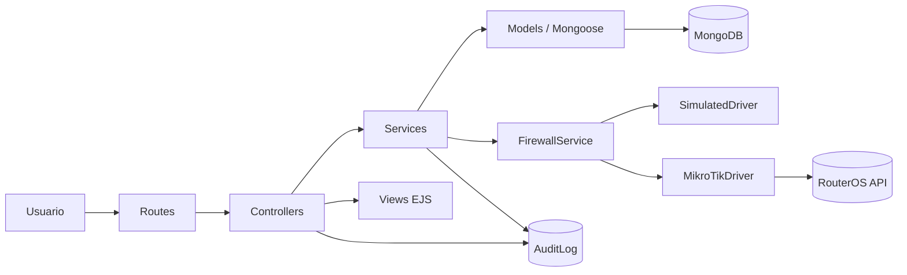
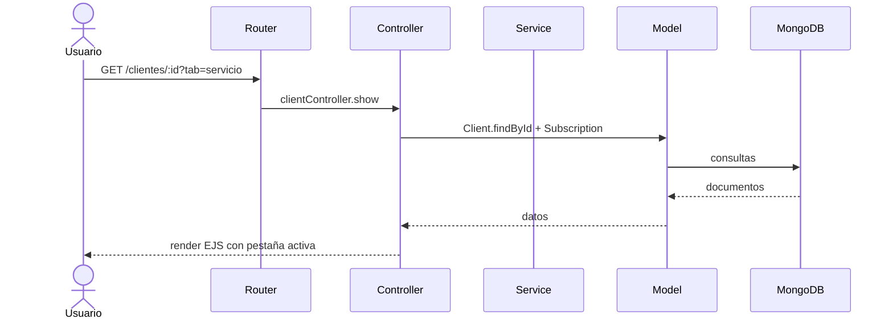
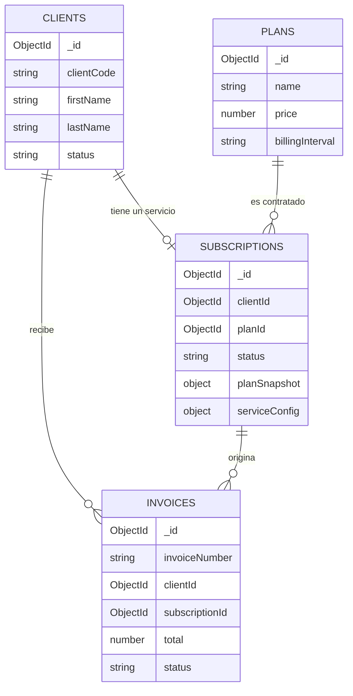
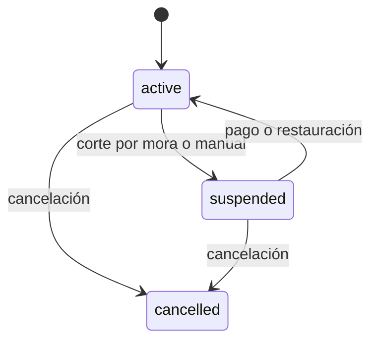
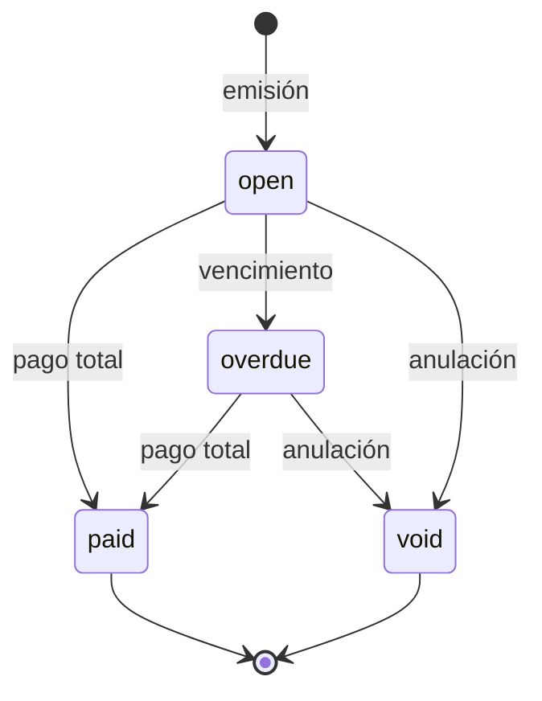
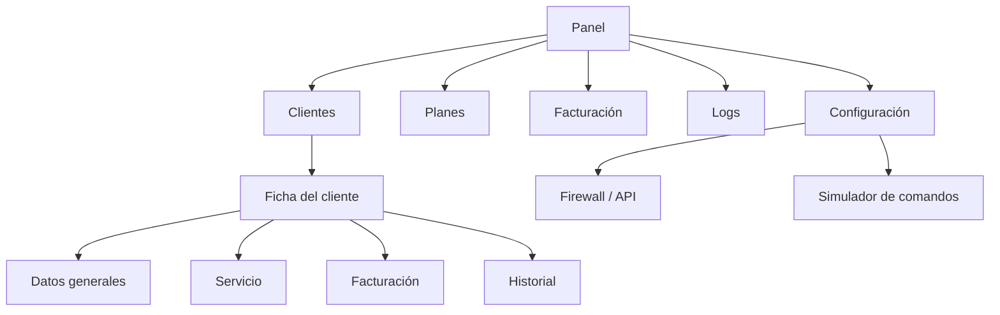

# CRACKENTICK

## Documento de desarrollo

| Campo | Valor |
|---|---|
| **Proyecto** | CRACKENTICK |
| **Tema** | Redes y telecomunicaciones — gestión de ISP |
| **Tipo** | Aplicación web con arquitectura MVC |
| **Versión del documento** | 1.6 |
| **Fecha** | 11 de noviembre de 2026 |
| **Estado** | Aprobado para implementación |
| **Stack** | Node.js, Express, MongoDB, Mongoose, EJS |
| **Inspiración funcional** | MikroWisp |
| **Base de datos** | `crackentick` (MongoDB local) |

---

## Control de versiones

| Versión | Fecha | Cambio |
|---|---|---|
| 0.1 | 10/11/2026 | Primer borrador a partir de la especificación del proyecto. |
| 1.0 | 10/11/2026 | Se fija el alcance: un solo ISP, tres dominios, cortes por firewall en modo simulado y real, auditoría detallada y ficha de cliente con pestañas. |
| 1.1 | 10/11/2026 | La moneda por defecto pasa a USD y se agrega configuración de moneda y formato regional, con reglas para no alterar facturas emitidas. |
| 1.2 | 10/11/2026 | Se agrega la identidad visual: tema oscuro, glassmorphism, fondo abstracto animado, acentos verde/morado y especificaciones de la pantalla de inicio de sesión. |
| 1.3 | 10/11/2026 | Se amplía el panel de inicio como dashboard operativo: KPIs, gráficos, cobranza, actividad, cortes fallidos y accesos rápidos. |
| 1.4 | 11/11/2026 | Rediseño plano «Nocturne Flat», animaciones con anime.js, localización para Venezuela (`es-VE`, `America/Caracas`, `VES`) y facturación flexible: IVA editable por plan y por factura, descuentos, base imponible, notas y nuevos métodos de pago. |
| 1.5 | 11/11/2026 | Aprovisionamiento MikroTik multi-router (PPPoE, colas simples, pools CIDR), soporte técnico con tickets, inventario por cantidad y serializado, ventas e instalaciones con descuento de stock, facturas de venta que no cortan el servicio, monitorización WAN y por cliente con alertas, simuladores ampliados y seed completo. |
| 1.6 | 11/11/2026 | Autenticación real con `scrypt`, usuarios y permisos por nodo, rutas canónicas por sección, finanzas mensuales con gastos e ingresos manuales, monitorización WAN en tarjetas o bloques con bps exactos y lectura real del tráfico del cliente, catálogo de comandos RouterOS, WAN dinámicas, selector pool→IP, login con lienzo reactivo al puntero y `node-routeros` como dependencia obligatoria. |

---

## Índice

1. Ficha del proyecto
2. Introducción
3. Alcance y decisiones
4. Requisitos
5. Arquitectura
6. Modelo de datos
7. Reglas de negocio
8. Firewall y cortes de servicio
9. Auditoría y trazabilidad
10. Rutas y pantallas
11. Validaciones y manejo de errores
12. Interfaz y experiencia de usuario
13. Plan de pruebas y criterios de aceptación
14. Migración del código actual
15. Plan de trabajo, riesgos y evolución
16. Especificaciones estéticas y de interacción
17. Versión 1.5: aprovisionamiento, soporte, inventario, ventas, monitorización y simuladores
18. Versión 1.6: autenticación, permisos, finanzas y rutas por nodo
- Anexo A. Plantillas de comandos RouterOS
- Anexo B. Glosario
- Anexo C. Referencias

---

## 1. Ficha del proyecto

**CRACKENTICK** es una aplicación web para administrar un Proveedor de Servicios de Internet (ISP). Permite gestionar clientes, planes, servicios contratados, facturación, pagos y cortes de servicio, con una base de datos NoSQL y una interfaz web dinámica.

El sistema se organiza en tres dominios funcionales que comparten información por identificadores, pero mantienen responsabilidades separadas:

| Dominio | Responsabilidad | Colecciones |
|---|---|---|
| **Comercial** | Clientes, catálogo de planes y ventas/instalaciones | `Clients`, `Plans`, `Sales` |
| **Técnico** | Servicio contratado, configuración de red, routers y pools | `Subscriptions`, `Routers`, `IpPools` |
| **Financiero** | Facturas, pagos y mora | `Invoices` |
| **Operaciones** | Soporte, inventario y monitorización | `Tickets`, `InventoryItems`, `Alerts` |
| **Transversal** | Configuración, cortes y trazabilidad | `Settings`, `AuditLog` |

La aplicación está inspirada en el flujo de trabajo de MikroWisp: listado de clientes, ficha individual con pestañas de datos generales, servicio y facturación, generación de facturas, registro de pagos y suspensión automática por mora mediante firewall.

---

## 2. Introducción

### 2.1 Contexto

Un ISP necesita operar tres áreas que suelen estar mezcladas en hojas de cálculo: quién es el cliente y qué plan tiene, cómo está configurado técnicamente su servicio y cuánto debe. Cuando un cliente entra en mora, el servicio debe cortarse; cuando paga, debe restaurarse.

CRACKENTICK concentra esas operaciones en una sola aplicación web, con reglas claras para que un cambio en un área no dañe las otras. Por ejemplo, cambiar el precio de un plan no debe alterar facturas ya emitidas, y suspender un servicio no debe borrar su historial financiero.

### 2.2 Problema

La gestión manual o dispersa genera:

- Duplicidad de datos entre clientes, servicios y facturas.
- Errores al calcular deudas y fechas de corte.
- Cortes aplicados tarde, mal o sin registro.
- Facturas modificadas después de emitidas, sin trazabilidad.
- Dificultad para saber por qué un cliente está suspendido y quién lo reactivó.

### 2.3 Objetivos

**Objetivo general**

Construir una aplicación web MVC con MongoDB que gestione clientes, planes, servicios y facturación de un ISP, incluyendo cortes y restauración de servicio mediante un módulo de firewall con modos simulado y real.

**Objetivos específicos**

1. Administrar clientes y planes con validaciones y reglas de integridad.
2. Registrar un servicio por cliente con su configuración técnica.
3. Emitir facturas inmutables usando una copia congelada del plan.
4. Registrar pagos totales y calcular la deuda del cliente.
5. Ejecutar cortes por mora y restauraciones por pago.
6. Permitir cambiar entre firewall simulado y real desde la configuración.
7. Mostrar el comando que se ejecutaría en modo simulado.
8. Auditar todos los cambios, procesos y comandos utilizados.
9. Mantener una interfaz clara, responsive y con ficha de cliente por pestañas.

---

## 3. Alcance y decisiones

### 3.1 Alcance de la versión 1

- **Un solo ISP.** No hay multi-tenant en esta versión. La empresa se configura en un documento único de `Settings`.
- **Un servicio por cliente.** La suscripción es única por cliente; si se cancela, el mismo registro puede reactivarse.
- **Pago total.** Cada factura se paga completa; no hay abonos ni saldos parciales.
- **Facturación manual desde el panel.** Los procesos de previsualización, emisión y mora se ejecutan con botones; el cron queda como evolución.
- **Cortes por firewall en dos modos.** Simulado (por defecto) y real (API RouterOS), configurables desde el sistema.
- **Auditoría completa.** Todo cambio y todo comando queda registrado.
- **Moneda configurable.** Dólar estadounidense (`USD`) por defecto; el administrador puede cambiarla desde la configuración, con `VES` disponible para Venezuela.
- **Localización venezolana.** Formato `es-VE`, zona `America/Caracas` y datos demo de Venezuela; el IVA no está fijado a una tasa regional.
- **Identidad visual oscura y plana.** Superficies sólidas, bordes finos, acentos violeta y verde, y animaciones con anime.js.

### 3.2 Decisiones de simplicidad

| Decisión | Justificación |
|---|---|
| Autenticación simplificada | La v1.6 incorpora login real, roles `admin`/`staff` y permisos por nodo, sin gestor de identidades externo. |
| Sin multi-tenant | Reduce complejidad; el modelo deja preparada la evolución con `tenantId`. |
| Un servicio por cliente | Evita ambigüedad en facturación, corte y ficha del cliente. |
| Facturación manual | Es reproducible en la demo y no depende de un planificador. |
| Sin prorrateo | Las facturas cubren periodos completos. |
| Sin notas de crédito | La anulación (`void`) cubre el caso académico. |
| Pago total | Un pago cierra una factura; no se manejan abonos. |
| Multi-router desde v1.5 | `Router` e `IpPool` permiten seleccionar el equipo por servicio; v1.4 usaba un `routerId` lógico. |
| Número de factura secuencial | Contador atómico en `Settings`; sin reinicio anual. |
| Moneda global configurable | Un solo ISP y una sola moneda activa; sin conversión automática ni tasas de cambio. |

### 3.3 Fuera de alcance

- Portal del cliente.
- Pasarelas de pago en línea.
- Notificaciones por correo, SMS o WhatsApp.
- Multi-tenant y administración de varios ISP.
- Multi-moneda simultánea, conversión automática y tasas de cambio.
- Pagos parciales, prorrateo, notas de crédito y conciliación bancaria.
- Reportes avanzados, exportaciones y contabilidad formal.
- Alta disponibilidad, respaldos automáticos y despliegue en producción.

> La **autenticación real**, la **autorización por nodo** y la **gestión de usuarios** se incorporaron en la v1.6 y se documentan en §18; el resto de esta lista sigue fuera de alcance.

### 3.4 Supuestos

- El servidor tiene acceso a MongoDB local o Atlas.
- Para el modo real, existe un MikroTik (o CHR) accesible por API y con un usuario habilitado.
- El router tiene creada la lista `MOROSOS` y una regla de firewall que descarta el tráfico de esa lista.
- En modo real, el sistema puede crear o actualizar *secrets* PPPoE, colas simples, direcciones IP y pools mediante la API; en modo simulado solo genera y audita los comandos.
- Los clientes PPPoE pueden existir previamente como *secrets* en el router; el aprovisionamiento del sistema los crea o sincroniza según el modo.
- La moneda es configurable (`USD` por defecto) y se aplica a los nuevos planes y facturas; no hay conversión automática de importes.
- Las facturas emitidas conservan la moneda con la que se crearon.
- El IVA es configurable en tres niveles: global, por plan y por factura pendiente. No se impone una tasa regional.
- Las fechas se almacenan en UTC y se muestran en la zona horaria configurada.
- El sistema se ejecuta en un entorno académico controlado, sin exposición pública.

### 3.5 Cambios respecto a la especificación inicial

| Especificación inicial | Decisión v1 |
|---|---|
| Tres dominios separados | Se mantiene: Comercial, Técnico y Financiero. |
| Multi-tenant con `tenantId` | Pospuesto. Se usa `Settings` único; el documento deja la ruta de evolución. |
| Colección `Tenants` | Reemplazada por `Settings` (documento único). |
| Facturación con cron | Se ejecuta manualmente desde el panel; cron como evolución. |
| Integración con MikroTik fuera de alcance | **Entra en alcance** como módulo de cortes, con modo simulado y real. |
| Autenticación y roles fuera de alcance | **Entra en alcance en la v1.6** con login real y permisos por nodo. |
| Portal y notificaciones fuera de alcance | Se mantienen fuera de alcance. |
| Identidad glassmorphism con fondo animado | Reemplazada por «Nocturne Flat»: superficies sólidas, bordes finos y animaciones con anime.js. |
| Localización genérica `es-CO` | Reemplazada por Venezuela: `es-VE`, `America/Caracas`, moneda `VES` disponible y datos demo venezolanos. |
| IVA único global | Ampliado a IVA editable por plan y por factura, con descuentos y base imponible. |

---

## 4. Requisitos

### 4.1 Requisitos funcionales

#### Comercial

| ID | Requisito |
|---|---|
| RF-COM-01 | Listar clientes con búsqueda por nombre, código, correo o identificación. |
| RF-COM-02 | Crear y editar clientes con validaciones de datos personales y de facturación. |
| RF-COM-03 | Cambiar el estado del cliente: `active`, `suspended`, `cancelled`. |
| RF-COM-04 | Eliminar un cliente solo si no tiene servicio ni facturas; en caso contrario, bloquear con mensaje claro. |
| RF-COM-05 | Listar, crear, editar, activar/desactivar y eliminar planes sin servicios asociados. |
| RF-COM-06 | Mostrar en el listado el plan, el estado del servicio y la deuda del cliente. |

#### Técnico

| ID | Requisito |
|---|---|
| RF-TEC-01 | Asignar un plan y una configuración técnica al cliente. |
| RF-TEC-02 | Soportar conexión `pppoe`, `static` y `dhcp`. |
| RF-TEC-03 | Validar usuario PPPoE e IP según el tipo de conexión. |
| RF-TEC-04 | Guardar la contraseña PPPoE cifrada y mostrarla enmascarada. |
| RF-TEC-05 | Mostrar el periodo actual, el estado del servicio y el estado del firewall. |
| RF-TEC-06 | Permitir corte y restauración manual con motivo obligatorio. |
| RF-TEC-07 | Cambiar de plan actualizando el `planSnapshot` para facturas futuras. |

#### Financiero

| ID | Requisito |
|---|---|
| RF-FIN-01 | Previsualizar las facturas que se emitirían, sin escribir en la base. |
| RF-FIN-02 | Emitir facturas de forma idempotente usando `planSnapshot`. |
| RF-FIN-03 | Numerar facturas de forma secuencial y única. |
| RF-FIN-04 | Calcular subtotal, descuento, base imponible, IVA y total con redondeo a dos decimales. |
| RF-FIN-05 | Listar facturas por cliente y por estado. |
| RF-FIN-06 | Registrar pago total con método y referencia (efectivo, transferencia, tarjeta, Pago Móvil, Zelle u otro). |
| RF-FIN-07 | Marcar facturas vencidas como `overdue`. |
| RF-FIN-08 | Calcular la deuda como la suma de facturas `open` y `overdue`. |
| RF-FIN-09 | Anular facturas `open` u `overdue` con motivo, sin borrarlas. |
| RF-FIN-10 | Impedir la edición de importes de facturas pagadas o anuladas. |
| RF-FIN-11 | Guardar en cada factura la moneda y la tasa de impuesto utilizadas. |
| RF-FIN-12 | Editar IVA, descuento, vencimiento y notas mientras la factura esté `open` o `overdue`. |
| RF-FIN-13 | Configurar el IVA de forma global, por plan y por factura, sin una tasa regional fija. |
| RF-FIN-14 | Aplicar descuentos porcentuales o de monto fijo antes del IVA y guardar la base imponible. |
| RF-FIN-15 | Soportar métodos de pago locales venezolanos además de los genéricos. |

#### Firewall y cortes

| ID | Requisito |
|---|---|
| RF-FW-01 | Ejecutar el corte cuando una factura vencida supera los días de gracia. |
| RF-FW-02 | Ejecutar el corte por PPPoE o por lista de direcciones, según la conexión. |
| RF-FW-03 | Restaurar el servicio cuando se paga la última factura pendiente. |
| RF-FW-04 | Permitir cambiar entre modo simulado y real desde la configuración. |
| RF-FW-05 | En modo simulado, mostrar el comando RouterOS que se ejecutaría. |
| RF-FW-06 | Registrar cada acción con su comando, resultado y duración. |
| RF-FW-07 | No repetir un corte ya aplicado; permitir reintentar los fallidos. |
| RF-FW-08 | Probar la conexión con el router desde la configuración. |

#### Configuración y auditoría

| ID | Requisito |
|---|---|
| RF-CFG-01 | Editar datos de la empresa, moneda, formato regional, impuesto, vencimiento y días de gracia. |
| RF-CFG-02 | Configurar host, puerto, usuario, contraseña, TLS y modo del firewall. |
| RF-CFG-03 | Registrar en auditoría los cambios de configuración. |
| RF-CFG-04 | Cambiar la moneda solo si no hay facturas pendientes; las emitidas conservan su moneda. |
| RF-LOG-01 | Registrar altas, cambios y bajas de entidades. |
| RF-LOG-02 | Registrar procesos de facturación, pagos, cortes y restauraciones. |
| RF-LOG-03 | Registrar el comando utilizado y su resultado. |
| RF-LOG-04 | Permitir consultar y filtrar el log; no permitir editarlo ni borrarlo. |

### 4.2 Requisitos no funcionales

| ID | Requisito |
|---|---|
| RNF-01 | Interfaz web responsive para escritorio y móvil. |
| RNF-02 | Tema claro y oscuro persistente. |
| RNF-03 | Validaciones tanto en el navegador como en el servidor. |
| RNF-04 | Mensajes de error claros, por campo y con conservación de datos. |
| RNF-05 | Contraseñas y credenciales nunca visibles en texto plano ni en logs. |
| RNF-06 | Operaciones de facturación y corte idempotentes. |
| RNF-07 | Tiempos de respuesta menores a 1 segundo en consultas normales. |
| RNF-08 | Código organizado por responsabilidades y con nombres consistentes. |
| RNF-09 | Fechas y dinero formateados según la moneda y el formato regional configurados. |
| RNF-10 | El fallo de un corte no debe interrumpir el resto del proceso de mora. |
| RNF-11 | Identidad visual oscura y plana, con superficies sólidas, bordes finos y acentos violeta/verde. |
| RNF-12 | Animaciones fluidas con anime.js, con propósito y respeto a `prefers-reduced-motion`. |
| RNF-13 | Contraste WCAG AA en texto, controles y estados sobre superficies sólidas. |

### 4.3 Trazabilidad con los requisitos académicos

| Requisito de la materia | Cómo se cumple |
|---|---|
| Servidor funcional | Express en `server.js` y `app.js`. |
| Rutas para listar, crear, editar y eliminar | `routes/` con un router por dominio. |
| Separación `models/`, `views/`, `controllers/`, `routes/` | Estructura del proyecto. |
| Base de datos NoSQL | MongoDB con Mongoose. |
| Modelo con atributos y validaciones | Seis modelos con validaciones y reglas. |
| Controladores con lógica de negocio | Controladores delgados + servicios de dominio. |
| Vistas dinámicas | EJS con layout y parciales. |
| CRUD completo desde la interfaz | Clientes, planes, servicios y facturas. |
| Manejo de errores y mensajes claros | Middleware central, vistas 400/404/409/422/500 y avisos flash. |

---

## 5. Arquitectura

### 5.1 Vista general



### 5.2 MVC con capa de servicios

- **Modelos:** esquemas, validaciones, índices y métodos de consulta.
- **Controladores:** reciben la petición, validan el contexto, llaman a servicios y eligen la vista o redirección.
- **Servicios:** reglas de negocio que involucran varias entidades o efectos externos.
  - `BillingService`: previsualización, emisión, mora, pagos y deuda.
  - `FirewallService`: selección del driver, corte, restauración y prueba de conexión.
  - `AuditService`: registro uniforme de acciones y comandos.
  - `CryptoService`: cifrado y descifrado de credenciales.
- **Vistas:** EJS con layout compartido y parciales reutilizables.
- **Rutas:** un router por dominio, montado en `app.js`.

La capa de servicios evita que los controladores conozcan detalles del router o de la numeración de facturas, y permite probar la lógica sin pasar por HTTP.

### 5.3 Estructura de carpetas propuesta

```text
CRACKENTICK/
├── app.js
├── server.js
├── seed.js
├── config/
│   ├── db.js
│   └── constants.js              # Estados, permisos, categorías y enums
├── models/
│   ├── Settings.js
│   ├── User.js                   # Usuarios, rol y permisos
│   ├── Client.js
│   ├── Plan.js
│   ├── Router.js                 # Routers y WAN dinámicas
│   ├── IpPool.js
│   ├── Subscription.js
│   ├── InventoryItem.js
│   ├── Invoice.js
│   ├── FinanceEntry.js           # Gastos e ingresos manuales
│   ├── Ticket.js
│   ├── Sale.js
│   ├── Alert.js
│   └── AuditLog.js
├── controllers/
│   ├── dashboardController.js
│   ├── authController.js         # Login real y logout
│   ├── clientController.js
│   ├── planController.js
│   ├── routerController.js
│   ├── poolController.js
│   ├── subscriptionController.js
│   ├── invoiceController.js
│   ├── billingController.js
│   ├── ticketController.js
│   ├── inventoryController.js
│   ├── salesController.js
│   ├── monitoringController.js
│   ├── financeController.js
│   ├── expenseController.js
│   ├── userController.js
│   ├── firewallController.js
│   ├── settingsController.js
│   └── auditController.js
├── services/
│   ├── billingService.js
│   ├── firewallService.js
│   ├── auditService.js
│   ├── cryptoService.js
│   ├── routerService.js
│   ├── routeros.js
│   ├── provisioningService.js
│   ├── monitoringService.js
│   ├── salesService.js
│   └── firewall/
│       ├── drivers.js
│       ├── simulatedDriver.js
│       └── mikrotikDriver.js
├── routes/
│   ├── index.js · auth.js
│   ├── clients.js · plans.js · subscriptions.js
│   ├── routers.js · pools.js
│   ├── tickets.js · inventory.js · sales.js · monitoring.js
│   ├── billing.js · invoices.js · finance.js · expenses.js
│   ├── users.js · settings.js · audit.js
├── middlewares/
│   ├── auth.js                   # Sesión, permisos y ruta inicial
│   ├── asyncHandler.js
│   └── errorHandler.js
├── utils/
│   ├── money.js · dates.js · validators.js · sanitize.js
│   └── password.js               # scrypt + verificación timing-safe
├── views/
│   ├── layout.ejs
│   ├── layouts/auth.ejs
│   ├── auth/login.ejs
│   ├── dashboard.ejs
│   ├── partials/                 # sidebar, topbar, icon, etc.
│   ├── clients/ · plans/ · subscriptions/ · invoices/ · billing/
│   ├── routers/ · pools/ · monitoring/ · tickets/ · inventory/ · sales/
│   ├── finance/ · expenses/ · users/ · settings/ · audit/
│   └── errors/                   # 404, 500 y 403
└── public/
    ├── css/styles.css
    ├── js/app.js                 # Tema, menú, canvas, polling y formularios
    └── vendor/anime.min.js
```

### 5.4 Flujo de una petición



1. Express recibe la petición y aplica middlewares generales.
2. El router del dominio llama al controlador.
3. El controlador valida parámetros y solicita datos a modelos o servicios.
4. El servicio aplica reglas de negocio y registra auditoría cuando corresponde.
5. El controlador renderiza una vista EJS o redirige con un mensaje flash.
6. Cualquier error se envía al middleware central.

### 5.5 Separación entre dominios

| Regla | Implementación |
|---|---|
| Comercial no depende de Financiero | Clientes y planes no importan servicios de facturación. |
| Técnico no modifica facturas | Solo lee el estado financiero para mostrar deuda. |
| Financiero no envía comandos al router | Solicita al `FirewallService` y registra el resultado. |
| La comunicación es por identificadores | `clientId`, `planId`, `subscriptionId`; nunca se embeben documentos completos. |
| Los hechos financieros son inmutables | Facturas emitidas no se editan; se pagan o se anulan. |
| La configuración es transversal | `Settings` y `AuditLog` son usados por todos los dominios. |

### 5.6 Convenciones

- **Idioma:** interfaz y documentación en español; nombres de colecciones y campos en inglés, según la especificación.
- **Fechas:** se guardan como `Date` en UTC; se muestran en `Settings.billing.timezone`.
- **Dinero:** `Number` redondeado a dos decimales mediante `utils/money.js`; en producción se recomienda `Decimal128`.
- **Identificadores:** `ObjectId` para relaciones; cadenas legibles para `clientCode` e `invoiceNumber`.
- **Estados:** enums en minúsculas (`active`, `open`, `paid`, etc.).
- **Borrado:** los documentos con historial no se borran físicamente; se cancelan o anulan.

---

## 6. Modelo de datos

### 6.1 Diagrama de relaciones



`Settings` y `AuditLog` son transversales y no participan en relaciones directas.

### 6.2 `Settings` — configuración del sistema

Documento único con `key: "system"`. Se crea en el seed y se edita desde `/admin/configuracion`.

| Campo | Tipo | Obligatorio | Reglas / valor por defecto |
|---|---|---|---|
| `key` | String | Sí | Único; siempre `"system"`. |
| `company.name` | String | Sí | Nombre comercial del ISP. |
| `company.taxId` | String | No | RIF o identificación fiscal. |
| `company.address` | String | No | Dirección. |
| `company.phone` | String | No | Teléfono. |
| `company.email` | String | No | Correo de contacto. |
| `billing.currency` | String | Sí | `USD` por defecto; incluye `VES` (bolívar) entre las monedas disponibles. |
| `billing.locale` | String | Sí | `es-VE` por defecto. |
| `billing.timezone` | String | Sí | `America/Caracas` por defecto. |
| `billing.taxRate` | Number | Sí | `0` por defecto. Es una referencia editable, no una tasa fija: cada plan y cada factura pueden sobrescribirla. |
| `billing.invoicePrefix` | String | Sí | `INV`. |
| `billing.dueDays` | Number | Sí | Días para vencer; `5`. |
| `billing.graceDays` | Number | Sí | Días de gracia antes del corte; `3`. |
| `billing.nextInvoiceNumber` | Number | Sí | Contador atómico; inicia en `1`. |
| `firewall.mode` | String | Sí | `simulated` o `real`; por defecto `simulated`. |
| `firewall.host` | String | No | Host del router para modo real. |
| `firewall.port` | Number | No | `8728` (API) u `8729` (API TLS). |
| `firewall.username` | String | No | Usuario API. |
| `firewall.passwordEnc` | String | No | Contraseña cifrada; nunca se devuelve en claro. |
| `firewall.tls` | Boolean | No | `false` por defecto. |
| `firewall.verifyTls` | Boolean | No | `false` por defecto en entorno académico. |
| `firewall.routerName` | String | No | `principal`. |
| `updatedAt` | Date | Sí | Automático. |

### 6.3 `Clients` — clientes

| Campo | Tipo | Obligatorio | Reglas |
|---|---|---|---|
| `clientCode` | String | Sí | Único; formato `CL-0001`. |
| `firstName` | String | Sí | 2–60 caracteres. |
| `lastName` | String | Sí | 2–60 caracteres. |
| `taxId` | String | No | Identificación fiscal; único si existe. |
| `email` | String | No | Formato de correo; único si existe. |
| `phone` | String | No | 7–20 caracteres. |
| `address.street` | String | No | Dirección. |
| `address.city` | String | No | Ciudad. |
| `address.state` | String | No | Departamento/estado. |
| `address.postalCode` | String | No | Código postal. |
| `billingData.legalName` | String | No | Razón social si difiere del nombre. |
| `billingData.taxId` | String | No | Identificación para factura. |
| `billingData.email` | String | No | Correo de facturación. |
| `billingData.address` | String | No | Dirección de facturación. |
| `status` | String | Sí | `active`, `suspended`, `cancelled`; por defecto `active`. |
| `notes` | String | No | Máximo 500 caracteres. |
| `createdAt`, `updatedAt` | Date | Sí | Automáticos. |

**Índices:** `clientCode` único; `taxId` único parcial; `email` único parcial; `status`; índice de texto o compuesto para búsqueda por nombre.

### 6.4 `Plans` — planes

| Campo | Tipo | Obligatorio | Reglas |
|---|---|---|---|
| `name` | String | Sí | Único; 3–60 caracteres. |
| `description` | String | No | Máximo 300 caracteres. |
| `downloadSpeed` | Number | Sí | Entero mayor que 0; Mbps. |
| `uploadSpeed` | Number | Sí | Entero mayor que 0; Mbps. |
| `price` | Number | Sí | Mayor o igual a 0; dos decimales. |
| `taxRate` | Number | No | IVA propio del plan entre 0 y 1. `null` usa el IVA global de `Settings`. |
| `billingInterval` | String | Sí | `monthly`, `quarterly`, `annual`. |
| `active` | Boolean | Sí | `true` por defecto. |
| `createdAt`, `updatedAt` | Date | Sí | Automáticos. |

**Índices:** `name` único; `active`.

### 6.5 `Subscriptions` — servicio contratado

| Campo | Tipo | Obligatorio | Reglas |
|---|---|---|---|
| `clientId` | ObjectId → `Clients` | Sí | Único: un servicio por cliente. |
| `planId` | ObjectId → `Plans` | Sí | Debe existir y estar activo al contratar. |
| `planSnapshot` | Object | Sí | Copia congelada del plan. |
| `planSnapshot.name` | String | Sí | Nombre del plan al contratar. |
| `planSnapshot.downloadSpeed` | Number | Sí | Mbps. |
| `planSnapshot.uploadSpeed` | Number | Sí | Mbps. |
| `planSnapshot.price` | Number | Sí | Precio congelado. |
| `planSnapshot.taxRate` | Number | No | IVA congelado del plan; `null` usa el IVA global al emitir. |
| `planSnapshot.billingInterval` | String | Sí | Intervalo congelado. |
| `planSnapshot.capturedAt` | Date | Sí | Fecha de la copia. |
| `serviceConfig.connectionType` | String | Sí | `pppoe`, `static`, `dhcp`. |
| `serviceConfig.ipAddress` | String | Condicional | Obligatoria en `static`; IPv4 válida. |
| `serviceConfig.pppoeUsername` | String | Condicional | Obligatorio en `pppoe`; único si existe. |
| `serviceConfig.pppoePasswordEnc` | String | Condicional | Obligatorio en `pppoe`; cifrado. |
| `serviceConfig.routerId` | String | No | `principal` por defecto. |
| `status` | String | Sí | `active`, `suspended`, `cancelled`; por defecto `active`. |
| `currentPeriodStart` | Date | Sí | Inicio del periodo vigente. |
| `currentPeriodEnd` | Date | Sí | Fin del periodo vigente. |
| `installedAt` | Date | No | Fecha de instalación. |
| `firewallState` | String | Sí | `none`, `pending`, `blocked`, `error`; por defecto `none`. |
| `firewallBlockedAt` | Date | No | Última suspensión efectiva. |
| `lastStatusChangeAt` | Date | No | Último cambio de estado. |
| `notes` | String | No | Máximo 500 caracteres. |
| `createdAt`, `updatedAt` | Date | Sí | Automáticos. |

**Índices:** `clientId` único; `pppoeUsername` único parcial; `ipAddress` único parcial; `status`; `currentPeriodEnd`; `firewallState`.

**Regla:** el `planSnapshot` se actualiza solo cuando se cambia de plan; las facturas ya emitidas conservan su propia copia.

### 6.6 `Invoices` — facturas

| Campo | Tipo | Obligatorio | Reglas |
|---|---|---|---|
| `invoiceNumber` | String | Sí | Único; formato `INV-000001`. |
| `clientId` | ObjectId → `Clients` | Sí | Cliente facturado. |
| `subscriptionId` | ObjectId → `Subscriptions` | Sí | Servicio facturado. |
| `periodStart` | Date | Sí | Inicio del periodo facturado. |
| `periodEnd` | Date | Sí | Fin del periodo facturado. |
| `issueDate` | Date | Sí | Fecha de emisión. |
| `dueDate` | Date | Sí | `issueDate + dueDays`. |
| `planSnapshot` | Object | Sí | Copia del plan usada para facturar. |
| `lines` | Array | Sí | Al menos una línea. |
| `lines[].description` | String | Sí | Texto de la línea. |
| `lines[].quantity` | Number | Sí | `1` en v1. |
| `lines[].unitPrice` | Number | Sí | Precio congelado. |
| `lines[].amount` | Number | Sí | `quantity × unitPrice`. |
| `subtotal` | Number | Sí | Suma de líneas. |
| `discountType` | String | No | `none`, `percent` o `amount`; por defecto `none`. |
| `discount` | Number | No | Porcentaje (0–100) o monto fijo según `discountType`. |
| `discountAmount` | Number | No | Descuento calculado y congelado en la factura. |
| `taxBase` | Number | No | `subtotal − discountAmount`; base sobre la que se aplica el IVA. |
| `taxRate` | Number | Sí | Tasa aplicada: IVA del plan o, si el plan no define uno, el IVA global. Editable mientras la factura está pendiente. |
| `tax` | Number | Sí | `round(taxBase × taxRate)`. |
| `total` | Number | Sí | `taxBase + tax`. |
| `notes` | String | No | Notas de cobro o acuerdos de pago; máximo 500 caracteres. |
| `status` | String | Sí | `draft`, `open`, `paid`, `overdue`, `void`. |
| `paidAt` | Date | No | Fecha de pago. |
| `paymentMethod` | String | No | `cash`, `transfer`, `card`, `pago_movil`, `zelle`, `other`. |
| `paymentReference` | String | No | Referencia o comprobante. |
| `voidedAt` | Date | No | Fecha de anulación. |
| `voidReason` | String | No | Motivo de anulación. |
| `createdAt`, `updatedAt` | Date | Sí | Automáticos. |

**Índices:** `invoiceNumber` único; `{ subscriptionId, periodStart }` único (idempotencia); `clientId`; `status`; `dueDate`; `issueDate`.

**Inmutabilidad:** una vez emitida, no se modifican `lines`, `subtotal`, `periodStart`, `periodEnd` ni `planSnapshot`. Mientras la factura está `open` o `overdue` se pueden ajustar `taxRate`, `discountType`, `discount`, `discountAmount`, `taxBase`, `tax`, `total`, `dueDate` y `notes`, dejando registro en auditoría. Al pasar a `paid` o `void` la factura queda completamente inmutable salvo los campos de pago y anulación.

### 6.7 `AuditLog` — auditoría

| Campo | Tipo | Obligatorio | Reglas |
|---|---|---|---|
| `timestamp` | Date | Sí | Momento del evento. |
| `module` | String | Sí | `commercial`, `technical`, `financial`, `firewall`, `settings`. |
| `entity` | String | No | `Client`, `Plan`, `Subscription`, `Invoice`, `Settings`. |
| `entityId` | String | No | Identificador del documento afectado. |
| `action` | String | Sí | `create`, `update`, `delete`, `billing_preview`, `billing_issue`, `billing_overdue`, `payment`, `block`, `unblock`, `config_change`, `test_connection`. |
| `description` | String | Sí | Resumen legible del evento. |
| `changes` | Object | No | `{ before, after }` saneado. |
| `command` | String | No | Comando RouterOS ejecutado o simulado. |
| `commandResult` | String | No | Respuesta del router o marca de simulación. |
| `status` | String | Sí | `success`, `failed`. |
| `durationMs` | Number | No | Duración de la operación. |
| `actor` | String | Sí | `admin` (acción manual) o `system` (proceso). |

**Índices:** `timestamp` descendente; `module`; `entityId`; `action`; `status`.

**Reglas:** es *append-only*; no se edita ni se borra desde la interfaz. Los secretos se eliminan antes de guardar `changes` y `command`.

### 6.8 Decisiones de modelado

| Decisión | Motivo |
|---|---|
| Referencias por `ObjectId` | Evita duplicación y permite crecer sin reescribir documentos. |
| `planSnapshot` embebido | Garantiza que el precio facturado no cambie si el plan cambia. |
| `serviceConfig` embebido | Se lee siempre junto con la suscripción y no se consulta por separado. |
| `lines` embebidas en la factura | Son parte indivisible del documento fiscal. |
| `AuditLog` separado | Historial append-only, consultable y sin afectar las entidades. |
| `Settings` único | Un solo ISP en v1; reemplaza a `Tenants`. |
| Una suscripción por cliente | Índice único en `clientId`; simplifica facturación y cortes. |

### 6.9 Enums y máquinas de estado

**Cliente**

```text
active ⇄ suspended → cancelled
```

**Suscripción**



**Factura**



`draft` queda reservado para una emisión manual futura; la v1 emite directamente en `open`.

---

## 7. Reglas de negocio

### 7.1 Planes y snapshot

1. Al contratar un plan se copia en `planSnapshot`: nombre, velocidades, precio, IVA del plan (`taxRate`, puede ser `null`) y fecha.
2. La factura usa `planSnapshot`, nunca `Plans.price`.
3. Si se cambia el plan de una suscripción, se actualiza `planId` y se toma un nuevo `planSnapshot` para las facturas futuras.
4. Las facturas anteriores conservan su copia y no se recalculan.
5. Un plan con suscripciones activas no se elimina; se desactiva.
6. El IVA del plan es opcional y libre: si está vacío se usa el IVA global; si tiene valor, prevalece al emitir.

### 7.2 Ciclo de facturación

1. La suscripción nace con `currentPeriodStart = hoy` y `currentPeriodEnd = hoy + intervalo`.
2. Al emitir la factura, se usa el periodo vigente y luego se avanza:
   - `currentPeriodStart = currentPeriodEnd`
   - `currentPeriodEnd = currentPeriodStart + intervalo`
3. El avance ocurre solo si la factura se creó correctamente.
4. La factura se emite en `open` y vence en `issueDate + dueDays`.

### 7.3 Previsualización

- Lista las suscripciones `active` cuyo `currentPeriodEnd` esté dentro de la ventana de previsualización (por defecto, próximos 5 días).
- Muestra cliente, plan, periodo, subtotal, IVA con su tasa y total.
- Cada fila indica si el IVA proviene del plan o del valor global.
- No escribe en la base de datos.
- Omite las suscripciones que ya tienen factura para el mismo `periodStart`.

### 7.4 Emisión

1. Se repite la selección de la previsualización.
2. Por cada suscripción elegible:
   - Se reserva el número con un incremento atómico en `Settings.billing.nextInvoiceNumber`.
   - Se crea la factura con el snapshot.
   - Se avanza el periodo de la suscripción.
   - Se registra `billing_issue` en `AuditLog`.
3. Si falla una suscripción, se registra el error y se continúa con las demás.
4. La operación es idempotente: el índice único `{ subscriptionId, periodStart }` impide duplicados.
5. Al finalizar se muestra un resumen: procesadas, creadas, omitidas y fallidas.

### 7.5 Numeración, impuestos, descuentos y redondeo

- Formato: `INV-` + consecutivo de seis dígitos (`INV-000001`).
- El consecutivo se incrementa con `findOneAndUpdate` y `$inc`, evitando duplicados por concurrencia.
- `subtotal = suma(lines.amount)`.
- `discountAmount` se calcula según `discountType`:
  - `none`: `0`.
  - `percent`: `redondear(subtotal × min(discount, 100) / 100)`.
  - `amount`: `redondear(min(discount, subtotal))`.
- `taxBase = redondear(subtotal − discountAmount)`.
- `tax = redondear(taxBase × taxRate, 2)`. El descuento se aplica **antes** del IVA.
- `total = taxBase + tax`.
- La tasa aplicada se guarda en la factura (`taxRate`), de modo que un cambio futuro de IVA no altera facturas anteriores.
- Orden de resolución del IVA al emitir: `planSnapshot.taxRate` si no es `null`; en caso contrario, `Settings.billing.taxRate`.
- No existe una tasa regional impuesta: el IVA global, el del plan y el de cada factura son editables.

### 7.5.1 Edición de facturas pendientes

- Solo las facturas `open` o `overdue` se pueden editar.
- Se pueden modificar `taxRate`, `discountType`, `discount`, `dueDate` y `notes`.
- El servidor recalcula `discountAmount`, `taxBase`, `tax` y `total`; nunca confía en los valores enviados por el formulario.
- El descuento porcentual se limita a 100 %; el descuento por monto no puede superar el subtotal.
- Cada edición registra un `AuditLog` con los valores anteriores y posteriores.
- Una factura `paid` o `void` rechaza cualquier edición (HTTP 409).

### 7.6 Mora y deuda

- Una factura `open` pasa a `overdue` cuando `hoy > dueDate`.
- La deuda del cliente es la suma de `total` de facturas `open` + `overdue`.
- Un cliente está en mora si tiene al menos una factura `overdue`.
- El corte se aplica cuando `hoy > dueDate + graceDays`.
- El proceso de mora se puede ejecutar manualmente y es idempotente.

### 7.7 Pago y reactivación

1. Solo se paga una factura `open` u `overdue`.
2. Se registran método y referencia; se guarda `paidAt` y estado `paid`.
3. Si el cliente no tiene otras facturas `open` u `overdue`, se restaura el servicio.
4. La restauración ejecuta el comando de desbloqueo y registra la acción.
5. Si el desbloqueo falla, el servicio queda en `active` con `firewallState: error` y se muestra una alerta para reintentar. No se oculta el fallo.

### 7.8 Inmutabilidad de facturas

- Mientras la factura está `open` o `overdue` se pueden editar IVA, descuento, vencimiento y notas, pero **no** `lines`, `subtotal`, `periodStart`, `periodEnd` ni `planSnapshot`.
- Al registrar el pago (`paid`) o anular (`void`), la factura queda completamente inmutable.
- La anulación (`void`) solo aplica a `open` u `overdue` y exige motivo.
- Una factura `paid` no se anula en v1.
- Las facturas anuladas no se borran y conservan su número.
- No se regenera una factura para el mismo periodo; ese caso queda fuera de alcance.

### 7.9 Fechas y periodos

- Almacenamiento en UTC; presentación en la zona configurada.
- Intervalos: `monthly` = 1 mes, `quarterly` = 3 meses, `annual` = 12 meses.
- Si el día de inicio no existe en el mes destino (por ejemplo, 31), se usa el último día del mes.
- La comparación de vencimiento se hace por día calendario en la zona configurada.

### 7.10 Reglas de borrado y protecciones

| Entidad | Regla |
|---|---|
| Cliente | No se borra si tiene suscripción o facturas. Se cancela. |
| Plan | No se borra si tiene suscripciones. Se desactiva. |
| Suscripción | No se borra si tiene facturas. Se cancela. |
| Factura | No se borra nunca. Se anula. |
| Configuración | No se borra; se edita. |
| Auditoría | No se edita ni se borra. |

Estas reglas se implementan en los controladores y se refuerzan con mensajes 409 claros.

---

## 8. Firewall y cortes de servicio

### 8.1 Principio

El sistema no "apaga" el servicio desde la aplicación: envía una instrucción al router/firewall. El módulo de firewall abstrae esa comunicación para que la misma lógica funcione con un simulador (desarrollo y demo) o con un MikroTik real (producción).

**Regla de oro:** Facturación decide que hay mora; Técnico ejecuta el corte; Auditoría registra el hecho. Ningún dominio escribe directamente en el router.

### 8.2 Modos

| Modo | Comportamiento | Uso |
|---|---|---|
| `simulated` | No hay conexión de red. Se genera el comando, se registra y se devuelve una respuesta simulada. | Desarrollo, pruebas y demostración. |
| `real` | Se conecta a RouterOS por API y ejecuta el comando. | Producción o laboratorio con MikroTik/CHR. |

El modo se guarda en `Settings.firewall.mode` y se cambia desde `/admin/configuracion?tab=firewall`. Cambiar de modo no altera el historial ni los estados existentes.

### 8.3 Configuración de la API

La pestaña **Firewall/API** incluye:

- Selector de modo: **Simulado** / **Real**.
- Host, puerto (8728 u 8729), usuario y contraseña.
- TLS y verificación de certificado.
- Nombre lógico del router (`principal`).
- Botón **Probar conexión**, que ejecuta una operación de lectura y registra el resultado.
- Aviso visible cuando el modo es simulado.
- Enlace a la pestaña **Simulador de comandos**.

La contraseña se guarda cifrada con AES-256-GCM y nunca se muestra; el formulario la deja en blanco para conservarla.

### 8.4 Driver de firewall

Contrato conceptual:

```text
FirewallDriver
  block(subscription, context)   → { ok, command, result, durationMs }
  unblock(subscription, context) → { ok, command, result, durationMs }
  testConnection()               → { ok, result, durationMs }
```

- `SimulatedDriver`: arma el comando, lo devuelve y responde como si se hubiera aplicado.
- `MikroTikDriver`: usa la API RouterOS, aplica el comando y devuelve la respuesta del equipo.
- La selección se hace con una fábrica (`createFirewallDriver(settings)`).
- Los controladores solo conocen `FirewallService`, nunca el driver concreto.

### 8.5 Estrategias según el tipo de conexión

| Conexión | Corte | Restauración |
|---|---|---|
| `pppoe` | Deshabilitar el *secret* del usuario PPPoE. | Habilitar el *secret*. |
| `static` | Agregar la IP a la lista `MOROSOS`. | Quitar la IP de la lista. |
| `dhcp` | Agregar la IP arrendada a `MOROSOS`. | Quitar la IP de la lista. |

Advertencia documentada: en `dhcp` la IP puede cambiar; se recomienda PPPoE o reserva DHCP. La interfaz mostrará esta limitación.

### 8.6 Plantillas de comandos

Las plantillas se construyen con datos no secretos (usuario PPPoE o IP) y se guardan en la auditoría. El Anexo A contiene las versiones completas.

Ejemplo de corte PPPoE:

```routeros
/ppp/secret/disable [find name="cliente001"]
```

Ejemplo de corte por IP:

```routeros
/ip/firewall/address-list/add list=MOROSOS address=192.0.2.10 comment="CRACKENTICK CL-0001"
```

### 8.7 Simulador de comandos

Pestaña disponible en `/admin/configuracion/firewall/simulador` y accesible desde la pestaña **Servicio** del cliente.

- Selector de cliente/suscripción.
- Acción a previsualizar: cortar o restaurar.
- Comando que se ejecutaría, con botón **Copiar**.
- Resultado esperado y advertencia de que no se aplicará nada.
- Historial de comandos simulados con fecha, cliente y acción.
- Botón **Registrar simulación** para dejar la acción en la auditoría como `success`.

En modo real, la pestaña sigue disponible como previsualización, pero el botón de ejecución se deshabilita y se muestra el modo activo.

### 8.8 Idempotencia, reintentos y fallos

- `Subscription.firewallState` evita repetir un corte ya aplicado.
- Antes de cortar: si `firewallState === "blocked"`, se omite.
- Antes de restaurar: si `firewallState === "none"`, se omite.
- Si el driver falla:
  - Se registra `AuditLog` con `status: failed` y el mensaje.
  - La suscripción queda en `active` con `firewallState: "error"` (no se marca como cortada si el corte no se aplicó).
  - Aparece en el panel de **cortes fallidos** con botón **Reintentar**.
- El proceso de mora continúa con los demás clientes aunque uno falle.
- El resultado final muestra procesados, cortados, restaurados, omitidos y fallidos.

### 8.9 Seguridad de credenciales

- Contraseña PPPoE y contraseña de API cifradas con AES-256-GCM.
- Clave en `ENCRYPTION_KEY` (32 bytes en hexadecimal o base64), fuera del repositorio.
- La UI muestra `••••••••` y permite reemplazar, nunca revelar.
- Los logs guardan comandos sin contraseñas; cualquier valor sensible se enmascara antes de persistir.
- El modo real debe usarse en una red controlada; no se expone la API del router a Internet.

### 8.10 Prerrequisitos del router

1. Usuario API con permisos mínimos para PPP y firewall.
2. Lista de direcciones `MOROSOS` creada.
3. Regla de filtro que descarte el tráfico de `MOROSOS`.
4. Servicio API habilitado en el puerto configurado.
5. Conectividad desde el servidor al router.
6. Reloj sincronizado para que las fechas de corte coincidan.

---

## 9. Auditoría y trazabilidad

### 9.1 Qué se registra

| Categoría | Ejemplos |
|---|---|
| Comercial | Crear/editar/cancelar cliente; crear/editar/desactivar plan. |
| Técnico | Crear/editar/cancelar suscripción; cambio de plan; corte/restauración manual. |
| Financiero | Previsualización, emisión, pago, anulación y actualización de mora. |
| Firewall | Comando generado, comando ejecutado, resultado, error y reintento. |
| Configuración | Cambio de datos de empresa, impuesto, días de gracia, modo o credenciales. |

### 9.2 Estructura de un registro

```json
{
  "timestamp": "2026-11-10T15:04:05.000Z",
  "module": "firewall",
  "entity": "Subscription",
  "entityId": "6730f1c2a9b4d1e2f3a45678",
  "action": "block",
  "description": "Corte por mora del cliente CL-0001",
  "changes": {
    "before": { "status": "active", "firewallState": "none" },
    "after": { "status": "suspended", "firewallState": "blocked" }
  },
  "command": "/ppp/secret/disable [find name=\"cliente001\"]",
  "commandResult": "SIMULATED: comando registrado, no ejecutado",
  "status": "success",
  "durationMs": 3,
  "actor": "system"
}
```

### 9.3 Reglas

1. Toda acción que modifica datos genera un registro.
2. Todo proceso de facturación genera al menos un registro de resumen.
3. Todo comando de firewall se guarda completo, salvo secretos.
4. Los registros son inmutables y no se eliminan desde la aplicación.
5. Si una operación falla, se registra el error y no se oculta.
6. El log no reemplaza a la factura: son fuentes distintas.

### 9.4 Consulta

- `/admin/auditoria` con filtros por módulo, acción, estado, entidad y rango de fechas.
- Detalle con resumen, cambios, comando y resultado.
- En la ficha del cliente, pestaña **Historial**, se filtran los eventos por `entityId` y por sus facturas/suscripción.
- Exportación CSV queda como evolución.

---

## 10. Rutas y pantallas

### 10.1 Mapa de navegación



### 10.2 Dashboard

**Ruta:** `/` · **Objetivo:** ser el centro de operación diario. En una sola pantalla el administrador debe responder: cuánto se cobró, cuánto se debe, quién está cortado, qué falló y qué debe hacer ahora.

**Estructura de la pantalla**

1. **Cabecera operativa**
   - Etiqueta “Dashboard · Venezuela”, saludo y fecha actual en la zona horaria configurada (`America/Caracas` por defecto).
   - Insignia del modo de firewall (`Simulado` en ámbar, `Real` en verde).
   - Selector de periodo (`Este mes`, `Mes anterior`, `Últimos 90 días`) y botón **Actualizar** que conserva el periodo en la URL.
2. **Cuatro KPIs primarios** en una fila (`.dash-kpis`):

| KPI | Cálculo | Acento |
|---|---|---|
| **Ingresos del periodo** | Suma de `Invoice.total` con `status = paid` y `paidAt` dentro del periodo. | Verde |
| **Deuda pendiente** | Suma de `Invoice.total` con `status` `open` u `overdue`. | Ámbar |
| **Clientes activos** | `Clients.countDocuments({ status: 'active' })`. | Violeta |
| **Servicios activos** | `Subscriptions.countDocuments({ status: 'active' })`. | Verde |

Cada tarjeta muestra la cifra principal, una variación contra el periodo anterior cuando aplica y un enlace al listado filtrado. Los valores monetarios usan la moneda y el formato regional configurados.

3. **Franja operativa compacta** (`.dash-resumen`): servicios cortados, cortes fallidos, facturas emitidas y modo de firewall. Son datos de un vistazo, sin tarjetas grandes, para mantener el dashboard limpio.
4. **Rejilla de paneles de 12 columnas** (`.dash-grid`):
   - **Ingresos vs. deuda (6 meses):** gráfico de barras agrupadas (`span 8`) con ingresos pagados y deuda pendiente por mes. Incluye leyenda y tabla accesible oculta.
   - **Estado de los servicios:** dona con `active`, `suspended` y `cancelled`, porcentajes y total (`span 4`).
   - **Top deudores** (`span 4`) y **Cobranza** (`span 4`) con monto vencido, barra de proporción y botón **Ejecutar mora**.
   - **Cortes fallidos** (`span 4`) con opción de reintento.
   - **Facturas recientes** (`span 8`) con número, cliente, total, estado y enlace al detalle.
   - **Actividad reciente** (`span 4`) con los últimos eventos de `AuditLog`.
   - **Accesos rápidos** (`span 12`) en rejilla de seis columnas.
5. **Estado vacío:** si no hay datos, cada bloque muestra un mensaje breve y una acción para crear el primero; el dashboard nunca queda en blanco.

**Fuentes de datos**

| Bloque | Colecciones / consulta |
|---|---|
| KPIs de ingresos y deuda | `Invoices` agregadas por estado y rango de fechas. |
| Clientes y servicios | `Clients` y `Subscriptions` por estado. |
| Ingresos vs. deuda | `Invoices` agrupadas por mes (`$dateToString` sobre `paidAt` y `dueDate`). |
| Estado de servicios | `Subscriptions` agrupadas por `status`. |
| Cobranza y top deudores | `Invoices` `open`/`overdue` agrupadas por `clientId`. |
| Cortes fallidos | `Subscriptions` con `firewallState: 'error'`. |
| Facturas recientes | `Invoices` ordenadas por `issueDate` descendente. |
| Actividad | `AuditLog` ordenado por `timestamp` descendente. |

**Reglas**

- El dashboard es de solo lectura: no emite facturas ni corta servicios; esas acciones se hacen desde sus módulos.
- Todos los cálculos se hacen en el servidor; la vista no recalcula dinero.
- Los enlaces de cada tarjeta llevan al listado con el filtro correspondiente aplicado.
- Si una consulta falla, el bloque muestra un aviso y el resto del dashboard sigue funcionando.
- La carga inicial debe resolver todas las consultas en paralelo (`Promise.all`) y renderizar en menos de 1 segundo con datos de demo.
- El botón **Actualizar** recarga la página conservando el periodo seleccionado en la URL (`?periodo=mes`).

**Responsive**

- ≥ 1200 px: cuatro KPIs en fila, franja operativa en cuatro columnas y rejilla de paneles de 12 columnas.
- 780–1199 px: KPIs en dos columnas; paneles a 6 columnas con los laterales a 3.
- ≤ 780 px: una columna, gráficos a ancho completo y tablas convertidas en tarjetas.
- ≤ 560 px: accesos rápidos en rejilla de dos columnas y tipografía compacta.

**Accesibilidad**

- Cada KPI tiene un título textual y una descripción para lectores de pantalla.
- Los gráficos incluyen una tabla equivalente oculta visualmente y un resumen textual.
- Los estados no dependen solo del color: incluyen etiqueta e icono.
- Los botones de acción tienen nombres accesibles y foco visible.
- Las animaciones de entrada, contadores y barras se desactivan con `prefers-reduced-motion`.

**Criterios de aceptación del dashboard**

1. Muestra los cuatro KPIs primarios con datos correctos y enlaces funcionales.
2. Los ingresos del periodo solo cuentan facturas pagadas dentro del periodo.
3. La deuda coincide con la suma de facturas `open` y `overdue`.
4. El gráfico de seis meses y la dona de servicios se renderizan correctamente y se animan con anime.js.
5. El top de deudores y las facturas recientes enlazan a la ficha o al detalle.
6. Los cortes fallidos se listan con opción de reintento.
7. La actividad reciente refleja la auditoría real.
8. El modo de firewall es visible.
9. El dashboard funciona en móvil y en ambos temas.
10. Ningún bloque roto impide ver los demás.

### 10.3 Clientes

**Listado `/clientes`**

| Columna | Contenido |
|---|---|
| Código | `CL-0001` |
| Cliente | Nombre completo y correo. |
| Plan | Nombre del plan o “Sin servicio”. |
| Servicio | `active`, `suspended`, `cancelled` o “Sin servicio”. |
| Deuda | Suma de facturas pendientes. |
| Estado | Estado comercial del cliente. |
| Acciones | Ver, editar, cortar/restaurar. |

Filtros: búsqueda, estado del cliente, estado del servicio, plan y “solo con deuda”. Paginación y orden por nombre, código, deuda o fecha de alta.

**Ficha `/clientes/:id`**

Cabecera con nombre, código, estado, deuda y acciones rápidas (editar, registrar pago, cortar/restaurar).

Pestañas:

1. **Datos generales**
   - Información personal y de contacto.
   - Dirección.
   - Datos de facturación.
   - Notas.
   - Tarjetas resumen: plan actual, estado del servicio, deuda.
2. **Servicio**
   - Plan contratado, velocidades y precio snapshot.
   - Tipo de conexión, IP, usuario PPPoE (contraseña enmascarada), router.
   - Periodo actual y próximo vencimiento.
   - Estado del servicio y estado del firewall.
   - Botones **Cortar servicio** y **Restaurar servicio** con motivo.
   - Última acción de firewall y enlace al simulador.
   - Formulario para cambiar de plan.
3. **Facturación**
   - Deuda total y facturas pendientes.
   - Tabla de facturas: número, periodo, emisión, vencimiento, total, estado, acciones.
   - **Registrar pago** en facturas `open` u `overdue`.
   - **Anular factura** con motivo.
   - Enlace al detalle de cada factura.
4. **Historial**
   - Eventos de auditoría del cliente, su suscripción y sus facturas.
   - Filtro por tipo de evento.

La pestaña activa se conserva en la URL (`?tab=servicio`) para permitir enlaces directos.

### 10.4 Planes

- Listado con nombre, velocidades, precio, IVA aplicable (propio o global), intervalo, servicios activos y estado.
- Crear y editar con validaciones, incluyendo un IVA opcional por plan (0–100 %; vacío usa el global).
- Activar/desactivar.
- Eliminar solo si no tiene suscripciones.

### 10.5 Facturación

**Panel `/finanzas/facturacion`**

- Resumen: pendientes, vencidas, pagadas del mes, deuda total.
- Tres procesos:
  1. **Previsualizar**: facturas que se emitirían (sin escribir).
  2. **Emitir facturas**: crea las facturas y avanza periodos.
  3. **Ejecutar mora y cortes**: marca vencidas, suspende y aplica firewall.
- Resultado de cada corrida con contadores y detalle.
- Acceso al listado de facturas.

**Listado `/finanzas/facturas`**

- Filtros por estado, cliente, número y rango de fechas.
- Totales por estado.
- Acciones: ver, editar IVA y cobro (solo `open`/`overdue`), pagar, anular.

**Detalle `/finanzas/facturas/:id`**

- Encabezado con número, cliente, periodo, fechas y estado.
- Líneas, subtotal, descuento, base imponible, IVA con su tasa y total.
- Notas de la factura cuando existen.
- Datos del pago si está pagada.
- Historial de la factura.
- Acciones permitidas según el estado.

**Edición `/finanzas/facturas/:id/editar`**

- Disponible solo para facturas `open` o `overdue`.
- Permite ajustar IVA (0–100 %), tipo y valor de descuento, fecha de vencimiento y notas.
- El aside muestra el recálculo en vivo (subtotal, descuento, base, IVA y total) con `Intl.NumberFormat` según la moneda y el locale configurados.
- El servidor valida y recalcula los importes; el formulario nunca define el total.
- Al guardar se registra `update` en `AuditLog` con antes/después.
- Una factura pagada o anulada redirige al detalle con un aviso y no admite cambios.

### 10.6 Configuración

`/admin/configuracion` con pestañas:

1. **Empresa**: nombre, RIF, dirección, teléfono y correo.
2. **Facturación**: moneda (incluye `VES`), formato regional (`es-VE`), zona horaria (`America/Caracas`), IVA global editable, prefijo, días de vencimiento, gracia y anticipación. Un panel explica que el IVA puede sobrescribirse por plan y por factura.
3. **Firewall/API**: modo, host, puerto, usuario, contraseña, TLS, nombre del router y prueba de conexión.
4. **Comandos API**: catálogo completo de comandos RouterOS que usa la aplicación (v1.6, §18.8).

Cada cambio queda en auditoría. Los campos sensibles se muestran enmascarados.

### 10.7 Simulador

`/admin/configuracion/firewall/simulador`

- Selector de cliente y acción.
- Comando resultante y botón de copiar.
- Advertencia de modo simulado.
- Historial de comandos.
- Acceso directo desde la pestaña Servicio.

### 10.8 Logs

`/admin/auditoria`

- Filtros por módulo, acción, estado, entidad, identificador y fechas.
- Tabla con fecha, módulo, acción, descripción y estado.
- Detalle con cambios, comando y resultado.
- Solo lectura.

### 10.9 Tabla de rutas

Rutas canónicas de la v1.6. Cada una exige el permiso indicado entre paréntesis; el rol `admin` pasa siempre. Los alias heredados se listan al final.

| Método | Ruta | Acción |
|---|---|---|
| GET | `/` | Dashboard operativo (primer nodo permitido) |
| GET | `/login` | Formulario de acceso |
| POST | `/login` | Validar credenciales y crear sesión |
| POST/GET | `/salir` | Cerrar sesión |
| GET | `/sin-acceso` | 403 cuando el usuario no tiene nodos |
| GET | `/clientes` | Listado de clientes (`general.clientes`) |
| GET | `/clientes/nuevo` | Formulario de cliente |
| POST | `/clientes` | Crear cliente |
| GET | `/clientes/:id` | Ficha con pestañas (`general`, `servicio`, `monitoreo`, `facturacion`, `tickets`, `historial`) |
| GET | `/clientes/:id/editar` · PUT · DELETE | Editar o eliminar cliente |
| GET | `/clientes/api/pools/:poolId/ips` | IPs disponibles del pool (JSON) |
| GET/POST | `/clientes/:id/servicio/nuevo` · `/clientes/:id/servicio` | Crear servicio |
| PUT | `/clientes/:id/servicio` | Actualizar servicio (incluye pool e IP) |
| PUT | `/clientes/:id/servicio/plan` | Cambiar de plan |
| POST | `/clientes/:id/servicio/cortar` · `/restaurar` | Corte y restauración manual |
| GET/POST | `/red/routers`, `/red/routers/nuevo`, `/red/routers/:id/editar`, `/red/routers/:id/probar`, `/red/routers/:id` | Routers y prueba de conexión (`red.routers`) |
| GET/POST | `/red/pools`, `/red/pools/nuevo`, `/red/pools/:id/editar`, `/red/pools/:id/aplicar`, `/red/pools/:id` | Pools CIDR (`red.pools`) |
| GET/POST | `/red/planes`, `/red/planes/nuevo`, `/red/planes/:id/editar`, `/red/planes/:id/estado`, `/red/planes/:id` | Planes (`red.planes`) |
| GET | `/red/monitoreo` | WAN en tarjetas o bloques, filtro por proveedor y alertas (`red.monitoreo`) |
| GET | `/red/monitoreo/api/wan` | Lecturas WAN en JSON |
| POST | `/red/monitoreo/interfaces` | Agregar interfaz WAN desde la vista |
| GET | `/red/monitoreo/cliente/:id` | Monitor puntual por cliente |
| POST | `/red/monitoreo/api/cliente/:id/iniciar` · `/detener` · GET `/leer` | Sesión de monitor de cliente |
| POST | `/red/monitoreo/alertas/:id/reconocer` · `/resolver` | Gestionar alertas |
| GET/POST | `/ventas`, `/ventas/nueva`, `/ventas/:id`, `/ventas/:id/instalar`, `/ventas/:id/cancelar` | Ventas con técnico y promotor (`ventas.ventas`) |
| GET/POST | `/ventas/inventario`, `/ventas/inventario/nuevo`, `/ventas/inventario/:id`, `/ventas/inventario/:id/editar`, `/ventas/inventario/:id/ajustar`, `/ventas/inventario/:id/seriales`, `/ventas/inventario/:id/seriales/:serialId/estado` | Inventario (`ventas.inventario`) |
| GET/POST | `/soporte/tickets`, `/soporte/tickets/nuevo`, `/soporte/tickets/:id`, `/soporte/tickets/:id/mensajes`, `/soporte/tickets/:id/estado`, `/soporte/tickets/:id/prioridad` | Tickets (`soporte.tickets`) |
| GET | `/finanzas?mes=YYYY-MM` | Resultado mensual y serie de 6 meses (`finanzas.gestion`) |
| GET/POST | `/finanzas/facturacion`, `/finanzas/facturacion/previsualizar`, `/finanzas/facturacion/emitir`, `/finanzas/facturacion/mora` | Cobro y corridas (`finanzas.facturacion`) |
| GET/POST | `/finanzas/facturas`, `/finanzas/facturas/nueva`, `/finanzas/facturas/:id`, `/finanzas/facturas/:id/editar`, `/finanzas/facturas/:id/pagar`, `/finanzas/facturas/:id/anular` | Facturas (`finanzas.facturas`) |
| GET/POST | `/admin/gastos`, `/admin/gastos/nuevo`, `/admin/gastos/:id/editar`, `/admin/gastos/:id/estado`, `/admin/gastos/:id` | Gastos e ingresos manuales (`admin.gastos`) |
| GET/POST | `/admin/usuarios`, `/admin/usuarios/nuevo`, `/admin/usuarios/:id/editar`, `/admin/usuarios/:id/estado`, `/admin/usuarios/:id` | Usuarios y permisos (`admin.usuarios`) |
| GET/PUT | `/admin/configuracion` (`empresa`, `facturacion`, `firewall`, `comandos`), `/admin/configuracion/empresa`, `/admin/configuracion/facturacion`, `/admin/configuracion/firewall`, `/admin/configuracion/firewall/probar`, `/admin/configuracion/firewall/simulador`, `/admin/configuracion/firewall/simular`, `/admin/configuracion/provision/simulador`, `/admin/configuracion/provision/simular` | Configuración y simuladores (`admin.configuracion`) |
| GET | `/admin/auditoria`, `/admin/auditoria/:id` | Auditoría (`admin.auditoria`) |

**Alias heredados** (sin redirección, para enlaces antiguos): `/planes`, `/routers`, `/pools`, `/monitoreo`, `/inventario`, `/tickets`, `/facturacion`, `/facturas`, `/configuracion`, `/logs`.

Los formularios HTML envían `PUT` y `DELETE` mediante un campo oculto `_method` (method-override). La autenticación y los permisos se detallan en §18.

---

## 11. Validaciones y manejo de errores

### 11.1 Matriz de validaciones

| Entidad | Campo | Regla | Mensaje |
|---|---|---|---|
| Cliente | `clientCode` | Único, formato `CL-0001` | “El código de cliente ya existe.” |
| Cliente | `firstName`, `lastName` | 2–60 caracteres | “El nombre debe tener entre 2 y 60 caracteres.” |
| Cliente | `email` | Formato válido y único | “El correo no es válido o ya está registrado.” |
| Cliente | `status` | Enum permitido | “El estado del cliente no es válido.” |
| Plan | `name` | Único, 3–60 | “Ya existe un plan con ese nombre.” |
| Plan | `price` | ≥ 0, dos decimales | “El precio debe ser mayor o igual a 0.” |
| Plan | `downloadSpeed`, `uploadSpeed` | Enteros > 0 | “La velocidad debe ser un número entero mayor que 0.” |
| Plan | `taxRate` | 0–1 o vacío (`null`) | “El IVA del plan debe ser un número entre 0 y 100 %.” |
| Suscripción | `planId` | Existente y activo | “El plan seleccionado no está disponible.” |
| Suscripción | `clientId` | Único | “El cliente ya tiene un servicio contratado.” |
| Suscripción | `connectionType` | Enum | “El tipo de conexión no es válido.” |
| Suscripción | `pppoeUsername` | Requerido en PPPoE, único | “El usuario PPPoE ya está en uso.” |
| Suscripción | `ipAddress` | IPv4 válida, requerida en estática | “La dirección IP no es válida.” |
| Suscripción | `pppoePassword` | Requerida al crear PPPoE | “La contraseña PPPoE es obligatoria.” |
| Factura | `status` | Transición permitida | “La factura no se puede modificar en su estado actual.” |
| Factura | `taxRate` | 0–100 % al editar | “El IVA debe estar entre 0 y 100 %.” |
| Factura | `discount` | ≥ 0; porcentaje ≤ 100; monto ≤ subtotal | “El descuento no puede superar el subtotal de la factura.” |
| Factura | `total` | Calculado en servidor | “El total es calculado automáticamente.” |
| Pago | `paymentMethod` | Enum (`cash`, `transfer`, `card`, `pago_movil`, `zelle`, `other`) | “Selecciona un método de pago válido.” |
| Configuración | `taxRate` | 0–1 | “La tasa de impuesto debe estar entre 0 y 1.” |
| Configuración | `graceDays` | Entero ≥ 0 | “Los días de gracia deben ser un entero positivo.” |
| Firewall | `mode` | `simulated` o `real` | “El modo de firewall no es válido.” |
| Firewall | `port` | 1–65535 | “El puerto no es válido.” |

### 11.2 Errores de negocio

| Código | Situación | Respuesta |
|---|---|---|
| 400 | Datos mal formados o ID inválido | Vista 400 o formulario con error. |
| 404 | Cliente, plan, factura o ruta inexistente | Vista 404 con enlace al listado. |
| 409 | Conflicto de integridad (duplicado, plan en uso, factura pagada o anulada) | Mensaje claro y acción sugerida. |
| 422 | Validación de formulario | Se repinta el formulario con errores por campo y datos conservados. |
| 500 | Error inesperado | Vista 500; detalle técnico solo en desarrollo. |

### 11.3 Middleware y flujo de errores

1. `asyncHandler` captura rechazos de promesas.
2. Los controladores lanzan errores de negocio con `status` y `mensaje`.
3. `errorHandler` decide la vista y el código HTTP.
4. Los errores de Mongoose se traducen: `ValidationError` → 422, `CastError` → 404/400, duplicados → 409.
5. Los fallos de firewall no lanzan 500: se registran y se muestran como alerta operativa.

### 11.4 Mensajes

- Éxito: aviso flash verde con la acción realizada.
- Error de validación: resumen y mensaje junto al campo.
- Error de negocio: aviso rojo con explicación y siguiente paso.
- Advertencia de firewall: aviso ámbar con enlace a reintentar o al log.
- Confirmaciones: eliminar cliente/plan y anular factura exigen confirmación.

---

## 12. Interfaz y experiencia de usuario

### 12.1 Principios

- La ficha del cliente es el centro de operación: todo lo relevante en tres pestañas.
- Los estados se muestran con insignias de color consistentes.
- Las acciones destructivas se confirman y explican.
- Los procesos de facturación muestran un resumen antes y después.
- El modo simulado se indica de forma visible para no confundirlo con producción.
- La interfaz es deliberadamente sobria: menos adornos, más jerarquía, datos y acciones claras.

### 12.2 Componentes

- Layout con cabecera, navegación, contenido y pie.
- Tarjetas de métricas y franjas de datos compactas.
- Tablas responsive que se convierten en tarjetas en móvil.
- Formularios con ayuda, validación y errores por campo.
- Pestañas de la ficha del cliente.
- Insignias de estado: activo, suspendido, cancelado, pagada, vencida, anulada.
- Avisos flash.
- Diálogos de confirmación.
- Bloques de código con botón de copiar para comandos.
- Panel de resultados de procesos.
- Panel lateral de recálculo en la edición de facturas.

### 12.3 Tema y responsive

- **Tema oscuro por defecto**, alineado con la identidad “Nocturne Flat” de la sección 16; se conserva un tema claro como alternativa.
- Fondo sólido con una capa estática (`.fondo`); sin orbes, cuadrículas ni transparencias decorativas.
- Superficies planas (`.superficie`) con bordes finos de 1 px; sin `backdrop-filter`, sin sombras difusas y sin degradados decorativos.
- Diseño mobile-first con puntos de quiebre en 1240, 960, 780 y 560 px.
- Tablas convertidas en tarjetas en pantallas pequeñas.
- Navegación y pestañas desplazables en móvil.
- Animaciones resueltas con **anime.js** sobre `transform`, `opacity` y trazos SVG; se desactivan con `prefers-reduced-motion`.

### 12.4 Accesibilidad

- Etiquetas asociadas a cada campo.
- `aria-invalid` y `aria-describedby` en errores.
- Foco visible.
- Contraste suficiente en ambos temas.
- Enlace “Saltar al contenido”.
- Confirmaciones con texto explícito, no solo color.

---

## 13. Plan de pruebas y criterios de aceptación

### 13.1 Estrategia

- Pruebas manuales guiadas por los requisitos.
- Pruebas de integración HTTP con datos de seed.
- Pruebas del simulador sin router.
- Prueba opcional del modo real con un CHR/MikroTik de laboratorio.
- Verificación de auditoría después de cada operación.

### 13.2 Casos por dominio

| ID | Caso | Resultado esperado |
|---|---|---|
| C-01 | Crear cliente válido | Se guarda, aparece en el listado y en auditoría. |
| C-02 | Crear cliente con código duplicado | 409 con mensaje claro. |
| C-03 | Eliminar cliente con servicio | Bloqueado con explicación. |
| C-04 | Crear plan y contratarlo | Suscripción con snapshot correcto. |
| C-05 | Cambiar precio del plan | La suscripción y sus facturas anteriores no cambian. |
| T-01 | Crear servicio PPPoE sin usuario | 422 con error en el campo. |
| T-02 | Crear servicio estático sin IP | 422 con error en el campo. |
| T-03 | Contraseña PPPoE guardada | Se almacena cifrada y se muestra enmascarada. |
| T-04 | Segundo servicio al mismo cliente | Bloqueado por regla de unicidad. |
| F-01 | Previsualizar facturación | No crea documentos. |
| F-02 | Emitir facturas | Crea una por suscripción y avanza el periodo. |
| F-03 | Emitir dos veces seguidas | No duplica; informe de omitidas. |
| F-04 | Verificar totales | `subtotal − descuento = base`; `base + IVA = total`, con dos decimales. |
| F-05 | Registrar pago total | Factura `paid`, deuda actualizada. |
| F-06 | Anular factura abierta | Estado `void` con motivo; no se borra. |
| F-07 | Intentar editar una factura pagada | Rechazado con 409; la factura sigue inmutable. |
| F-08 | Editar IVA de una factura pendiente | Se recalcula el total y se registra en auditoría. |
| F-09 | Aplicar descuento porcentual | El descuento se resta antes del IVA y se guarda la base imponible. |
| F-10 | Descuento por monto mayor al subtotal | 422 con mensaje; no se guarda. |
| F-11 | Emitir con plan sin IVA propio | Usa el IVA global de `Settings`. |
| F-12 | Emitir con plan exento (0 %) | La factura no cobra IVA aunque el global sea mayor. |
| M-01 | Factura vencida | Pasa a `overdue` al ejecutar mora. |
| M-02 | Mora dentro de gracia | No corta. |
| M-03 | Mora superada la gracia | Suspende y ejecuta corte. |
| W-01 | Corte en modo simulado | Comando visible y registrado; no hay red. |
| W-02 | Restauración tras pago | Comando inverso y servicio activo. |
| W-03 | Corte ya aplicado | Se omite sin duplicar. |
| W-04 | Fallo del driver | Log `failed`, alerta y opción de reintentar. |
| W-05 | Cambio de modo | Se guarda y se refleja en la UI. |
| W-06 | Probar conexión | Resultado registrado en auditoría. |
| L-01 | Consultar logs | Filtros y detalle funcionan; no se puede editar. |
| L-02 | Verificar secreto en log | No aparece la contraseña. |
| S-01 | Cambiar el IVA global | No altera facturas anteriores; solo aplica a planes sin IVA propio en emisiones futuras. |
| S-02 | Cambiar días de gracia | Aplica a procesos futuros. |
| S-03 | Cambiar moneda sin facturas pendientes | Se guarda la nueva moneda y las facturas futuras la usan. |
| S-04 | Cambiar moneda con facturas pendientes | 409 con explicación; no se modifica. |
| S-05 | Consultar factura anterior al cambio de moneda | Conserva la moneda original. |
| V-01 | Abrir `/login` | Se ve la tarjeta sólida y las animaciones de entrada con anime.js. |
| V-02 | Activar `prefers-reduced-motion` | Las animaciones de entrada, contadores y barras se desactivan. |
| V-03 | Revisar contraste | Texto y controles cumplen WCAG AA en tema oscuro. |
| V-04 | Abrir en móvil | Login en una columna, sin desbordes y con animaciones reducidas. |
| V-05 | Revisar CSS | No hay `backdrop-filter`, degradados decorativos ni `@keyframes`. |

### 13.3 Criterios de aceptación

1. La aplicación arranca, conecta a MongoDB y responde en `http://localhost:3000`.
2. Se puede recorrer el flujo completo: cliente → servicio → factura → pago.
3. El corte y la restauración funcionan en modo simulado y dejan evidencia.
4. El modo real es configurable y falla de forma controlada si no hay router.
5. La ficha del cliente muestra las tres pestañas solicitadas y conserva la pestaña activa.
6. La deuda mostrada coincide con la suma de facturas pendientes.
7. Ninguna factura pagada o anulada cambia de importe; las pendientes solo se ajustan mediante la edición auditada.
8. Todo cambio y comando queda en el log.
9. Los errores muestran mensajes claros y no rompen la aplicación.
10. La interfaz funciona en escritorio y móvil, en tema claro y oscuro.
11. La moneda se configura (`USD` por defecto) y cada factura conserva la moneda con la que se emitió.
12. El tema oscuro, los acentos violeta/verde y las superficies planas se aplican de forma consistente.
13. Las animaciones de anime.js se ven fluidas y se desactivan con `prefers-reduced-motion`.
14. El contraste de texto y controles cumple WCAG AA.
15. El IVA es editable en configuración, plan y factura pendiente, y los descuentos se aplican antes del IVA.

---

## 14. Migración del código actual

El proyecto actual ya cuenta con una base MVC funcional (inventario de productos) que se reutiliza:

### 14.1 Se conserva

- `app.js`, `server.js` y `config/db.js`.
- `middlewares/asyncHandler.js` y `middlewares/errorHandler.js`.
- `views/layout.ejs`, `views/partials/`, `views/errors/`.
- `public/css/styles.css` y `public/js/app.js` (tema, confirmaciones, contadores).
- Dependencias: Express, Mongoose, EJS, express-ejs-layouts, express-session, connect-flash, method-override, dotenv, morgan.
- Patrón de avisos flash y validación por campo.

### 14.2 Se reemplaza

- `models/Product.js` por los seis modelos nuevos.
- `controllers/productController.js` por los controladores por dominio.
- `routes/products.js` por los routers por dominio.
- `views/products/` por las vistas de clientes, planes, servicios, facturas, facturación, configuración, logs y firewall.
- `seed.js` con datos de ISP.
- Textos y marca “CrackenStock” por “CRACKENTICK”.

### 14.3 Orden de migración

1. Renombrar la marca y ajustar el layout.
2. Crear `Settings`, `AuditService` y `CryptoService`.
3. Crear modelos `Client`, `Plan`, `Subscription`, `Invoice`, `AuditLog`.
4. Implementar Comercial (clientes y planes).
5. Implementar Técnico (suscripción y configuración del servicio).
6. Implementar Firewall simulado y su pestaña de comandos.
7. Implementar Facturación, pagos y mora.
8. Implementar configuración, modo real y logs.
9. Cargar seed y ejecutar el plan de pruebas.
10. Actualizar README y entregar.

**Nota:** no se migran datos de productos; la base `crackentick` se siembra limpia.

---

## 15. Plan de trabajo, riesgos y evolución

### 15.1 Fases

| Fase | Entregable | Estimación |
|---|---|---|
| 0 | Documento de desarrollo aprobado | Completado |
| 1 | Base, configuración, modelos y seed | 2 días |
| 2 | Comercial: clientes y planes | 3 días |
| 3 | Técnico: servicio y firewall simulado | 3 días |
| 4 | Financiero: facturación, pagos y mora | 4 días |
| 5 | Configuración, modo real y auditoría | 2 días |
| 6 | Pruebas, pulido, README y entrega | 2 días |

### 15.2 Riesgos

| Riesgo | Impacto | Mitigación |
|---|---|---|
| No hay router disponible | No se puede probar el modo real | Modo simulado por defecto y driver real incluido con `node-routeros`. |
| Reglas del router mal configuradas | El corte no surte efecto | Documentar prerrequisitos y probar conexión. |
| Credenciales expuestas | Riesgo de seguridad | Cifrado AES y logs saneados. |
| Fechas y zonas horarias | Cortes o vencimientos incorrectos | Utilidades de fecha y pruebas de borde. |
| Duplicidad de facturas | Cobros dobles | Índice único y proceso idempotente. |
| Concurrencia en numeración | Números repetidos | `$inc` atómico y restricción única. |
| Alcance creciente | Retraso | Reglas de simplicidad y lista de fuera de alcance. |
| Pérdida de datos en pruebas | Reprocesos | Seed reproducible y `--reset`. |

### 15.3 Evolución

- Multi-tenant con `tenantId` y selector de ISP.
- Facturación automática con cron.
- Pagos parciales y notas de crédito.
- Notificaciones por correo/WhatsApp.
- Portal del cliente.
- Exportación de reportes y contabilidad.
- Historial de cambios de plan por suscripción.

> Completado antes de esta lista: aprovisionamiento e inventario (v1.5) y autenticación con permisos por nodo (v1.6).

---

## 16. Especificaciones estéticas y de interacción

### 16.1 Concepto visual: «Nocturne Flat»

CRACKENTICK usa una identidad **dark-first, plana y funcional**: fondo casi negro, superficies sólidas, bordes finos y dos acentos que ordenan la lectura. No hay vidrio, ni orbes, ni degradados decorativos. La interfaz se parece a una consola de operaciones: densa en datos, silenciosa en adornos.

| Acento | Color | Significado |
|---|---|---|
| **Violeta** | `#7C5CFF` | Comercial y marca: clientes, planes, identidad. |
| **Verde** | `#22C55E` | Técnico y salud del servicio: activo, conectado, pago confirmado. |
| **Rojo** | `#F43F5E` | Errores, mora, corte y acciones destructivas. |
| **Ámbar** | `#F59E0B` | Advertencias, modo simulado, reintentos pendientes. |

**Principios**

1. **Oscuro por defecto.** El tema claro existe como alternativa, pero la experiencia de referencia es oscura.
2. **Plano y sólido.** Las superficies usan `background` sólido, borde de 1 px y radios pequeños (6–12 px). Sin `backdrop-filter`, sin sombras difusas, sin transparencias decorativas.
3. **Dos acentos, no cinco.** El violeta identifica, el verde confirma, el rojo y el ámbar solo advierten. Nada más compite por atención.
4. **Jerarquía por tamaño, no por efectos.** Los títulos, cifras y etiquetas se distinguen por escala, peso y color de texto.
5. **Movimiento con propósito.** Las animaciones se resuelven con **anime.js** y explican una transición (entrar, contar, cargar); no hay animaciones ambientales infinitas.
6. **Localización venezolana por defecto.** Formato `es-VE`, zona `America/Caracas`, moneda de facturación USD con `VES` disponible y datos de ejemplo de Venezuela.

### 16.2 Paleta y tokens de color

Los tokens se declaran en `:root` y se consumen por nombre; ningún componente escribe colores literales.

| Token | Valor (oscuro) | Uso |
|---|---|---|
| `--bg` | `#0A0A0E` | Fondo base de la aplicación. |
| `--bg-soft` | `#0F0F15` | Fondo secundario. |
| `--surface` | `#14141B` | Tarjetas, paneles y barra lateral. |
| `--surface-2` | `#1A1A23` | Filas, inputs y elementos elevados. |
| `--surface-3` | `#21212C` | Hover y estados seleccionados. |
| `--border` | `#272733` | Bordes y separadores. |
| `--border-strong` | `#3A3A49` | Bordes de énfasis y foco. |
| `--text` | `#F1F1F6` | Texto principal. |
| `--text-soft` | `#C8C8D4` | Texto secundario. |
| `--muted` | `#8C8C9E` | Texto terciario. |
| `--faint` | `#666678` | Metadatos y placeholders. |
| `--violet` | `#7C5CFF` | Morado principal de marca. |
| `--violet-soft` | `#A78BFA` | Morado claro para hover y textos de acento. |
| `--green` | `#22C55E` | Verde principal de confirmación. |
| `--green-soft` | `#4ADE80` | Verde claro para detalles. |
| `--red` | `#F43F5E` | Error y acción destructiva. |
| `--amber` | `#F59E0B` | Advertencia y modo simulado. |
| `--gray` | `#71717F` | Estados neutros. |

**Reglas de uso**

- El violeta nunca se usa para indicar éxito ni el verde para indicar marca.
- Los estados se acompañan siempre de texto o icono; el color no es el único portador de significado.
- El tema claro redefine los mismos tokens con superficies blancas y bordes grises; los componentes no cambian.
- Los degradados y el desenfoque quedan prohibidos en la interfaz; el único degradado permitido es el `conic-gradient` funcional de la dona de servicios.

### 16.3 Tipografía

| Rol | Fuente | Tamaño / interlineado | Peso |
|---|---|---|---|
| Display (login, portada) | `Space Grotesk`, `Sora`, system-ui | 48 / 56 px | 600 |
| Título de página (H1) | `Space Grotesk`, system-ui | 32 / 40 px | 600 |
| Sección (H2) | `Inter`, system-ui | 24 / 32 px | 600 |
| Subsección (H3) | `Inter`, system-ui | 20 / 28 px | 600 |
| Cuerpo | `Inter`, system-ui | 15 / 24 px | 400 |
| Secundario | `Inter`, system-ui | 13 / 20 px | 400 |
| Código y comandos | `JetBrains Mono`, ui-monospace | 13 / 22 px | 400 |
| Cifras de métricas | `Space Grotesk`, system-ui | 36 / 40 px | 600 |

- Se cargan como máximo dos familias (display + cuerpo) y una monoespaciada, con `font-display: swap`.
- Si no hay conexión, se usa la pila del sistema; el diseño no depende de la fuente web.
- Los títulos no usan mayúsculas sostenidas ni `letter-spacing` amplio; la jerarquía se logra por tamaño y peso.
- El dinero y las cifras usan `font-variant-numeric: tabular-nums` para alinear columnas.

### 16.4 Superficies planas

Receta base:

```css
.superficie {
  background: var(--surface);
  border: 1px solid var(--border);
  border-radius: var(--radius); /* 12px */
}

.superficie--strong {
  background: var(--surface-2);
  border-color: var(--border-strong);
}
```

**Variantes**

| Clase | Ajuste | Uso |
|---|---|---|
| `.superficie` | Fondo sólido y borde de 1 px. | Tarjetas, paneles y tablas. |
| `.superficie--strong` | Fondo un nivel más claro y borde reforzado. | Login, cabeceras de panel y estados seleccionados. |

**Reglas**

- No se anidan superficies con borde para evitar marcos dobles; el contraste se logra con `--surface` y `--surface-2`.
- No se usa `backdrop-filter`, `box-shadow` difusa ni transparencias decorativas.
- Los radios son pequeños: `6px` para controles, `9px` para botones e inputs, `12px` para tarjetas.
- El foco usa borde violeta y un anillo de 2 px, no sombras.

### 16.5 Fondo estático

El fondo es una sola capa fija, sin animación y sin interceptar clics:

```css
.fondo {
  position: fixed;
  inset: 0;
  z-index: 0;
  pointer-events: none;
  background: var(--bg);
}
```

- No hay orbes, cuadrícula, ruido ni figuras SVG de fondo.
- El contenido vive en un contenedor con `z-index: 1`.
- El tema claro usa el mismo mecanismo con `--bg` claro.
- La superficie de la barra lateral y la topbar es sólida (`--surface` y `--bg`), sin desenfoque.

### 16.6 Pantalla de inicio de sesión

Ruta `/login`. Desde la v1.6 valida **credenciales reales** contra `User` y crea una sesión; ya no es una pieza decorativa.

**Estructura**

- **Lienzo de fondo:** `<canvas id="loginCanvas">` fijo, a pantalla completa y sin capturar el puntero. Dibuja entre 14 y 34 líneas onduladas violetas; la posición del puntero deforma las líneas cercanas (amplitud, atracción vertical y opacidad) y el efecto se desvanece al salir de la ventana.
- **Panel izquierdo:** marca CRACKENTICK y un separador de señal (`.auth__senal`) con dos líneas y un punto. No hay frases de marketing ni textos de características.
- **Panel derecho:** tarjeta sólida con el formulario: usuario, contraseña con botón para mostrarla, «Recordarme por 7 días» y **Entrar al panel**.
- **Pie:** «Acceso restringido: solicita credenciales al administrador», versión y aviso legal.

En móvil se mantiene una sola columna; el lienzo sigue activo y la marca se compacta.

**Estados**

| Estado | Apariencia |
|---|---|
| Reposo | Tarjeta sólida, borde de 1 px, líneas del lienzo en movimiento lento. |
| Foco | Borde violeta y anillo de 3 px en el campo activo. |
| Envío | El botón queda deshabilitado y atenuado hasta recibir respuesta. |
| Error | Aviso rojo con el mensaje del servidor (credenciales inválidas o usuario inactivo). |
| Éxito | Sesión regenerada y redirección al primer nodo permitido. |

**Comportamiento**

- `POST /login` normaliza el usuario a minúsculas, verifica el hash `scrypt` y rechaza usuarios inactivos.
- La sesión se regenera al autenticar para evitar fijación; «recordarme» extiende la cookie a 7 días.
- Cada intento fallido y cada acceso correcto se registra en auditoría.
- El lienzo respeta `prefers-reduced-motion`: dibuja un cuadro estático y no entra en el bucle de animación.
- La contraseña nunca se rellena de vuelta en el HTML.

**Movimiento**

- **Lienzo:** `requestAnimationFrame`; onda base por línea, onda adicional y atracción gaussiana alrededor del puntero.
- **Botón y campos:** transiciones cortas de color y borde (160 ms).
- **Error:** bloque de aviso, sin sacudidas ni animaciones de salida.
- No hay animación de logo, trazos SVG ni textos animados en el login.

### 16.7 Movimiento y transiciones

Las animaciones se resuelven con **anime.js v4** (`public/vendor/anime.min.js`) desde `public/js/app.js`. El CSS solo conserva transiciones cortas de color, borde y posición.

| Token / uso | Valor | Uso |
|---|---|---|
| `--transition` | `160ms ease` | Hover, foco, botones. |
| Entrada de contenido | `520 ms`, `outCubic`, stagger `55 ms` | Bloques de `.contenido`. |
| Contadores | `900 ms`, `outExpo` | KPIs con `data-contador`. |
| Barras | `720 ms`, `outCubic`, stagger `35 ms` | `.grafico__barra` con `scaleY`. |
| Dona | `620 ms`, `outCubic` | `[data-dona]` con `scale` y `opacity`. |
| Progreso | `900 ms`, `outCubic` | `[data-progreso]` de `0%` al ancho real. |
| Login | `620–680 ms` | Marca, panel y trazos SVG. |

**Menú lateral**

- Hover: `translateX(3px)` y fondo `--surface-2` en 160 ms.
- Activo: barra violeta de 3 px a la izquierda; sin halo.
- Los ítems no se animan al cargar para no retrasar la navegación.

**Cambio de página**

- El contenido entra con fade y `translateY(14px)` en 520 ms, escalonado 55 ms.
- Las tarjetas de métricas aparecen con el mismo patrón.
- Los avisos flash entran con fade y `translateY(-6px)` en 320 ms.

**Regla de oro:** ninguna animación bloquea la interacción y ninguna se repite indefinidamente. Con `prefers-reduced-motion: reduce`, anime.js no se ejecuta y el contenido aparece en su estado final.

### 16.8 Estilo de componentes

**Botones**

| Tipo | Fondo | Texto | Borde |
|---|---|---|---|
| Primario | `--violet` sólido | Blanco | Ninguno |
| Secundario | `--surface-2` | `--text` | `--border` |
| Éxito | `--green` | Blanco | Ninguno |
| Peligro | Transparente | `--red` | `rgba(244,63,94,0.4)` |
| Fantasma | Transparente | `--muted` | Ninguno |

- Altura mínima 38 px; radio 9 px; padding 9 × 16 px.
- Hover: un tono más oscuro o `--surface-3`; sin elevación.
- Foco visible con anillo de 2 px y separación de 2 px.
- Estado deshabilitado con opacidad 0.45 y `cursor: not-allowed`.
- El botón de peligro exige confirmación y nunca es el foco inicial.

**Formularios**

- Inputs sobre `--surface-2`, borde `--border`, radio 9 px.
- Foco: borde violeta y anillo `rgba(124,92,255,0.18)`.
- Error: borde rojo, icono y mensaje debajo; nunca solo color.
- Éxito: borde verde tenue y check discreto.
- Etiquetas arriba del campo, 13 px, `--muted`; ayuda en `--faint`.
- Contraseña con botón de ojo que alterna visibilidad.

**Tarjetas de métricas**

- Superficie sólida, radio 12 px, padding 18–20 px y borde superior de 3 px según el acento.
- Cifra grande en display, etiqueta en 13 px y detalle en `--muted`.
- Hover: solo cambia el color del borde; no se eleva.
- En el dashboard conviven con la franja `.dash-dato`, más compacta.

**Tablas**

- Superficie sólida `--surface`; cabecera en `--surface-2` con texto 12 px en mayúsculas suaves.
- Filas separadas por `--border`; hover con `--surface-2`.
- Insignias de estado con fondo translúcido del color semántico y texto claro.
- En móvil, cada fila se convierte en tarjeta con etiqueta y valor.

**Insignias**

| Estado | Fondo | Texto |
|---|---|---|
| Activo / Pagada | `rgba(34,197,94,0.14)` | `--green-soft` |
| Suspendido / Vencida | `rgba(245,158,11,0.14)` | `--amber` |
| Cancelado / Anulada | `--surface-3` | `--muted` |
| Error / Mora | `rgba(244,63,94,0.14)` | `--red` |

**Modales y avisos**

- Fondo `rgba(4,4,8,0.72)` sin desenfoque.
- Panel sólido `--surface`, radio 12 px, ancho máximo 560 px.
- Avisos flash en la esquina superior derecha: superficie sólida, franja de color a la izquierda y cierre manual.
- Bloque de comando RouterOS: fondo `#08080B`, borde verde tenue, fuente monoespaciada y botón **Copiar** con confirmación «Copiado».

### 16.9 Responsive

| Punto de quiebre | Cambios |
|---|---|
| ≤ 1240 px | KPIs y franja operativa a dos columnas; la rejilla del dashboard pasa a 6 columnas. |
| ≤ 960 px | El login pasa a una columna; el panel de marca se reduce a una cabecera. El menú lateral se convierte en panel deslizante. |
| ≤ 780 px | Las tarjetas de métricas pasan a una columna; las tablas se transforman en tarjetas. |
| ≤ 560 px | Una sola columna; botones a ancho completo; tipografía display a 32/40 px; accesos rápidos en dos columnas. |

- El menú deslizante entra en 280 ms y cierra con `Escape` o toque fuera.
- Las animaciones de entrada se acortan a 300 ms y el escalonado se reduce a 30 ms.
- Ningún elemento genera scroll horizontal.

### 16.10 Accesibilidad

- **Contraste:** texto principal ≥ 7:1; secundario ≥ 4.5:1; controles y bordes ≥ 3:1 sobre superficies sólidas.
- **Foco:** anillo de 2 px violeta con `outline-offset: 2px`; nunca `outline: none` sin reemplazo.
- **Movimiento:** `prefers-reduced-motion: reduce` impide que anime.js ejecute entradas, contadores, barras y trazos; el contenido aparece directamente.
- **Semántica:** el fondo es decorativo y queda fuera del árbol de accesibilidad.
- **Estados:** siempre hay texto o icono además del color.
- **Formularios:** etiqueta asociada, `aria-invalid`, `aria-describedby` y mensaje anunciado con `role="alert"`.
- **Login:** el error se anuncia, el foco se mueve al campo problemático y el botón conserva su nombre accesible durante la carga.
- **Teclado:** todos los controles son alcanzables; el modal atrapa el foco y lo devuelve al cerrar.

```css
@media (prefers-reduced-motion: reduce) {
  *,
  *::before,
  *::after {
    animation-duration: 0.01ms !important;
    animation-iteration-count: 1 !important;
    transition-duration: 0.01ms !important;
    scroll-behavior: auto !important;
  }
}
```

### 16.11 Rendimiento visual

- Sin `backdrop-filter` ni desenfoques: el render es más barato y consistente en equipos modestos.
- Las animaciones de anime.js usan `transform`, `opacity` y `width`; no se animan sombras ni filtros.
- anime.js se sirve localmente desde `public/vendor/anime.min.js`; no hay dependencia de CDN.
- Los contadores se ejecutan una sola vez y escriben el valor final si no hay animación.
- Las fuentes se cargan con `swap`; los iconos son SVG en línea, sin librerías pesadas.
- Objetivo: primera pintura con contenido en menos de 1.5 s en una red doméstica y sin bloqueo por fuentes.

### 16.12 Criterios de aceptación estética

1. El tema oscuro es el predeterminado y usa los tokens de la tabla 16.2 sin colores literales en componentes.
2. No hay `backdrop-filter`, degradados decorativos, sombras difusas ni animaciones CSS `@keyframes`.
3. Las superficies son sólidas, con bordes de 1 px y radios de 6–12 px.
4. El login muestra la tarjeta sólida y la secuencia de entrada resuelta con anime.js.
5. El dashboard usa cuatro KPIs, una franja operativa y una rejilla de 12 columnas.
6. Los acentos respetan su significado: violeta marca, verde éxito, rojo error, ámbar advertencia.
7. Todos los textos y controles cumplen WCAG AA sobre su superficie real.
8. `prefers-reduced-motion` desactiva todas las animaciones de anime.js.
9. En 560 px no hay desbordes, el login es de una columna y las tablas se leen como tarjetas.
10. El botón **Copiar** del bloque de comando confirma la acción sin alterar el texto.
11. El formato regional es `es-VE`, la zona `America/Caracas` y el IVA es editable en configuración, plan y factura.

---

## 17. Versión 1.5: aprovisionamiento, soporte, inventario, ventas, monitorización y simuladores

Esta sección documenta la ampliación funcional posterior a la versión 1.4. Todo lo descrito aquí convive con las reglas anteriores de facturación, cortes, auditoría y diseño «Nocturne Flat».

### 17.1 Resumen de la versión

| Área | Cambio principal |
|---|---|
| Red | Routers múltiples con interfaces WAN, pools CIDR y aprovisionamiento MikroTik de PPPoE, IP y colas simples. |
| Ventas | Registro de ventas con cliente, plan, materiales e instalación; estados `waiting`, `installed` y `cancelled`. |
| Inventario | Artículos por cantidad (cable, conectores) y serializados (routers, ONU, antenas, switches), con serial, MAC, movimientos y stock mínimo. |
| Facturación | Facturas de servicio, instalación, venta y otras; solo las de servicio participan en mora y corte. |
| Soporte | Tickets técnicos con prioridad, estado, mensajes del cliente y respuestas internas. |
| Monitorización | Lectura de tráfico WAN cada 5 s con alertas, y monitor por cliente bajo demanda con expiración automática a los 60 s. |
| Simuladores | Nuevo simulador de aprovisionamiento con vistas de servicio, plan y pool, además del simulador de corte/restauración. |
| Interfaz | Nuevas pantallas, navegación por grupos, logo violeta uniforme y animación de dibujo/rotación en el login. |
| Datos demo | Seed ampliado con routers, pools, inventario, ventas, tickets, alertas y facturas de instalación/venta. |

### 17.2 Arquitectura y módulos nuevos

Se mantiene el patrón MVC con capa de servicios. Los controladores validan la petición, los servicios concentran las reglas y los modelos definen el esquema.

```text
models/
  Router.js            Router MikroTik, credenciales cifradas e interfaces WAN
  IpPool.js            Bloques CIDR y propósito (pppoe/static/dhcp/mixed)
  InventoryItem.js     Existencias por cantidad o serializadas
  Sale.js              Venta e instalación de cliente nuevo
  Ticket.js            Ticket de soporte y conversación
  Alert.js             Alertas de red, clientes y stock
services/
  routeros.js          Driver RouterOS (simulado o node-routeros)
  routerService.js     Comandos, aprovisionamiento, sincronización y tráfico
  inventoryService.js  Validación, consumo, restauración y ajustes
  salesService.js      Creación, instalación y cancelación de ventas
  monitoringService.js Muestreo WAN, alertas y sesiones de cliente
controllers/
  routerController.js  poolController.js
  ticketController.js  inventoryController.js
  salesController.js   monitoringController.js
```

Reglas de dependencia:

- `salesService` usa `inventoryService`, `routerService` y `billingService`.
- `routerService` usa `routeros` y nunca conecta al router cuando el modo es simulado.
- `monitoringService` usa `routerService` para leer tráfico y `Alert` para persistir incidentes.
- Los controladores no construyen comandos RouterOS ni descuentan stock directamente.

### 17.3 Modelo de datos ampliado

#### `Routers`

| Campo | Tipo | Descripción |
|---|---|---|
| `name` | String único | Nombre visible del equipo. |
| `description` | String | Referencia operativa. |
| `mode` | `simulated` \| `real` | Modo de conexión. |
| `host`, `port`, `username`, `passwordEnc`, `tls` | — | Datos de API; la contraseña se guarda cifrada y no se devuelve por defecto. |
| `active` | Boolean | Los routers inactivos no se ofrecen para servicios nuevos. |
| `wanInterfaces[]` | Subdocumento | `name`, `provider`, `downloadMbps`, `uploadMbps`, `notes`. |
| `lastTestAt`, `lastTestOk`, `lastTestResult` | — | Resultado de la última prueba de conexión. |

#### `IpPools`

| Campo | Tipo | Descripción |
|---|---|---|
| `name` | String | Nombre del pool, único por router. |
| `cidr` | String | Bloque normalizado, por ejemplo `192.168.0.0/24`. |
| `routerId` | ObjectId | Router que aplica el pool. |
| `purpose` | `pppoe` \| `static` \| `dhcp` \| `mixed` | Uso previsto. |
| `autoProvision` | Boolean | Si se aplica automáticamente al guardar. |
| `appliedAt`, `lastApplyResult` | — | Última aplicación en el router. |
| `active` | Boolean | Disponible para asignación. |

Virtuales calculados con `utils/ip.js`: `network`, `prefix`, `usable`, `firstUsable`, `lastUsable` y `rangeLabel`. El sistema valida que el prefijo esté entre `/16` y `/32`, normaliza la dirección de red y permite contar direcciones sin enumerar bloques enormes.

#### `InventoryItems`

- `tracking: 'bulk'`: stock numérico en `quantity` y unidad libre (`metro`, `unidad`, etc.).
- `tracking: 'serial'`: el stock real es la cantidad de seriales en estado `available`.
- Cada serial guarda `serial`, `mac`, `status` (`available`, `installed`, `sold`, `defective`), `clientId`, `saleId` e `installedAt`.
- `movements[]` registra `entrada`, `salida`, `ajuste`, `instalacion` y `venta`, con motivo, actor, venta y factura asociadas.
- Virtuales: `stock`, `availableSerials`, `installedSerials`, `soldSerials` y `bajoMinimo`.
- El código se genera con el patrón `ART-0001`.

#### `Sales`

- `code` con patrón `VEN-0001`.
- `customer` guarda los datos del prospecto aunque todavía no exista como `Client`.
- `service` guarda plan, router, pool, tipo de conexión, IP y usuario PPPoE previstos.
- `items[]` congela nombre, seguimiento, unidad, cantidad, precio, importe y seriales.
- Totales: `materialsTotal`, `installationCost`, `subtotal`, `taxRatePercent`, `tax` y `total`.
- Estados: `waiting` (no toca stock), `installed` (descuenta stock y factura) y `cancelled` (no toca stock).
- Al instalar se guardan `clientId`, `subscriptionId`, `invoiceId` e `installedAt`.

#### `Tickets`

- `code` con patrón `TCK-00001`.
- `clientId` obligatorio y `subscriptionId` opcional.
- `subject`, `description`, `category`, `priority` y `status`.
- `assignedTo` y `messages[]`; cada mensaje tiene `author`, `body`, `internal` y `createdAt`.
- Los mensajes internos se distinguen visualmente y no se comparten con el cliente.
- Virtuales: `totalMensajes`, `ultimoMensaje` y `abierto`.

#### `Alerts`

- `routerId` opcional para permitir alertas de stock sin router.
- `routerName`, `wan`, `type` (`wan_down`, `wan_up`, `client_down`, `stock_low`), `severity`, `value`.
- `status`: `active`, `acknowledged`, `resolved`.
- `startedAt`, `acknowledgedAt` y `resolvedAt`.

#### Cambios en `Subscriptions`

`serviceConfig` incorpora:

| Campo | Descripción |
|---|---|
| `routerId` | Referencia real a `Router`. |
| `ipPoolId` | Pool del que se toma la IP. |
| `queueName` | Nombre de la cola simple, por defecto `ct-<usuario o código>`. |
| `provisioningState` | `none`, `ok` o `error`. |
| `provisionedAt` | Última aplicación correcta. |
| `lastProvisionResult` | Resultado o error del aprovisionamiento. |

Se mantienen los índices únicos parciales para usuario PPPoE e IP cuando tienen valor, y las validaciones por tipo de conexión.

#### Cambios en `Invoices`

| Campo | Descripción |
|---|---|
| `type` | `service`, `installation`, `sale` u `other`. |
| `affectsService` | Solo `true` en facturas de servicio. |
| `saleId` | Venta que originó una factura de instalación o venta. |
| `lines[].inventoryItemId` y `lines[].serials` | Artículos y seriales incluidos. |
| `periodStart`, `periodEnd` | Nulos en facturas manuales, de venta y de instalación. |

El índice único por `subscriptionId + periodStart` es parcial y solo aplica a `type: 'service'`, de modo que una misma suscripción puede tener varias facturas de venta o instalación sin colisión.

### 17.4 Aprovisionamiento MikroTik

El servicio `routerService` construye comandos estructurados:

```js
{ op: 'add' | 'set' | 'remove', path: '/ppp/secret', params: {...}, lookup: {...}, comando: '...' }
```

Flujos disponibles:

| Acción | Comandos generados |
|---|---|
| Alta de servicio PPPoE | `/ppp/secret/add`, `/ip/pool/...` si aplica, `/queue/simple/add`. |
| Alta con IP estática o DHCP | `/ip/address/add` o reserva desde el pool y `/queue/simple/add`. |
| Actualización | `/ppp/secret/set`, `/ip/address/set` y `/queue/simple/set` con el nombre de cola. |
| Baja | `/queue/simple/remove` y `/ppp/secret/remove` o retiro de la IP. |
| Sincronización de plan | `/queue/simple/set` sobre todas las suscripciones del plan. |
| Aplicación de pool | `/ip/pool/add` o `/ip/pool/set` con el rango usable del CIDR. |

Comportamiento:

- En modo `simulated` los comandos se generan, se muestran y se auditan, pero no se abre ninguna conexión.
- En modo `real` se carga `node-routeros` (dependencia normal en `dependencies`) y se ejecutan los comandos. Si la librería o la conexión fallan, el servicio devuelve error y el estado de aprovisionamiento queda en `error` sin romper la transacción de la venta.
- Los nombres de cola se normalizan a partir del usuario PPPoE o del código del cliente.
- La sincronización de plan actualiza `max-limit` con la velocidad de descarga/subida en formato MikroTik.
- Cada ejecución registra auditoría con módulo `provisioning`, acción `provision` o `sync`, comando y resultado.

### 17.5 Pools CIDR y direcciones

- El formulario acepta un bloque como `192.168.0.0/24`; el modelo normaliza la red y calcula:
  - cantidad total de direcciones,
  - cantidad usable,
  - primera y última IP usable.
- Los pools se filtran por router en los formularios de servicio y venta.
- Al instalar una venta, si el tipo es `static` o `dhcp` y no se indica IP, se toma la primera dirección libre del pool seleccionado, excluyendo las ya asignadas en `Subscriptions`.
- Para PPPoE la IP puede quedar vacía; el router la entrega en la sesión. Si se indica, también se valida su unicidad.
- El pool se puede aplicar al router desde su ficha (`POST /pools/:id/aplicar`), con auditoría del resultado.

### 17.6 Ventas e instalaciones

Flujo de una venta:

1. `POST /ventas` registra la venta en `waiting` y valida que los artículos existan y tengan stock suficiente, sin descontarlo.
2. La venta se puede cancelar en `waiting`: pasa a `cancelled`, no mueve inventario ni emite factura.
3. `POST /ventas/:id/instalar`:
   - reutiliza un cliente existente por correo o identificación, o crea uno nuevo con código `CL-####`;
   - crea la suscripción con plan, router, pool, PPPoE y cola;
   - descuenta inventario: los artículos por cantidad restan `quantity`; los serializados pasan a `installed` y se vinculan al cliente y a la venta;
   - emite una factura `installation` con `affectsService: false`;
   - intenta aprovisionar el servicio en el router;
   - deja la venta en `installed` con enlaces a cliente, suscripción y factura.
4. Si el aprovisionamiento falla, la venta y la factura ya creadas se conservan; el servicio queda en `provisioningState: 'error'` y puede reintentarse.

Resumen de efectos:

| Estado de la venta | Inventario | Factura | Servicio |
|---|---|---|---|
| `waiting` | Sin cambios | No | No |
| `installed` | Descuenta y marca seriales | Factura de instalación, no corta | Se crea y se aprovisiona |
| `cancelled` | Sin cambios | No | No |

### 17.7 Inventario

- **Por cantidad:** cables, conectores, rosetas y patch cords. Se ajustan con `POST /inventario/:id/ajustar`, que exige un delta distinto de cero y no permite stock negativo.
- **Serializado:** routers, ONU, antenas y switches. Cada serial se agrega desde la ficha del artículo y puede cambiar de estado.
- Alta de seriales: `POST /inventario/:id/seriales`.
- Cambio de estado: `POST /inventario/:id/seriales/:serialId/estado`.
- El stock mínimo dispara una alerta `stock_low` cuando el stock disponible es menor o igual al mínimo.
- Al anular una factura de venta o instalación, `inventoryService.restaurarFactura` devuelve las cantidades y libera los seriales vendidos o instalados, dejando un movimiento de entrada.
- El listado muestra existencias, mínimo, estado y valor; la ficha muestra seriales, movimientos y acciones.

### 17.8 Facturas, pagos y regla de no corte

| Tipo | Origen | Periodo | `affectsService` | ¿Corta? |
|---|---|---|---|---|
| `service` | Facturación mensual o mora | Sí | `true` | Sí |
| `installation` | Instalación de una venta | No | `false` | No |
| `sale` | Venta de artículos o factura manual | No | `false` | No |
| `other` | Ajuste manual | No | `false` | No |

Reglas:

- La mora, la deuda del servicio y el corte automático solo consideran facturas con `affectsService: true`.
- Pagar una factura de venta o instalación cierra la factura, pero no restaura el servicio ni altera su estado.
- Pagar una factura de servicio pendiente sí puede restaurar el servicio si no quedan otras facturas de servicio pendientes.
- Las facturas de venta pueden incluir artículos del inventario; al crearlas desde `/finanzas/facturas/nueva` se descuenta stock y se registra el movimiento.
- La numeración sigue siendo atómica y global (`INV-######`).
- Las facturas emitidas conservan su `planSnapshot`, moneda, tasa de IVA y líneas.

### 17.9 Tickets de soporte

- Listado con filtros por estado, prioridad, categoría y búsqueda.
- Creación desde `/soporte/tickets/nuevo` o desde la ficha del cliente.
- Categorías: `technical`, `billing`, `installation`, `other`.
- Prioridades: `low`, `medium`, `high`, `urgent`.
- Estados: `open`, `in_progress`, `resolved`, `closed`.
- Conversación con mensajes públicos y respuestas internas.
- Cambio rápido de estado y prioridad desde el detalle.
- La pestaña «Tickets» de la ficha del cliente muestra sus tickets y permite abrir uno nuevo con el cliente preseleccionado.

### 17.10 Monitorización y alertas

#### WAN

- `monitoringService` inicia un temporizador al arrancar el servidor.
- Cada 5 segundos recorre las interfaces WAN de los routers activos y guarda hasta 60 muestras por interfaz en memoria (ring buffer).
- La vista `/red/monitoreo` ofrece **vista de tarjetas** y **vista de bloques** con el mismo conjunto de datos; el botón segmentado cambia la clase `.wan-grid--bloques`.
- Cada tarjeta/bloque muestra el consumo exacto en bps al pasar el ratón o enfocar con teclado (`.wan-tooltip`), con bajada, subida, capacidad y estado.
- Los chips de proveedor filtran las alertas por interfaz y permiten limpiar el filtro.
- El formulario **Agregar interfaz** de la propia vista crea una WAN mediante `POST /red/monitoreo/interfaces`.
- El navegador consulta `/red/monitoreo/api/wan` cada 5 segundos y pausa la consulta cuando la pestaña está oculta.
- Una caída crea una alerta `wan_down` con severidad `critical`; la recuperación crea `wan_up` y resuelve la anterior.
- La sección de alertas permite reconocer y resolver incidentes.
- Las alertas de stock bajo se generan sin router y se muestran en el dashboard.

#### Cliente

- `/red/monitoreo/cliente/:subscriptionId` abre una sesión en memoria con TTL de 60 segundos.
- `POST /red/monitoreo/api/cliente/:id/iniciar` crea o renueva la sesión y devuelve la primera lectura.
- `GET /red/monitoreo/api/cliente/:id/leer` devuelve tráfico, muestras y tiempo restante; si la sesión expiró responde `410`.
- `POST /red/monitoreo/api/cliente/:id/detener` termina la sesión manualmente.
- El cliente consulta cada 3 segundos, pausa con la pestaña oculta y detiene la sesión al cerrar la página con `sendBeacon`.
- Un limpiador elimina sesiones vencidas; no se monitoriza de forma permanente a todos los clientes.
- La lectura usa el router del servicio si está definido. En modo real intenta primero la tasa de la **cola simple** y, si no existe, `/interface/monitor-traffic` sobre la interfaz PPPoE o la IP; en modo simulado genera una caminata aleatoria coherente con el plan.
- La ficha del cliente incluye la pestaña **Monitoreo** con el enlace directo al monitor y el modo activo (real o simulado).

### 17.11 Simuladores

Se mantienen dos simuladores separados:

| Simulador | Ruta | Qué muestra |
|---|---|---|
| Corte y restauración | `/admin/configuracion/firewall/simulador` | Comandos de bloqueo/desbloqueo por PPPoE o IP. |
| Aprovisionamiento | `/admin/configuracion/provision/simulador` | Vistas `servicio`, `plan` y `pool`. |

El simulador de aprovisionamiento:

- selecciona un servicio, plan o pool;
- genera los comandos que se enviarían;
- permite copiar cada comando;
- registra una simulación en auditoría con `POST /admin/configuracion/provision/simular`;
- **no ejecuta** ningún comando, incluso si el router está en modo real.

### 17.12 Interfaz y experiencia de usuario

- Nuevos grupos de navegación: Red (routers, pools, monitorización), Operaciones (tickets, inventario, ventas) y Financiero.
- Nuevos iconos: `box`, `ticket`, `cart`, `network`, `message`, `key`, `gauge` y `store`.
- Logo unificado en violeta `#7C5CFF`, tanto en la barra lateral como en el login.
- El login de la v1.6 sustituye la animación de logo por un lienzo de líneas reactivo al puntero (§16.6 y §18.9).
- Dashboard más ligero: cuatro KPIs, franja compacta de alertas, gráfico de seis meses, tickets abiertos, stock bajo y accesos rápidos.
- Se redujeron textos explicativos redundantes en las pantallas operativas.
- Componentes nuevos en `public/css/styles.css`: tira de alertas, chat de tickets, tarjetas WAN, gráficos SVG, métricas de monitor, listas de comandos, tablas de venta, totales en vivo, chips y campos compactos.
- `public/js/app.js` incorpora: totales de venta y factura en vivo, alternancia cantidad/serializado, filtrado router→pool, filtrado cliente→servicio en tickets, selector de monitor, polling WAN, monitor de cliente con TTL y control de visibilidad.

### 17.13 Rutas nuevas

> Estas rutas son las de la v1.5. Las rutas canónicas de la v1.6 (con prefijo por nodo) están en §10.9 y §18.4; los nombres antiguos siguen disponibles como alias.

| Método | Ruta | Acción |
|---|---|---|
| GET | `/routers` | Listado de routers. |
| GET | `/routers/nuevo` | Formulario de alta. |
| POST | `/routers` | Crear router. |
| GET | `/routers/:id/editar` | Editar router. |
| PUT | `/routers/:id` | Actualizar router. |
| POST | `/routers/:id/probar` | Probar conexión API. |
| DELETE | `/routers/:id` | Eliminar router sin dependencias. |
| GET | `/pools` | Listado de pools CIDR. |
| GET | `/pools/nuevo` | Formulario de pool. |
| POST | `/pools` | Crear pool. |
| GET | `/pools/:id/editar` | Editar pool. |
| PUT | `/pools/:id` | Actualizar pool. |
| POST | `/pools/:id/aplicar` | Aplicar pool al router. |
| DELETE | `/pools/:id` | Eliminar pool sin servicios. |
| GET | `/tickets` | Listado de tickets. |
| GET | `/tickets/nuevo` | Nuevo ticket. |
| POST | `/tickets` | Crear ticket. |
| GET | `/tickets/:id` | Detalle y conversación. |
| POST | `/tickets/:id/mensajes` | Responder. |
| POST | `/tickets/:id/estado` | Cambiar estado. |
| POST | `/tickets/:id/prioridad` | Cambiar prioridad. |
| GET | `/inventario` | Listado de artículos. |
| GET | `/inventario/nuevo` | Nuevo artículo. |
| POST | `/inventario` | Crear artículo. |
| GET | `/inventario/:id` | Ficha, seriales y movimientos. |
| GET | `/inventario/:id/editar` | Editar artículo. |
| PUT | `/inventario/:id` | Actualizar artículo. |
| POST | `/inventario/:id/ajustar` | Ajustar stock por cantidad. |
| POST | `/inventario/:id/seriales` | Agregar seriales. |
| POST | `/inventario/:id/seriales/:serialId/estado` | Cambiar estado de un serial. |
| GET | `/ventas` | Listado de ventas. |
| GET | `/ventas/nueva` | Formulario de venta. |
| POST | `/ventas` | Registrar venta en espera. |
| GET | `/ventas/:id` | Detalle de venta. |
| POST | `/ventas/:id/instalar` | Instalar venta. |
| POST | `/ventas/:id/cancelar` | Cancelar venta en espera. |
| GET | `/facturas/nueva` | Factura de venta manual. |
| POST | `/facturas` | Emitir factura de venta (`sale`/`other`). |
| GET | `/monitoreo` | WAN, alertas y selector de cliente. |
| GET | `/monitoreo/api/wan` | Lecturas WAN en JSON. |
| GET | `/monitoreo/cliente/:id` | Monitor puntual de un cliente. |
| POST | `/monitoreo/api/cliente/:id/iniciar` | Iniciar sesión de cliente. |
| GET | `/monitoreo/api/cliente/:id/leer` | Leer tráfico del cliente. |
| POST | `/monitoreo/api/cliente/:id/detener` | Detener sesión. |
| POST | `/monitoreo/alertas/:id/reconocer` | Reconocer alerta. |
| POST | `/monitoreo/alertas/:id/resolver` | Resolver alerta. |
| GET | `/configuracion/provision/simulador` | Simulador de aprovisionamiento. |
| POST | `/configuracion/provision/simular` | Registrar simulación. |

### 17.14 Datos de ejemplo (`seed.js`)

`node seed.js --reset` reconstruye la base completa, incluidos los índices. El seed actual crea:

| Grupo | Cantidad | Detalle |
|---|---|---|
| Routers | 2 | Nodo Caracas (WAN `wan1` y `wan2`) y Nodo Maracaibo (WAN `ether1`). |
| Pools | 4 | PPPoE Caracas, Estáticas Caracas, PPPoE Maracaibo y Estáticas Occidente. |
| Planes | 5 | Básico 60, Hogar 150, Pro 300, Empresa 600 y Fibra 1 Gbps. |
| Clientes | 12 | Uno sin servicio (`CL-0011`) y uno creado por la venta instalada (`CL-0012`). |
| Servicios | 11 | PPPoE, IP estática y DHCP, con router, pool, cola y estado de aprovisionamiento. |
| Inventario | 8 | Cuatro serializados y cuatro por cantidad; incluye un artículo bajo mínimo. |
| Ventas | 3 | `VEN-0001` instalada, `VEN-0002` en espera y `VEN-0003` cancelada. |
| Tickets | 5 | Estados abierto, en proceso, resuelto y cerrado, con conversaciones. |
| Alertas | 4 | WAN caída, WAN restablecida, cliente sin conexión y stock bajo. |
| Facturas | 36 | 34 de servicio, 1 de instalación y 1 de venta. |

Notas del seed:

- La instalación de `VEN-0001` deja el router `HEXS-A1B2C3` en estado `installed` y descuenta cable y conectores.
- La factura de venta `INV-000036` deja el router `HEXS-D4E5F6` en estado `sold`.
- El pool y el router se asignan a cada suscripción; el servicio de `CL-0004` queda con aprovisionamiento en `error` para demostrar el reintento.
- `--reset` ejecuta `dropDatabase()`, por lo que también elimina índices antiguos; es obligatorio al cambiar índices como el de facturas por periodo.

### 17.15 Pruebas realizadas en esta versión

| Prueba | Resultado |
|---|---|
| `node --check` sobre modelos, servicios, controladores, rutas, `seed.js` y `public/js/app.js` | Sin errores de sintaxis. |
| `node seed.js --reset` | Base reconstruida con 2 routers, 4 pools, 8 artículos, 3 ventas, 5 tickets, 4 alertas y 36 facturas. |
| Smoke test GET de dashboard, clientes, pestañas, planes, facturas, routers, pools, tickets, inventario, ventas, monitorización, configuración, simuladores y logs | Respuestas `200`; los `404` observados corresponden a rutas inexistentes usadas solo como control negativo. |
| Monitor WAN `GET /monitoreo/api/wan` | JSON con muestras y estado. |
| Monitor de cliente: iniciar, leer y detener | `200` con lecturas y `ttl: 60000`; `detener` responde `ok`. |
| Instalación de venta en espera | Venta pasa a `installed`, se crea suscripción y factura de instalación, el stock baja y el serial ONU pasa a `installed`. |
| Factura de venta manual | Se crea como `type: 'sale'`, `affectsService: false`, descuenta stock y no altera el servicio. |
| Respuesta y cambio de estado de ticket | Redirección `302` y actualización persistida. |
| Ajuste de inventario | Redirección `302` y movimiento registrado. |
| Prueba de router y aplicación de pool en modo simulado | Redirección `302` con resultado auditado. |
| Simulación de aprovisionamiento por servicio y por plan | Redirección `302` y registro en auditoría sin ejecutar comandos. |

### 17.16 Invariantes que no deben romperse

1. Una factura de venta o instalación nunca debe incluirse en el cálculo de mora ni disparar un corte.
2. Una venta en espera o cancelada nunca descuenta inventario ni emite factura.
3. Los seriales solo pueden pasar a `installed` o `sold` si estaban `available`.
4. Una IP y un usuario PPPoE deben ser únicos cuando tienen valor.
5. El modo simulado nunca debe abrir una conexión al router.
6. El monitor por cliente debe expirar sin actividad; no debe quedar polling permanente.
7. Los comandos y cambios deben quedar en auditoría, incluso las simulaciones.
8. Las facturas emitidas no se editan en importes; solo se ajustan IVA, descuento, vencimiento y notas mientras estén pendientes.
9. El `dropDatabase()` del seed solo se ejecuta con `--reset`.

### 17.17 Operación y migración

- **Requisito para modo real:** instalar `node-routeros` y configurar host, puerto, usuario, contraseña y TLS del router. Sin la librería, el modo real devuelve error controlado.
- **Credenciales:** se cifran con `cryptoService`; el campo de contraseña no se selecciona por defecto en las consultas.
- **Reseed:** usar `node seed.js --reset` después de cambiar índices o esquemas. Sin `--reset` el seed se niega a ejecutarse si ya hay clientes.
- **Routers existentes:** si se migra una base v1.4, hay que crear al menos un `Router`, asignar `serviceConfig.routerId` y `ipPoolId` a las suscripciones y volver a calcular los índices de `Invoice`.
- **Compatibilidad:** los campos nuevos de `Invoice` tienen valores por defecto (`type: 'service'`, `affectsService: true`) para no romper facturas históricas.
- **Monitorización:** no requiere cron; el temporizador vive en el proceso del servidor y se detiene al apagar. En un despliegue multi-instancia se debería mover a un servicio dedicado.
- **Datos en memoria:** las muestras WAN y las sesiones de cliente se pierden al reiniciar; las alertas y los cambios de estado sí quedan en MongoDB.

---

## 18. Versión 1.6: autenticación, permisos, finanzas y rutas por nodo

### 18.1 Resumen de la versión

La v1.6 convierte el MVP en una base operativa con acceso real y separación por secciones:

| Área | Cambio |
|---|---|
| Autenticación | Login real con `scrypt`, sesión regenerada, «recordarme» 7 días y logout auditado. |
| Usuarios | CRUD de `User` con rol `admin`/`staff` y permisos individuales por nodo. |
| Navegación | Rutas canónicas `/red/*`, `/ventas/*`, `/soporte/*`, `/finanzas/*`, `/admin/*`, con alias heredados. |
| Finanzas | Resultado mensual, serie de 6 meses clicable y desglose por categoría. |
| Gastos | Movimientos manuales de gasto e ingreso con estado, recurrencia y proveedor. |
| Monitorización | Vista de tarjetas o bloques, tooltip con bps exactos, filtro por proveedor, alta de WAN y lectura real del tráfico del cliente. |
| RouterOS | Catálogo de comandos en Configuración, WAN dinámicas y `node-routeros` como dependencia obligatoria. |
| Servicios | Selector pool → IP disponible con conteo, también para PPPoE. |
| Ventas | Técnico instalador y promotor obligatorios. |
| Login | Lienzo de líneas reactivo al puntero y eliminación de textos y animaciones decorativas. |

### 18.2 Autenticación

**Contraseñas.** `utils/password.js` genera `scrypt:<sal hex>:<hash hex>` con `node:crypto`. La sal es aleatoria de 16 bytes y el hash de 64 bytes. `verifyPassword` reconstruye el hash y compara con `timingSafeEqual`; cualquier formato inválido devuelve `false` sin lanzar.

**Modelo `User`.**

| Campo | Tipo | Reglas |
|---|---|---|
| `name` | String | Obligatorio, 2–80 caracteres. |
| `username` | String | Obligatorio, único, minúsculas, 3–40, `[a-z0-9._-]`. |
| `email` | String | Opcional, minúsculas, máximo 120. |
| `passwordHash` | String | Obligatorio, `select: false`, nunca se serializa al navegador. |
| `role` | String | `admin` o `staff`; por defecto `staff`. |
| `permissions` | [String] | Claves de nodo; se filtran contra `PERMISOS` al guardar. |
| `active` | Boolean | Por defecto `true`; un usuario inactivo no puede iniciar sesión. |
| `lastLoginAt` | Date | Se actualiza en cada acceso correcto. |

**Flujo.** `middlewares/auth.js#cargarUsuario` lee `req.session.usuarioId`, descarta sesiones de usuarios inexistentes o inactivos y expone `req.usuario`, `res.locals.usuario`, `res.locals.permisosUsuario` y el helper `puede(clave)`. El rol `admin` recibe todos los permisos automáticamente.

`POST /login` normaliza el usuario, busca con `+passwordHash`, valida el hash, regenera la sesión, guarda `usuarioId` y redirige al primer nodo permitido (`rutaInicial`). Si el usuario no tiene ningún nodo, va a `/sin-acceso`. Los intentos fallidos y los accesos correctos se registran en `AuditLog` con módulo `auth`.

**Sesión.** Cookie `crackentick.sid`, `httpOnly`, `sameSite=lax`, `secure` en producción, 8 horas por defecto u 7 días con «recordarme». El secreto sale de `SESSION_SECRET`. En producción se recomienda un almacén externo y un secreto propio; el `MemoryStore` es suficiente para desarrollo.

**Logout.** `POST /salir` (y `GET /salir`) destruye la sesión, limpia la cookie y vuelve al login.

### 18.3 Usuarios, roles y permisos

Los permisos se declaran una sola vez en `config/constants.js` (`GRUPOS_PERMISOS`). De ahí se derivan `PERMISOS` y `ETIQUETAS_PERMISO`, que alimentan el formulario, la barra lateral y `requierePermiso`.

| Grupo | Nodos |
|---|---|
| General | `general.dashboard`, `general.clientes` |
| Red | `red.routers`, `red.pools`, `red.planes`, `red.monitoreo` |
| Ventas | `ventas.ventas`, `ventas.inventario` |
| Soporte | `soporte.tickets` |
| Finanzas | `finanzas.facturacion`, `finanzas.facturas`, `finanzas.gestion` |
| Administración | `admin.usuarios`, `admin.gastos`, `admin.configuracion`, `admin.auditoria` |

**Reglas de administración.**

- El rol `admin` omite la comprobación de permisos y ve todos los nodos.
- La cuenta con usuario `admin` representa siempre a **Juan Echenique**: el seed la crea así, el arranque sincroniza el nombre en bases existentes y el modelo lo fija en cada guardado, por lo que el formulario no puede renombrarla.
- Un `staff` solo entra a los nodos marcados; si intenta otra ruta recibe 403.
- No se puede quitar el rol admin ni desactivar/eliminar el propio usuario.
- Debe quedar al menos un administrador activo.
- El formulario agrupa los nodos con una casilla de grupo en estado marcado, vacío o indeterminado; marcar el grupo activa o desactiva todos sus nodos.
- Al crear o editar, el servidor descarta permisos desconocidos (`leerPermisos`).

### 18.4 Rutas por nodo y alias

Cada sección se monta con su prefijo y su `requierePermiso` en `app.js`:

| Prefijo | Permiso | Módulo |
|---|---|---|
| `/clientes`, `/suscripciones` | `general.clientes` | Clientes y servicios |
| `/red/routers` | `red.routers` | Routers |
| `/red/pools` | `red.pools` | Pools CIDR |
| `/red/planes` | `red.planes` | Planes |
| `/red/monitoreo` | `red.monitoreo` | WAN y monitor de cliente |
| `/ventas/inventario` | `ventas.inventario` | Inventario |
| `/ventas` | `ventas.ventas` | Ventas e instalaciones |
| `/soporte/tickets` | `soporte.tickets` | Mesa de ayuda |
| `/finanzas/facturacion` | `finanzas.facturacion` | Corridas de cobro |
| `/finanzas/facturas` | `finanzas.facturas` | Facturas |
| `/finanzas` | `finanzas.gestion` | Resultado mensual |
| `/admin/usuarios` | `admin.usuarios` | Usuarios |
| `/admin/gastos` | `admin.gastos` | Gastos e ingresos |
| `/admin/configuracion` | `admin.configuracion` | Configuración y simuladores |
| `/admin/auditoria` | `admin.auditoria` | Auditoría |

Las rutas específicas se montan antes que las raíces para evitar colisiones (`/ventas/inventario` antes de `/ventas`, `/finanzas/facturacion` y `/finanzas/facturas` antes de `/finanzas`). Los alias `/planes`, `/routers`, `/pools`, `/monitoreo`, `/inventario`, `/tickets`, `/facturacion`, `/facturas`, `/configuracion` y `/logs` siguen montados con el mismo permiso, sin redirección. La tabla completa está en §10.9.

### 18.5 Finanzas mensuales

`GET /finanzas?mes=YYYY-MM` calcula el resultado del mes seleccionado:

```
ingresos = facturas pagadas por paidAt + movimientos type=income
gastos   = movimientos type=expense
neto     = ingresos − gastos
margen   = neto / ingresos × 100
```

- Solo cuentan las facturas con `status: paid` y `paidAt` dentro del mes.
- Los gastos `pending` no restan del neto, pero se muestran aparte como «por pagar».
- La serie cubre los 6 meses que terminan en el mes seleccionado; cada columna enlaza a `/finanzas?mes=...`.
- El desglose por categoría suma solo gastos y calcula porcentaje sobre el total.
- El dashboard enlaza al mes exacto y a `/admin/gastos`.
- Los importes se redondean con `utils/money` y se formatean con `Intl.NumberFormat` según moneda y locale.

### 18.6 Gastos e ingresos manuales

`FinanceEntry` representa un movimiento de empresa:

| Campo | Reglas |
|---|---|
| `type` | `expense` o `income`. |
| `category` | `proveedores`, `empleados`, `autos`, `renta`, `servicios`, `impuestos`, `instalaciones`, `ventas`, `ajustes`, `otros`. |
| `concept` | Obligatorio, máximo 160. |
| `amount` | Obligatorio, no negativo. |
| `currency` | ISO de 3 letras, por defecto USD. |
| `date` | Fecha del movimiento; filtros por mes. |
| `recurring` | Booleano para gastos repetidos. |
| `vendor` | Proveedor o beneficiario. |
| `status` | `pending` o `paid`. |
| `reference`, `notes` | Texto libre. |
| `createdBy` | Usuario que lo registró. |

`/admin/gastos` lista por mes con filtros de tipo, categoría y estado; permite crear, editar, alternar pagado/pendiente y eliminar. Cada operación registra auditoría con módulo `financial`.

### 18.7 Monitorización: bloques, bps exactos y lectura real

**Vista.** La misma cuadrícula de tarjetas se muestra como tarjetas o como bloques compactos. El botón segmentado alterna `.wan-grid--bloques` y guarda la preferencia en la vista, sin duplicar el HTML ni las consultas. En modo bloque se ocultan gráfico, capacidad contratada y pie, y se mantienen estado, bajada, subida y alerta.

**Consumo exacto.** Cada tarjeta incluye `.wan-tooltip` con el valor en bps de bajada y subida, capacidad, proveedor, estado y hora de la última muestra. Se muestra al pasar el ratón o al enfocar con teclado; no depende de JavaScript.

**Filtro por proveedor.** Los chips construidos desde `monitoringService.estadoWan()` filtran la lista de alertas por `routerId` y `wan` mediante `?router=...&wan=...`; el chip «Todas» limpia el filtro. `alertasTotal` conserva el total sin filtrar.

**Alta de interfaz.** `POST /red/monitoreo/interfaces` agrega una WAN al router con nombre, proveedor, capacidades y notas; se reutiliza el mismo esquema `Router.wanInterfaces` del formulario de routers.

**Lectura real del cliente.** En modo real, `routerService.leerTraficoCliente()` intenta en orden:

1. la tasa de la **cola simple** del servicio (`/queue/simple/print` + `rate`);
2. `/interface/monitor-traffic` sobre la interfaz PPPoE o la IP del cliente.

Si el router es simulado o la lectura falla, `monitoringService` genera una caminata aleatoria coherente con el plan y marca el modo en la vista. La sesión expira a los 60 s sin lecturas y se detiene manualmente o con `sendBeacon` al cerrar.

### 18.8 Catálogo de comandos RouterOS

`/admin/configuracion?tab=comandos` muestra `CATALOGO_COMANDOS` agrupado por dominio:

| Grupo | Ejemplos |
|---|---|
| Diagnóstico y conexión | `/system/resource/print`, `/interface/print`. |
| PPPoE | `/ppp/secret/add`, `/ppp/secret/print`, `/ppp/secret/set`, `/ppp/active/remove`. |
| Colas simples | `/queue/simple/add`, `/queue/simple/print`, `/queue/simple/set`. |
| Listas de direcciones | `/ip/firewall/address-list/add`, `/print`, `/remove`. |
| Pools de IP | `/ip/pool/add`, `/ip/pool/set`. |
| Bloqueo por firewall | Reglas de descarte y `address-list`. |
| Monitorización WAN | `/interface/monitor-traffic`, `/interface/print`. |

Cada entrada incluye ruta, descripción y momento de uso. Los `print` se usan para resolver el `.id` antes de modificar. En modo simulado el comando se genera, se muestra y se audita, pero **nunca se ejecuta**.

### 18.9 Login con lienzo reactivo

`views/auth/login.ejs` incluye un `<canvas id="loginCanvas">` fijo y `public/js/app.js` lo anima:

- Entre 14 y 34 líneas según la altura de la ventana.
- Cada línea tiene base, amplitud, frecuencia, desfase, velocidad, opacidad y grosor propios.
- `pointermove` actualiza la posición; la cercanía vertical incrementa la deformación y la atracción horizontal usa una gaussiana.
- `pointerleave` desactiva el efecto; `resize` remide el lienzo con `devicePixelRatio` limitado a 2.
- Con `prefers-reduced-motion: reduce` se dibuja un solo cuadro estático.
- Se eliminaron los textos «Clientes, planes, facturación y cortes…», «Dashboard operativo en tiempo real», «Facturación con snapshot inmutable» y «Cortes y restauración con auditoría», junto con la animación SVG del logo.

### 18.10 Shell: sidebar plegable y hamburguesa

- En escritorio, `.app-shell.is-menu-oculto` desplaza la barra lateral fuera de la pantalla y devuelve el margen del contenido a 0 con transición de 260 ms.
- En móvil (≤ 980 px), la barra lateral es un drawer con fondo oscuro; se cierra con el botón **X**, el fondo, `Escape` o al pulsar un enlace.
- La hamburguesa de la barra superior abre y cierra el menú; ya no solo oscurece la pantalla.
- `aria-expanded` y `aria-controls` se actualizan en cada cambio.
- El estado no se persiste: cada carga inicia con el menú visible en escritorio.

### 18.11 Formularios dinámicos

**WAN del router.** El formulario arranca con una fila y un botón **Agregar interfaz**. Las filas se clonan desde `<template id="plantillaWan">`, se renumeran y se pueden quitar; siempre queda al menos una. Los campos son `name`, `provider`, `downloadMbps`, `uploadMbps` y `notes`.

**Pool → IP del servicio.** En PPPoE y en IP estática el formulario muestra primero el pool (nombre y CIDR) y luego un `select` de IP. `GET /clientes/api/pools/:poolId/ips` devuelve:

```json
{
  "ok": true,
  "pool": { "name": "Estáticas Caracas", "cidr": "192.168.10.0/24", "total": 254, "disponibles": 253 },
  "ips": ["192.168.10.1", "192.168.10.2"]
}
```

La lista excluye las IP ya asignadas y conserva la IP actual del servicio al editar (`?actual=`). Si el pool no tiene direcciones o la consulta falla, se habilita la entrada manual. La IP elegida se guarda también en PPPoE.

**Ventas.** El formulario exige `technicianId` y `promoterId`; el servidor responde 422 con un mensaje claro si falta alguno. El detalle muestra ambos usuarios.

### 18.12 Dependencias y modo real

`node-routeros` pasó de `optionalDependencies` a `dependencies`. `npm install` deja el driver disponible y los textos de la interfaz ya no muestran el aviso de instalación manual. Si el paquete o la conexión fallan, el modo real devuelve un error controlado y no altera estados; el modo simulado sigue funcionando sin abrir conexión.

### 18.13 Datos de ejemplo

`node seed.js --reset` crea:

| Grupo | Cantidad |
|---|---|
| Routers | 2 |
| Pools | 4 |
| Planes | 5 |
| Usuarios | 5 (`admin`, `tecnico`, `ventas`, `finanzas`, `soporte`) |
| Movimientos financieros | 12 (gastos e ingresos de mes actual y anterior) |
| Clientes | 12 |
| Servicios | 11 |
| Inventario | 8 |
| Ventas | 3 (con técnico y promotor) |
| Tickets | 5 |
| Alertas | 4 |
| Facturas | 36 |
| Auditoría | 21 |

Los usuarios demo usan `scrypt` y contraseñas distintas; las ventas `VEN-0001`, `VEN-0002` y `VEN-0003` referencian a `tecnico` y `ventas`.

### 18.14 Pruebas realizadas

- `node --check` sobre todos los archivos JavaScript modificados.
- Compilación de las 51 vistas EJS con `ejs.compile`.
- `node seed.js --reset` completo y verificación de los 13 grupos de datos.
- Smoke HTTP con sesión real: 27 rutas canónicas y alias responden 200; `/finanzas` y `/admin/usuarios` responden 403 para el usuario `soporte`.
- APIs: pool de IPs (`total=254`, `disponibles=253`), WAN (3 interfaces y 3 alertas), catálogo de comandos y monitor de cliente.
- Formularios: WAN dinámica, selector pool→IP, técnico/promotor y pestaña de monitoreo presentes en el HTML.
- Alta y borrado de un gasto de prueba; venta sin técnico devuelve 422.

### 18.15 Invariantes de la v1.6

- Toda ruta protegida comprueba sesión y permiso antes de ejecutar el controlador.
- Un usuario `staff` nunca ve ni ejecuta nodos que no tiene marcados.
- Las contraseñas solo existen como hash `scrypt` y nunca vuelven al cliente.
- El resultado financiero no cuenta gastos pendientes como pagados.
- El modo simulado no abre conexiones al router.
- La monitorización de cliente caduca y no queda activa permanentemente.
- Los alias heredados no deben eliminarse mientras existan enlaces antiguos.

---

## Anexo A. Plantillas de comandos RouterOS

### A.1 Corte PPPoE

```routeros
/ppp/secret/disable [find name="cliente001"]
```

### A.2 Restauración PPPoE

```routeros
/ppp/secret/enable [find name="cliente001"]
```

### A.3 Corte por IP estática o DHCP

```routeros
/ip/firewall/address-list/add list=MOROSOS address=192.0.2.10 comment="CRACKENTICK CL-0001"
```

### A.4 Restauración por IP

```routeros
/ip/firewall/address-list/remove [find list=MOROSOS address=192.0.2.10]
```

### A.5 Regla de descarte (prerrequisito)

```routeros
/ip/firewall/filter/add chain=forward src-address-list=MOROSOS action=drop comment="CRACKENTICK morosos"
```

### A.6 Prueba de conexión (conceptual)

```text
Conectar a host:puerto con usuario y contraseña.
Ejecutar una lectura simple, por ejemplo /system/identity/print.
Registrar resultado y duración.
```

### A.7 Alta de PPPoE

```routeros
/ppp/secret/add name="cliente001" password="********" service=pppoe profile="default" comment="CRACKENTICK CL-0001"
```

### A.8 Cola simple por plan

```routeros
/queue/simple/add name="ct-cliente001" target="10.10.0.11/32" max-limit=300M/100M comment="CRACKENTICK CL-0001"
```

### A.9 Pool CIDR

```routeros
/ip/pool/add name="PPPoE-Caracas" ranges=10.10.0.2-10.10.3.254 comment="CRACKENTICK 10.10.0.0/22"
```

### A.10 Dirección IP estática

```routeros
/ip/address/add address="192.168.10.24/24" interface="bridge-lan" comment="CRACKENTICK CL-0004"
```

### A.11 Sincronización de plan

```routeros
/queue/simple/set [find name="ct-cliente001"] max-limit=300M/100M
/queue/simple/set [find name="ct-cliente002"] max-limit=300M/100M
```

Las plantillas se generan con el usuario o la IP del servicio. Nunca incluyen contraseñas.

---

## Anexo B. Glosario

| Término | Definición |
|---|---|
| **ISP** | Proveedor de servicios de Internet. |
| **PPPoE** | Protocolo de conexión punto a punto sobre Ethernet, habitual en ISP. |
| **Address-list** | Lista de direcciones IP en RouterOS usada por reglas de firewall. |
| **Corte** | Suspensión técnica del servicio por mora o decisión administrativa. |
| **Mora** | Situación de deuda vencida. |
| **Snapshot** | Copia congelada de los datos del plan en el momento de contratar o facturar. |
| **Factura inmutable** | Factura pagada o anulada cuyos importes y periodos ya no se editan. Las pendientes admiten ajustes auditados de IVA, descuento, vencimiento y notas. |
| **Idempotencia** | Propiedad de una operación que puede repetirse sin duplicar efectos. |
| **Driver** | Componente que implementa una comunicación concreta (simulada o real). |
| **CHR** | RouterOS virtual para laboratorio. |
| **MRR** | Ingreso recurrente mensual. |
| **IVA** | Impuesto sobre el valor añadido. En CRACKENTICK es editable y puede definirse globalmente, por plan o por factura. |
| **Base imponible** | Subtotal menos descuento; es el monto sobre el que se calcula el IVA. |
| **ISO 4217** | Estándar que define los códigos de moneda de tres letras, como `USD`, `VES` o `COP`. |
| **Locale** | Configuración regional que define el formato de números, fechas y moneda (por ejemplo, `es-VE`). |
| **Moneda de facturación** | Moneda guardada en cada factura al emitirse; no cambia aunque la configuración global cambie después. |
| **Nocturne Flat** | Estilo visual plano de CRACKENTICK: superficies sólidas, bordes finos y acentos violeta/verde, sin vidrio ni degradados decorativos. |
| **anime.js** | Librería de animación usada para entradas, contadores, barras, dona y login. |
| **Reduced motion** | Preferencia del sistema que pide reducir o eliminar animaciones; se respeta con `prefers-reduced-motion`. |
| **RouterOS** | Sistema operativo de MikroTik; CRACKENTICK se comunica con su API. |
| **Cola simple** | Regla de RouterOS que limita la velocidad de un cliente; se nombra `ct-<usuario>`. |
| **CIDR** | Notación de bloque de red, por ejemplo `192.168.0.0/24`. |
| **WAN** | Interfaz o enlace del proveedor de Internet monitoreado por el sistema. |
| **ONU** | Equipo terminal de fibra óptica; en el inventario se controla por serial. |
| **Serial** | Identificador único de un equipo; se registra con MAC y estado. |
| **Ticket** | Caso de soporte con conversación entre cliente y mesa de ayuda. |
| **Aprovisionamiento** | Creación o actualización de PPPoE, IP y cola en el router. |

---

## Anexo C. Referencias

- Documentación de Node.js: <https://nodejs.org/docs>
- Documentación de Express: <https://expressjs.com>
- Documentación de Mongoose: <https://mongoosejs.com/docs/>
- Documentación de EJS: <https://ejs.co>
- MikroTik RouterOS API: <https://help.mikrotik.com/docs/display/ROS/API>
- MikroWisp: <https://mikrowisp.com>
- MongoDB Manual: <https://www.mongodb.com/docs/manual/>

---

**Fin del documento.**
