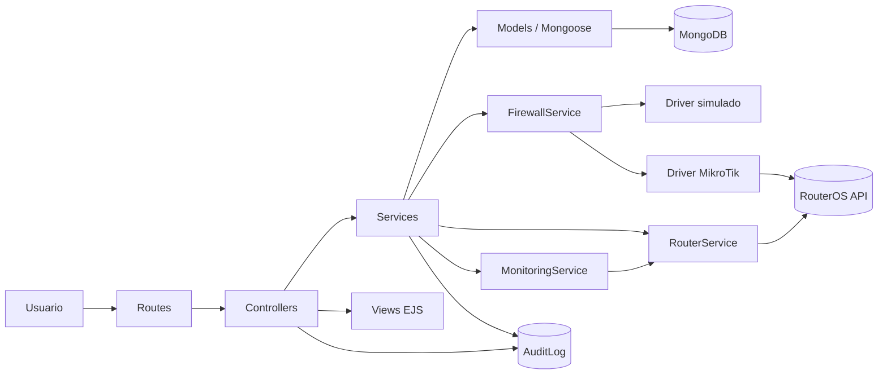
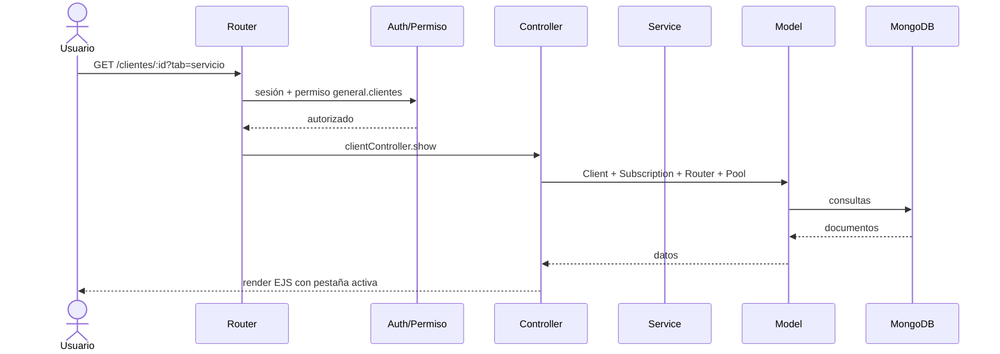
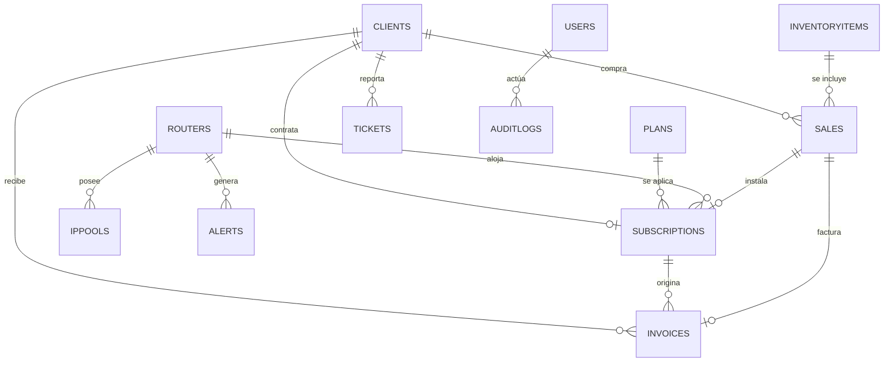
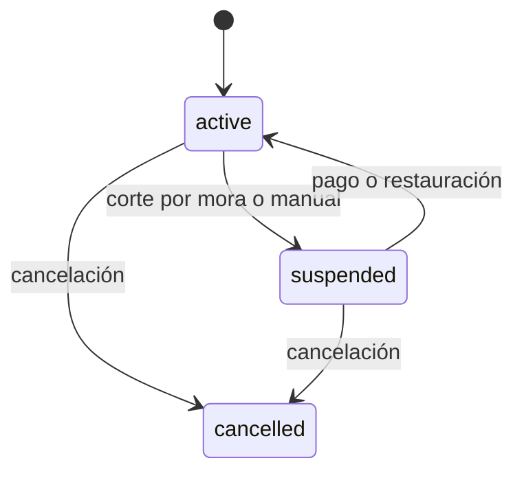
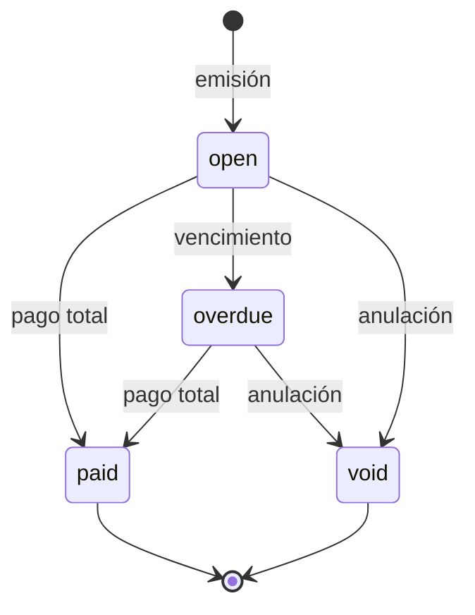
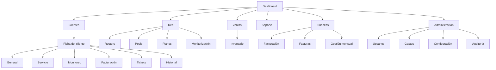

# CRACKENTICK

## Documento de desarrollo y especificación funcional

| Campo | Valor |
|---|---|
| **Proyecto** | CRACKENTICK |
| **Tema** | Redes y telecomunicaciones — gestión integral de un ISP |
| **Tipo** | Aplicación web con arquitectura MVC y capa de servicios |
| **Versión del documento** | 2.16 |
| **Versión de la aplicación** | 1.6 |
| **Fecha** | 19 de noviembre de 2026 |
| **Estado** | Implementado, probado y documentado |
| **Stack** | Node.js, Express, MongoDB, Mongoose, EJS |
| **Inspiración funcional** | MikroWisp |
| **Base de datos** | `crackentick` (MongoDB local) |
| **Modalidad de uso** | Un solo ISP, operación local y offline |

---

## Control de versiones del documento

| Versión | Fecha | Cambio |
|---|---|---|
| 0.1 | 10/11/2026 | Primer borrador a partir de la especificación del proyecto. |
| 1.0 | 10/11/2026 | Se fija el alcance: un ISP, tres dominios, cortes por firewall simulado/real, auditoría y ficha de cliente. |
| 1.1 | 10/11/2026 | Moneda USD por defecto y configuración regional; reglas para no alterar facturas emitidas. |
| 1.2 | 10/11/2026 | Identidad visual: tema oscuro, glassmorphism, fondo animado y pantalla de login. |
| 1.3 | 10/11/2026 | Dashboard operativo con KPIs, gráficos, cobranza, actividad y accesos rápidos. |
| 1.4 | 11/11/2026 | Rediseño «Nocturne Flat», localización venezolana y facturación flexible con IVA y descuentos. |
| 1.5 | 11/11/2026 | Aprovisionamiento MikroTik multi-router, tickets, inventario, ventas, monitorización WAN y simuladores. |
| 1.6 | 11/11/2026 | Autenticación real con `scrypt`, usuarios y permisos por nodo, rutas canónicas, finanzas mensuales, gastos, monitorización por bloques/bps, catálogo RouterOS y WAN dinámicas. |
| **2.0** | **11/11/2026** | **Reorganización completa del documento. Se amplía el problema y su justificación, se incorporan actores y permisos, se especifica módulo por módulo toda la aplicación (dashboard, clientes, servicios, routers, pools, monitorización, ventas, inventario, tickets, facturación, facturas, finanzas, gastos, usuarios, configuración, auditoría y simuladores) y se documenta la operación offline. Se conserva la v1.6 como respaldo histórico.** |
| **2.1** | **15/11/2026** | **Auditoría interna del código y de la interfaz: se verifican 150 clientes demo, 450 facturas, 77 archivos JavaScript, 51 vistas EJS y el comportamiento responsive; se documenta la verificación en §13.6 y se registran los hallazgos pendientes en §14.4.** |
| **2.2** | **15/11/2026** | **Mejoras de producción: PPPoE con profile por plan y rate-limit en orden correcto, aprovisionamiento idempotente en un solo lote, cortes en el router del servicio, lectura manual del tráfico por cliente, notificaciones separadas de stock/servicios, atribución real en auditoría, fechas locales y ajustes responsive para teléfono.** |
| **2.3** | **15/11/2026** | **Contabilidad: pagos en USD/Bs con método, tasa BCV vía dolarapi y respaldo offline, inmutabilidad de la tasa del pago, tarjeta de entradas por moneda, evolución económica con costo recuperado/ganancia/mensualidades, tooltip, panel de economía e impresión/PDF.** |
| 2.4 | 16/11/2026 | Prueba del modo real contra un CHR 7.20.2 en QEMU: conexión, aprovisionamiento PPPoE, corte/restauración y baja verificados; corrección de `!empty` en `node-routeros` con una conexión por comando. |
| 2.5 | 16/11/2026 | Cortes por lista MOROSOS con reglas `forward`/`input` automáticas; cola simple por servicio (incluido PPPoE) y en la sincronización de planes; «Desactivar/Activar PPPoE»; eliminación de servicio con limpieza de PPPoE, cola y listas; lanzadores de Windows y paquete para laptop. |
| 2.6 | 18/11/2026 | Robustez de formularios: conserva lo escrito al fallar, errores por campo y validación previa en el navegador; corrige la persistencia de dirección/facturación del cliente y los IDs inválidos de plan, pool o router; conserva la edición de servicio desde la ficha. |
| 2.7 | 19/11/2026 | Capacidad por router (Mbps vendidos, ocupación y reuso), modo de planes por cola simple o address list, PCQ con queue tree/mangle, validación plan-router y cambios de instalación de ventas. |
| 2.8 | 19/11/2026 | Zonas y reportes diarios de averías e instalaciones, permisos del dashboard y notificaciones, auditoría con segundos e intervención de IA, tema claro cálido, Chart.js local, herramientas experimentales MikroTik y asistente IA flotante con confirmación. |
| 2.9 | 19/11/2026 | Profundidad visual, modo claro más contrastado, notificaciones con contador, filtros y resolución masiva, y envío de alertas nuevas a Telegram. |
| 2.10 | 19/11/2026 | Contabilidad reworkeada con terminología ISP, ingresos netos sin IVA, ganancia bruta solo de instalaciones/equipos, gráficos Chart.js con selector de tipo y dona de gastos, y cobros convertidos correctamente. |
| 2.11 | 19/11/2026 | Contabilidad con base Caja/Devengo, cifras netas y con IVA, costos directos de instalación, cartera por vencimientos del mes y gráficos barras/líneas/área/apiladas/dona. |
| 2.12 | 19/11/2026 | Interruptor global para desactivar el IVA en facturas, ventas, planes y previsualización, conservando el histórico pagado o anulado. |
| 2.13 | 20/11/2026 | VLANs movidas a Red con CRUD y aplicación por router; fabricante/modelo en routers; conexión SSH y VLANs para Cisco experimental. |
| 2.14 | 20/11/2026 | VLANs agrupadas por router con creación contextual y monitorización WAN con conexión API persistente para no saturar los logs. |
| 2.15 | 20/11/2026 | Firewall y EOIP movidos a Red; selector de router primero y tabs VLANs/Firewall/EOIP; reparación de router deberá reponer estas configuraciones. |
| 2.16 | 20/11/2026 | Balanceo movido a Red con ECMP para hasta 256 WAN, dinámico en MikroTik y experimental en Cisco; Experimental retirado. |

---

## Índice

1. Ficha del proyecto
2. Introducción: contexto, problema, justificación y objetivos
3. Usuarios, roles y permisos
4. Arquitectura del sistema
5. Tecnologías, dependencias y estructura
6. Modelo de datos
7. Especificación funcional de los módulos
8. Reglas de negocio e invariantes
9. Firewall, cortes y aprovisionamiento MikroTik
10. Rutas y pantallas
11. Validaciones, errores y seguridad
12. Interfaz y experiencia de usuario
13. Pruebas y criterios de aceptación
14. Limitaciones y evolución
15. Operación, instalación y uso offline

- Anexo A. Plantillas de comandos RouterOS
- Anexo B. Glosario
- Anexo C. Referencias
- Anexo D. Credenciales demo y checklist de entrega

---

## 1. Ficha del proyecto

**CRACKENTICK** es una aplicación web para administrar un Proveedor de Servicios de Internet (ISP). Cubre el ciclo operativo completo: captación y registro del cliente, contratación del plan, configuración técnica del servicio, aprovisionamiento en el router, venta e instalación de equipos, inventario, soporte, facturación, cobranza, mora, cortes, restauración, finanzas y auditoría.

El sistema se organiza en seis dominios que comparten información por identificadores y mantienen responsabilidades separadas:

| Dominio | Responsabilidad | Colecciones |
|---|---|---|
| **Comercial** | Clientes, catálogo de planes y ventas/instalaciones | `Clients`, `Plans`, `Sales` |
| **Técnico** | Servicio contratado, configuración de red, routers y pools | `Subscriptions`, `Routers`, `IpPools` |
| **Operaciones** | Inventario, soporte y alertas | `InventoryItems`, `Tickets`, `Alerts` |
| **Financiero** | Facturas, pagos, mora, gastos e ingresos | `Invoices`, `FinanceEntries` |
| **Seguridad** | Autenticación, roles y permisos por nodo | `Users` |
| **Transversal** | Configuración, numeración y trazabilidad | `Settings`, `AuditLog` |

### 1.1 Actores del sistema

| Actor | Descripción | Acceso |
|---|---|---|
| **Administrador** (`admin`) | Responsable general del ISP. | Todos los nodos, usuarios y configuración. La cuenta `admin` representa siempre a **Juan Echenique**. |
| **Operador** (`staff`) | Técnico, vendedor, cajero o soporte. | Solo los nodos marcados en su usuario. |
| **Sistema** | Procesos internos: mora, muestreo WAN, expiración de sesiones de monitor, alertas. | Sin interfaz; registra auditoría. |
| **Router MikroTik** | Equipo externo que recibe comandos en modo real. | API RouterOS, opcional. |
| **Cliente final** | Persona o empresa que contrata el servicio. | No tiene portal; es un registro administrado por el ISP. |

### 1.2 Contexto de operación

- Un solo ISP, sin multi-tenant.
- Localización para Venezuela: `es-VE`, `America/Caracas`, precios en USD y cobros en USD/Bs con tasa BCV.
- Operación académica y local: la aplicación corre en la misma laptop que MongoDB, sin depender de internet.
- El modo real de RouterOS es opcional; el modo simulado permite demostrar todo el flujo sin router físico.

---

## 2. Introducción: contexto, problema, justificación y objetivos

### 2.1 Contexto

Un ISP pequeño o mediano suele operar con una combinación de hojas de cálculo, cuadernos, mensajes de WhatsApp, notas del técnico y algún sistema de facturación aislado. Cada área construye su propia versión de la verdad:

- Comercial sabe quién es el cliente y qué plan prometió, pero no siempre conoce el estado técnico del servicio.
- El técnico sabe qué usuario PPPoE o IP instaló, pero no cuánto debe el cliente ni si la factura está vencida.
- Finanzas sabe qué facturas emitió, pero no qué servicios están cortados ni por qué.
- Soporte recibe reclamos sin historial técnico ni financiero consolidado.
- Inventario vive en otra planilla y no se descuenta al instalar.
- La gerencia no tiene una vista única para decidir: cuánto se cobró, cuánto se debe, qué está caído y qué requiere atención.

CRACKENTICK nace para unificar esas operaciones en una sola aplicación web, con reglas explícitas para que un cambio en un área no dañe las otras. Por ejemplo: cambiar el precio de un plan no altera facturas ya emitidas; suspender un servicio no borra su historial financiero; vender un equipo no corta el servicio del cliente; y ningún corte se ejecuta sin quedar registrado.

### 2.2 Problema

La gestión manual o dispersa de un ISP produce fallas recurrentes que afectan la operación, la cobranza y la confianza del cliente. El problema se puede descomponer en diez dimensiones:

#### 2.2.1 Dispersión e inconsistencia de los datos

El cliente existe varias veces: en la planilla comercial, en la nota del técnico, en la factura y en el chat de soporte. Los datos no coinciden entre sí y no hay una fuente única de verdad. Esto genera duplicados, clientes sin servicio, servicios sin cliente y facturas con datos incompletos.

#### 2.2.2 Desconexión entre lo comercial, lo técnico y lo financiero

Contratar un plan, instalar el servicio y cobrarlo son tres actos que deberían estar encadenados. En la operación manual, el vendedor cierra la venta pero el técnico no recibe la orden; el técnico instala pero nadie emite la factura; finanzas cobra pero no sabe si el servicio está activo. El resultado es un flujo roto que depende de la memoria de las personas.

#### 2.2.3 Errores de facturación y pérdida de ingresos

Calcular mal un periodo, olvidar una factura, duplicarla o modificar su importe después de emitida son errores frecuentes. Sin un snapshot del plan, un cambio de precio altera retroactivamente facturas anteriores. Sin numeración atómica, dos usuarios pueden generar el mismo número. Sin control de estados, una factura pagada puede volver a cobrarse.

#### 2.2.4 Mora y cortes aplicados tarde, mal o sin evidencia

El corte por mora suele depender de una revisión manual. Se aplica tarde, se aplica a quien no debe, o no se aplica. Cuando se aplica, no queda registro de quién lo hizo, con qué comando, a qué hora ni con qué resultado. El cliente reclama, el servicio se restaura sin criterio y nadie puede reconstruir lo ocurrido.

#### 2.2.5 Ventas e inventario sin control

Los equipos (routers, ONU, antenas, switches, cable, conectores) se entregan sin descontar stock. No se sabe qué serial se instaló en qué cliente, qué equipo se vendió, cuál está defectuoso o cuánto queda disponible. Las compras se hacen a ciegas y las instalaciones se facturan sin respaldo material.

#### 2.2.6 Soporte sin trazabilidad

Los reclamos llegan por canales informales. No hay ticket, prioridad, responsable ni conversación registrada. Un caso se cierra sin solución o se reabre sin contexto. No se puede medir cuántos casos hay abiertos, cuánto tardan ni qué clientes concentran fallas.

#### 2.2.7 Falta de visibilidad operativa

La gerencia no puede responder en tiempo real: ¿cuánto se cobró este mes?, ¿cuánta deuda hay?, ¿cuántos servicios están cortados?, ¿qué WAN está caída?, ¿qué equipo está bajo mínimo?, ¿qué facturas están vencidas?, ¿cuál es el resultado financiero? Sin una vista consolidada, las decisiones se toman con datos atrasados.

#### 2.2.8 Acceso compartido y ausencia de auditoría

Una sola contraseña compartida impide saber quién hizo cada cambio. No hay separación entre el técnico, el vendedor, el cajero y el administrador. Cualquiera puede editar precios, anular facturas o borrar clientes. No existe un historial confiable de acciones ni de comandos enviados al router.

#### 2.2.9 Dependencia de internet y de servicios externos

Las herramientas en la nube fallan o no están disponibles en el aula, en el laboratorio o en una sede sin conexión. Un ISP necesita operar su panel aunque falle el enlace externo; la única dependencia de red debe ser, opcionalmente, el router local.

#### 2.2.10 Consecuencias del problema

| Síntoma | Consecuencia | Respuesta de CRACKENTICK |
|---|---|---|
| Datos duplicados | Clientes y facturas inconsistentes | Modelo único con referencias por `ObjectId` e índices únicos. |
| Flujo comercial/técnico/financiero separado | Instalaciones sin factura o cobros sin servicio | Venta → cliente → suscripción → factura → aprovisionamiento en un solo flujo. |
| Facturas recalculadas o duplicadas | Pérdida de ingresos y reclamos | `planSnapshot`, numeración atómica e idempotencia por periodo. |
| Mora manual | Cortes tardíos o injustificados | Proceso de mora con días de gracia, firewall y auditoría. |
| Inventario informal | Equipos perdidos y stock irreal | Inventario por cantidad y serializado, con movimientos y alertas. |
| Soporte informal | Casos sin dueño ni historial | Tickets con prioridad, estado, asignación y conversación. |
| Falta de visión gerencial | Decisiones tardías | Dashboard operativo, finanzas mensuales y alertas. |
| Acceso compartido | Cambios sin responsable | Login real, permisos por nodo y auditoría append-only. |
| Dependencia de internet | Panel inoperante sin conexión | Node.js + MongoDB locales y activos servidos desde el proyecto. |
| Sin evidencia de cortes | Conflictos con el cliente | Cada comando se registra con actor, resultado y duración. |

### 2.3 Justificación

CRACKENTICK no es solo un CRUD de clientes. Es una herramienta de operación que conecta cinco preguntas centrales de un ISP:

1. **¿Quién es el cliente y qué contrató?** Comercial y ficha única.
2. **¿Cómo está configurado su servicio y en qué router?** Técnico y aprovisionamiento.
3. **¿Cuánto debe y cómo se cobra?** Facturación, pagos y mora.
4. **¿Qué se instaló, qué hay en inventario y qué soporte recibió?** Ventas, stock y tickets.
5. **¿Qué pasó, quién lo hizo y con qué resultado?** Auditoría y permisos.

La aplicación permite demostrar el ciclo completo en un entorno académico, sin router físico y sin internet, y a la vez deja preparada la conexión real con MikroTik.

### 2.4 Objetivos

**Objetivo general**

Construir una aplicación web MVC con MongoDB que gestione de forma integral la operación de un ISP —clientes, planes, servicios, red, ventas, inventario, soporte, facturación, finanzas y auditoría— con cortes y restauración de servicio mediante firewall simulado o real.

**Objetivos específicos**

1. Administrar clientes y planes con validaciones e integridad referencial.
2. Registrar un servicio por cliente con configuración PPPoE, IP estática o DHCP.
3. Aprovisionar el servicio en uno o varios routers MikroTik, en modo simulado o real.
4. Emitir facturas inmutables usando una copia congelada del plan y numeración atómica.
5. Registrar pagos, calcular deuda, aplicar mora y ejecutar cortes con días de gracia.
6. Restaurar el servicio cuando el cliente paga y registrar cada comando.
7. Gestionar ventas e instalaciones con descuento de inventario y factura de instalación.
8. Controlar inventario por cantidad y por serial, con stock mínimo y alertas.
9. Ofrecer soporte mediante tickets con prioridad, estado y conversación.
10. Monitorizar el tráfico WAN y el consumo puntual por cliente.
11. Calcular el resultado financiero mensual con ingresos, gastos, neto y margen.
12. Autenticar usuarios reales y autorizar por nodo, con auditoría de cada acción.
13. Mantener una interfaz clara, responsive, offline y con identidad visual consistente.

### 2.5 Alcance

**Incluido en la versión 1.6**

- Un solo ISP y una sola base de datos local.
- Un servicio por cliente; el mismo registro puede reactivarse.
- Pago total por factura; sin abonos ni saldos parciales.
- Facturación manual desde el panel (previsualización, emisión y mora).
- Firewall simulado y real, configurable por router y desde la configuración global.
- Aprovisionamiento de PPPoE, direcciones IP, pools y colas simples.
- Ventas, instalaciones, inventario por cantidad y serializado.
- Tickets de soporte, monitorización WAN y monitor puntual por cliente.
- Finanzas mensuales y movimientos manuales de gasto e ingreso.
- Autenticación `scrypt`, roles `admin`/`staff` y permisos por nodo.
- Auditoría append-only de cambios, comandos y accesos.
- Operación offline con Node.js, MongoDB y dependencias locales.

**Fuera de alcance**

- Portal del cliente final.
- Pasarelas de pago en línea, facturación electrónica y envío por correo. La impresión/PDF se resuelve con el navegador.
- Notificaciones por correo, SMS o WhatsApp.
- Multi-tenant y administración de varios ISP.
- Multi-moneda simultánea fuera de USD/Bs; la conversión se limita a la tasa BCV del pago.
- Pagos parciales, prorrateo, notas de crédito y conciliación bancaria.
- Contabilidad formal, compras a proveedor y órdenes de compra.
- Alta disponibilidad, respaldos automáticos y despliegue en producción.
- Pruebas automatizadas y migraciones formales.

### 2.6 Supuestos

- El servidor tiene MongoDB local o una URI de Atlas.
- Para el modo real existe un MikroTik o CHR accesible por API, con usuario habilitado.
- El router tiene la lista `MOROSOS` y una regla de firewall que descarta su tráfico.
- Los clientes PPPoE pueden existir previamente como *secrets*; el sistema los crea o sincroniza.
- La facturación se lleva en USD; los cobros en Bs usan la tasa BCV y la guardan en la factura.
- El IVA es configurable en tres niveles: global, por plan y por factura pendiente.
- Las fechas se almacenan en UTC y se muestran en la zona configurada.
- El sistema se ejecuta en un entorno académico controlado, sin exposición pública.

---

## 3. Usuarios, roles y permisos

### 3.1 Modelo de acceso

La autenticación es real y la autorización es por **nodo funcional**. Un nodo es una sección de la aplicación (por ejemplo, `red.monitoreo` o `finanzas.facturas`). Los permisos se declaran una sola vez en `config/constants.js` y de ahí se derivan el formulario de usuarios, la barra lateral y el middleware `requierePermiso`.

| Grupo | Nodos |
|---|---|
| **General** | `general.dashboard`, `general.clientes` |
| **Red** | `red.routers`, `red.pools`, `red.planes`, `red.monitoreo` |
| **Ventas** | `ventas.ventas`, `ventas.inventario` |
| **Soporte** | `soporte.tickets` |
| **Finanzas** | `finanzas.facturacion`, `finanzas.facturas`, `finanzas.gestion` |
| **Administración** | `admin.usuarios`, `admin.gastos`, `admin.configuracion`, `admin.auditoria` |

### 3.2 Reglas de autorización

1. El rol `admin` omite la comprobación de permisos y ve todos los nodos.
2. Un usuario `staff` solo entra a los nodos marcados; si intenta otra ruta recibe `403`.
3. Un usuario sin nodos es enviado a `/sin-acceso`.
4. No se puede quitar el rol admin al último administrador activo.
5. No se puede desactivar ni eliminar el propio usuario.
6. La cuenta con usuario `admin` representa siempre a **Juan Echenique**: el seed la crea así, el arranque sincroniza el nombre en bases existentes y el modelo lo fija en cada guardado. El formulario de usuarios no puede renombrarla.
7. El formulario agrupa los nodos con casillas de grupo en estado marcado, vacío o indeterminado.
8. El servidor descarta permisos desconocidos antes de guardar.

> **Limitación conocida (15/11/2026):** el servidor bloquea el acceso, pero algunos enlaces del dashboard y del pie del sidebar aún no se ocultan por permiso. Un operador puede llegar a un `403` desde ellos. Ver §14.4, hallazgo H-05.

### 3.3 Usuarios demo

| Usuario | Contraseña | Rol | Nodos |
|---|---|---|---|
| `admin` | `admin123` | Administrador | Todos |
| `tecnico` | `tecnico123` | Operador | Dashboard, clientes, routers, monitoreo, ventas, tickets |
| `ventas` | `ventas123` | Operador | Dashboard, clientes, ventas, inventario, facturas |
| `finanzas` | `finanzas123` | Operador | Dashboard, facturación, facturas, contabilidad, gastos |
| `soporte` | `soporte123` | Operador | Dashboard, clientes, monitoreo, tickets |

> Las contraseñas se almacenan como `scrypt:<sal>:<hash>` y nunca se devuelven al navegador. La sesión se regenera al iniciar para evitar fijación; «recordarme» extiende la cookie a 7 días.

## 4. Arquitectura del sistema

### 4.1 Vista general



### 4.2 MVC con capa de servicios

- **Modelos:** esquemas, validaciones, índices, virtuales y métodos de consulta.
- **Controladores:** reciben la petición, validan el contexto, llaman a servicios y eligen la vista o redirección. Son delgados.
- **Servicios:** concentran las reglas que involucran varias entidades o efectos externos.
  - `BillingService`: previsualización, emisión, mora, pagos, anulación y deuda.
  - `FirewallService`: selección del driver, bloqueo, restauración y prueba de conexión.
  - `RouterService`: comandos RouterOS, aprovisionamiento, sincronización y lectura de tráfico.
  - `ProvisioningService`: apoyo al simulador de aprovisionamiento.
  - `InventoryService`: consumo, restauración, ajustes y seriales.
  - `SalesService`: creación, instalación y cancelación de ventas.
  - `MonitoringService`: muestreo WAN, alertas y sesiones de cliente.
  - `AuditService`: registro uniforme de acciones y comandos.
  - `CryptoService`: cifrado y descifrado AES-256-GCM.
- **Vistas:** EJS con layout compartido y parciales reutilizables.
- **Rutas:** un router por dominio, montado en `app.js` con su permiso.

La capa de servicios evita que los controladores conozcan detalles del router, de la numeración de facturas o del descuento de inventario, y permite probar la lógica sin pasar por HTTP.

### 4.3 Estructura de carpetas

```text
CRACKENTICK/
├── app.js                        # Express, middlewares, rutas y permisos
├── server.js                     # Conexión MongoDB, arranque y monitorización
├── seed.js                       # Datos demo completos (--reset)
├── config/
│   ├── db.js
│   └── constants.js              # Monedas, estados, permisos, enums y paginación
├── models/                       # 14 modelos (ver §6)
├── controllers/                  # Un controlador por módulo
├── services/
│   ├── billingService.js
│   ├── firewallService.js
│   ├── firewall/drivers.js
│   ├── routeros.js
│   ├── routerService.js
│   ├── provisioningService.js
│   ├── inventoryService.js
│   ├── salesService.js
│   ├── monitoringService.js
│   ├── cryptoService.js
│   └── auditService.js
├── routes/                       # auth, index, clients, plans, subscriptions,
│                                 # billing, invoices, routers, pools, tickets,
│                                 # inventory, sales, monitoring, finance,
│                                 # expenses, users, settings, audit
├── middlewares/
│   ├── auth.js                   # Sesión, permisos y ruta inicial
│   ├── asyncHandler.js
│   └── errorHandler.js
├── utils/                        # money, dates, strings, errors, ip, bits, password
├── views/                        # layout, partials, auth, dashboard y módulos
├── public/
│   ├── css/styles.css            # Nocturne Flat y componentes
│   ├── js/app.js                 # Tema, menú, canvas, polling y formularios
│   └── vendor/anime.min.js       # Anime.js local
├── docs/DOCUMENTO-DESARROLLO.md
├── GUIA-INSTALACION-OFFLINE.md
├── iniciar.bat · sembrar.bat
└── package.json
```

### 4.4 Flujo de una petición



1. Express aplica middlewares generales: body, estáticos, method-override, sesión, flash y usuario.
2. `requiereAuth` exige sesión; `requierePermiso` valida el nodo.
3. El router llama al controlador.
4. El controlador consulta modelos o invoca servicios.
5. El servicio aplica reglas, ejecuta comandos si corresponde y registra auditoría.
6. El controlador renderiza o redirige con mensaje flash.
7. Los errores llegan al middleware central.

### 4.5 Separación entre dominios

| Regla | Implementación |
|---|---|
| Comercial no depende de Financiero | Clientes y planes no importan servicios de facturación. |
| Técnico no modifica facturas | Solo lee el estado financiero para mostrar deuda. |
| Financiero no envía comandos al router | Solicita al `FirewallService` y registra el resultado. |
| Ventas orquesta, no implementa | `SalesService` usa inventario, router y facturación. |
| La comunicación es por identificadores | `clientId`, `planId`, `subscriptionId`, `routerId`; no se embeben documentos completos. |
| Los hechos financieros son inmutables | Facturas pagadas o anuladas no se editan. |
| La configuración es transversal | `Settings` y `AuditLog` son usados por todos los dominios. |

### 4.6 Procesos en segundo plano

- **Monitorización WAN:** un temporizador del proceso recorre cada 5 s las interfaces de los routers activos y guarda hasta 60 muestras por interfaz en memoria.
- **Sesiones de cliente:** se crean bajo demanda, expiran a los 60 s sin lectura y se eliminan con un limpiador. No hay polling permanente de todos los clientes.
- **Mora:** no hay cron en la v1.6; se ejecuta manualmente desde Facturación. El cron queda como evolución.
- **Alertas:** las caídas WAN y el stock bajo generan documentos `Alert`; las muestras de tráfico no se persisten.

### 4.7 Arquitectura offline

La aplicación no depende de servicios externos para funcionar:

- Node.js ejecuta el servidor y MongoDB guarda los datos en la misma laptop.
- `node_modules` viaja con el proyecto; no se necesita `npm install` en la universidad.
- CSS, JavaScript, iconos SVG y `anime.js` se sirven localmente.
- Las fuentes web pueden no cargar; el diseño cae a la pila del sistema sin romperse.
- El único destino de red opcional es la API del router MikroTik en modo real.
- La guía `GUIA-INSTALACION-OFFLINE.md` y los scripts `iniciar.bat`/`sembrar.bat` cubren la puesta en marcha sin internet.

---

## 5. Tecnologías, dependencias y estructura

### 5.1 Stack

| Capa | Tecnología | Uso |
|---|---|---|
| Servidor | Node.js 18+ | Ejecución del backend. |
| Framework | Express 4 | Rutas, middlewares y HTTP. |
| Base de datos | MongoDB | Persistencia NoSQL local. |
| ODM | Mongoose 8 | Esquemas, validaciones, índices y populate. |
| Vistas | EJS + express-ejs-layouts | HTML dinámico con layout y parciales. |
| Sesión | express-session + connect-flash | Sesión y mensajes entre peticiones. |
| Formularios | method-override | `PUT` y `DELETE` desde HTML. |
| Configuración | dotenv | Variables de entorno. |
| Logs HTTP | morgan | Registro de peticiones. |
| RouterOS | node-routeros | Driver real de MikroTik. |
| Animación | anime.js 4 | Entradas, contadores, barras y dona. |
| Estilos | CSS propio | Sin Bootstrap ni Tailwind. |
| Seguridad | `node:crypto` | `scrypt` para contraseñas y AES-256-GCM para credenciales. |

### 5.2 Dependencias principales

```text
express, mongoose, ejs, express-ejs-layouts, express-session,
connect-flash, method-override, dotenv, morgan, node-routeros, animejs
```

`node-routeros` es una dependencia normal, no opcional: el modo real queda disponible tras instalar el proyecto. En modo simulado nunca se abre una conexión.

### 5.3 Variables de entorno

| Variable | Uso | Valor demo |
|---|---|---|
| `PORT` | Puerto HTTP. | `3000` |
| `NODE_ENV` | Entorno; `development` muestra trazas. | `development` |
| `MONGODB_URI` | Conexión a MongoDB. | `mongodb://127.0.0.1:27017/crackentick` |
| `SESSION_SECRET` | Firma de la cookie de sesión. | Cadena larga y aleatoria. |
| `ENCRYPTION_KEY` | Clave de 32 bytes (hex o base64) para AES-256-GCM. | 64 caracteres hexadecimales. |

> Si se copia una base existente, debe conservarse el mismo `SESSION_SECRET` o `ENCRYPTION_KEY`: las contraseñas de routers y PPPoE están cifradas y no se pueden descifrar con otra clave.

---

## 6. Modelo de datos

### 6.1 Diagrama de relaciones



`Settings`, `FinanceEntries` y `AuditLog` son transversales y no participan en relaciones directas obligatorias.

### 6.2 `Settings` — configuración del ISP

Documento único con `key: "system"`. Se crea en el seed y se edita desde `/admin/configuracion`.

| Campo | Tipo | Regla |
|---|---|---|
| `key` | String | Único; siempre `system`. |
| `company.name`, `company.taxId`, `company.address`, `company.phone`, `company.email` | String | Datos comerciales y fiscales. |
| `billing.currency` | String | `USD` por defecto; incluye `VES`, `COP`, `EUR`, `MXN`, `ARS`, `CLP`, `PEN`, `BRL`. |
| `billing.locale` | String | `es-VE` por defecto. |
| `billing.timezone` | String | `America/Caracas` por defecto. |
| `billing.taxRate` | Number | IVA global de referencia (0 por defecto). Editable. |
| `billing.invoicePrefix` | String | `INV`. |
| `billing.dueDays` | Number | Días para vencer; `5` por defecto. |
| `billing.graceDays` | Number | Días de gracia antes del corte; `3` por defecto. |
| `billing.previewDays` | Number | Días de anticipación de la previsualización; `5` por defecto. |
| `billing.bcvRate`, `bcvUpdatedAt`, `bcvSource` | Number, Date, String | Tasa BCV de respaldo, fecha y fuente (`dolarapi`, `manual`, `demo`). |
| `billing.nextInvoiceNumber` | Number | Contador atómico; inicia en `1`. |
| `firewall.mode` | String | `simulated` o `real`. |
| `firewall.host`, `port`, `username`, `passwordEnc`, `tls`, `verifyTls`, `routerName` | — | Conexión global de respaldo para RouterOS. |

### 6.3 `Users` — usuarios y permisos

| Campo | Tipo | Regla |
|---|---|---|
| `name` | String | 2–80 caracteres. La cuenta `admin` se fuerza a «Juan Echenique». |
| `username` | String | Único, minúsculas, 3–40, `[a-z0-9._-]`. |
| `email` | String | Opcional, minúsculas, máximo 120. |
| `passwordHash` | String | `scrypt:<sal>:<hash>`; `select: false`. |
| `role` | String | `admin` o `staff`. |
| `permissions` | [String] | Claves de nodo filtradas contra `PERMISOS`. |
| `active` | Boolean | Un usuario inactivo no puede iniciar sesión. |
| `lastLoginAt` | Date | Se actualiza en cada acceso correcto. |

### 6.4 `Clients` — clientes

| Campo | Tipo | Regla |
|---|---|---|
| `clientCode` | String | Único; formato `CL-0001`. |
| `firstName`, `lastName` | String | 2–60 caracteres. |
| `taxId` | String | Único si existe. |
| `email` | String | Formato válido y único si existe. |
| `phone` | String | 7–20 caracteres. |
| `address` | Objeto | `street`, `city`, `state`, `postalCode`. |
| `billingData` | Objeto | `legalName`, `taxId`, `email`, `address`. |
| `status` | String | `active`, `suspended`, `cancelled`. |
| `notes` | String | Máximo 500 caracteres. |

### 6.5 `Plans` — planes

| Campo | Tipo | Regla |
|---|---|---|
| `name` | String | Único, 3–60. |
| `description` | String | Máximo 300. |
| `downloadSpeed`, `uploadSpeed` | Number | Enteros mayores que 0 (Mbps). |
| `price` | Number | Mayor o igual a 0. |
| `taxRate` | Number | IVA propio entre 0 y 1; `null` usa el global. |
| `billingInterval` | String | `monthly`, `quarterly`, `annual`. |
| `active` | Boolean | `true` por defecto. |

### 6.6 `Routers` — routers MikroTik

| Campo | Tipo | Regla |
|---|---|---|
| `name` | String | Único. |
| `description` | String | Referencia operativa. |
| `mode` | String | `simulated` o `real`. |
| `host`, `port`, `username`, `passwordEnc`, `tls`, `verifyTls` | - | API RouterOS; contraseña cifrada. |
| `active` | Boolean | Los inactivos no se ofrecen para servicios nuevos. |
| `wanInterfaces[]` | Subdocumento | `name`, `provider`, `downloadMbps`, `uploadMbps`, `notes`. |
| `lastTestAt`, `lastTestOk`, `lastTestResult` | — | Resultado de la última prueba. |

### 6.7 `IpPools` — bloques CIDR

| Campo | Tipo | Regla |
|---|---|---|
| `name` | String | Único por router. |
| `cidr` | String | Bloque normalizado, por ejemplo `192.168.0.0/24`. |
| `routerId` | ObjectId → `Routers` | Router que aplica el pool. |
| `purpose` | String | `pppoe`, `static`, `dhcp`, `mixed`. |
| `autoProvision` | Boolean | Aplicar al guardar. |
| `appliedAt`, `lastApplyResult` | — | Última aplicación. |
| `active` | Boolean | Disponible para asignación. |

Virtuales calculados: `network`, `prefix`, `usable`, `firstUsable`, `lastUsable` y `rangeLabel`. El prefijo válido va de `/16` a `/32`.

### 6.8 `Subscriptions` — servicio contratado

| Campo | Tipo | Regla |
|---|---|---|
| `clientId` | ObjectId → `Clients` | Único: un servicio por cliente. |
| `planId` | ObjectId → `Plans` | Plan activo al contratar. |
| `planSnapshot` | Objeto | Copia congelada: nombre, velocidades, precio, IVA, intervalo y fecha. |
| `serviceConfig.connectionType` | String | `pppoe`, `static`, `dhcp`. |
| `serviceConfig.ipAddress` | String | IPv4; obligatoria en `static`, única si existe. |
| `serviceConfig.pppoeUsername` | String | Obligatorio en PPPoE; único si existe. |
| `serviceConfig.pppoePasswordEnc` | String | Obligatorio en PPPoE; cifrado. |
| `serviceConfig.routerId` | ObjectId → `Routers` | Router del servicio. |
| `serviceConfig.ipPoolId` | ObjectId → `IpPools` | Pool del que se toma la IP. |
| `serviceConfig.queueName` | String | Cola simple; por defecto `ct-<usuario o código>`. |
| `serviceConfig.provisioningState` | String | `none`, `ok`, `error`. |
| `serviceConfig.provisionedAt`, `lastProvisionResult` | — | Última aplicación o error. |
| `status` | String | `active`, `suspended`, `cancelled`. |
| `currentPeriodStart`, `currentPeriodEnd` | Date | Periodo vigente. |
| `firewallState` | String | `none`, `pending`, `blocked`, `error`. |
| `firewallBlockedAt`, `lastStatusChangeAt` | Date | Trazabilidad de estado. |

### 6.9 `Invoices` — facturas

| Campo | Tipo | Regla |
|---|---|---|
| `invoiceNumber` | String | Único; `INV-000001`. |
| `type` | String | `service`, `installation`, `sale`, `other`. |
| `affectsService` | Boolean | Solo `true` en facturas de servicio. |
| `clientId`, `subscriptionId`, `saleId` | ObjectId | Origen de la factura. |
| `periodStart`, `periodEnd` | Date | Nulos en ventas, instalaciones y manuales. |
| `issueDate`, `dueDate` | Date | Emisión y vencimiento. |
| `planSnapshot` | Objeto | Copia usada al facturar. |
| `lines[]` | Array | Descripción, cantidad, precio, importe, artículo y seriales. |
| `subtotal` | Number | Suma de líneas. |
| `discountType`, `discount`, `discountAmount` | — | Sin descuento, porcentaje o monto fijo. |
| `taxBase`, `taxRate`, `tax` | Number | Base imponible, tasa aplicada e IVA. |
| `total` | Number | `taxBase + tax`. |
| `currency` | String | Moneda congelada al emitir. |
| `status` | String | `draft`, `open`, `paid`, `overdue`, `void`. |
| `paidAt`, `paymentMethod`, `paymentReference` | — | Datos del pago. |
| `paymentCurrency`, `paymentAmount` | String, Number | Moneda del pago (`USD`/`VES`) y monto en esa moneda. |
| `exchangeRate`, `paymentRateSource`, `paymentRateDate` | Number, String, Date | Tasa BCV del día del pago, fuente y fecha. Inmutables una vez pagada. |
| `voidedAt`, `voidReason` | — | Anulación con motivo. |
| `notes` | String | Máximo 500. |

**Índices:** `invoiceNumber` único; `{ subscriptionId, periodStart }` único parcial para `type: 'service'`; `clientId`; `status`; `dueDate`; `issueDate`.

### 6.10 `FinanceEntries` — gastos e ingresos manuales

| Campo | Tipo | Regla |
|---|---|---|
| `type` | String | `expense` o `income`. |
| `category` | String | `proveedores`, `empleados`, `autos`, `renta`, `servicios`, `impuestos`, `instalaciones`, `ventas`, `ajustes`, `otros`. |
| `concept` | String | Obligatorio, máximo 160. |
| `amount` | Number | Obligatorio, no negativo. |
| `currency` | String | ISO de 3 letras; USD por defecto. |
| `date` | Date | Fecha del movimiento; filtros por mes. |
| `recurring` | Boolean | Gasto repetido. |
| `vendor` | String | Proveedor o beneficiario. |
| `status` | String | `pending` o `paid`. |
| `reference`, `notes` | String | Texto libre. |
| `createdBy` | ObjectId → `Users` | Usuario que lo registró. |

### 6.11 `InventoryItems` — inventario

- `code` con patrón `ART-0001`; `name`, `category`, `tracking`, `unit`, `quantity`, `minStock`, `cost`, `price`, `active`.
- `tracking: 'bulk'`: stock numérico en `quantity` (cable, conectores, rosetas).
- `tracking: 'serial'`: el stock real es la cantidad de seriales `available`.
- `serials[]`: `serial`, `mac`, `status` (`available`, `installed`, `sold`, `defective`), `clientId`, `saleId`, `installedAt`.
- `movements[]`: `entrada`, `salida`, `ajuste`, `instalacion`, `venta`, con motivo, actor, venta y factura.
- Virtuales: `stock`, `availableSerials`, `installedSerials`, `soldSerials`, `bajoMinimo`.

### 6.12 `Sales` — ventas e instalaciones

| Campo | Tipo | Regla |
|---|---|---|
| `code` | String | `VEN-0001`. |
| `customer` | Objeto | Datos del prospecto aunque no exista como cliente. |
| `service` | Objeto | Plan, router, pool, tipo de conexión, IP y PPPoE previstos. |
| `items[]` | Array | Artículo, seguimiento, unidad, cantidad, precio, importe y seriales. |
| `materialsTotal`, `installationCost`, `subtotal`, `taxRatePercent`, `tax`, `total` | Number | Totales congelados. |
| `technicianId`, `promoterId` | ObjectId → `Users` | Obligatorios y activos. |
| `status` | String | `waiting`, `installed`, `cancelled`. |
| `clientId`, `subscriptionId`, `invoiceId`, `installedAt` | — | Resultado de la instalación. |

### 6.13 `Tickets` — soporte

- `code` con patrón `TCK-00001`; `clientId` obligatorio y `subscriptionId` opcional.
- `subject`, `description`, `category`, `priority`, `status`, `assignedTo`.
- Categorías: `technical`, `billing`, `installation`, `other`.
- Prioridades: `low`, `medium`, `high`, `urgent`.
- Estados: `open`, `in_progress`, `resolved`, `closed`.
- `messages[]`: `author`, `body`, `internal`, `createdAt`. Los mensajes internos no se comparten con el cliente.
- Virtuales: `totalMensajes`, `ultimoMensaje`, `abierto`.

### 6.14 `Alerts` — alertas operativas

| Campo | Tipo | Regla |
|---|---|---|
| `routerId`, `routerName` | — | Opcional para alertas de stock. |
| `wan` | String | Interfaz afectada. |
| `type` | String | `wan_down`, `wan_up`, `client_down`, `stock_low`, `wan_latency`. |
| `severity` | String | `info`, `warning`, `critical`. |
| `value` | Number/String | Lectura que originó la alerta. |
| `status` | String | `active`, `acknowledged`, `resolved`. |
| `startedAt`, `acknowledgedAt`, `resolvedAt` | Date | Ciclo de vida. |

### 6.15 `AuditLogs` — auditoría

| Campo | Tipo | Regla |
|---|---|---|
| `timestamp` | Date | Momento del evento. |
| `module` | String | `commercial`, `technical`, `financial`, `firewall`, `settings`, `provisioning`, `inventory`, `support`, `monitoring`, `auth`. |
| `entity`, `entityId` | String | Documento afectado. |
| `action` | String | `create`, `update`, `delete`, `billing_*`, `payment`, `void`, `block`, `unblock`, `config_change`, `test_connection`, `simulation`, `provision`, `sync`, `install`, `cancel`, `adjust`, `alert`, `reply`, `login`, `logout`. |
| `description` | String | Resumen legible. |
| `changes` | Objeto | `{ before, after }` saneado. |
| `command`, `commandResult` | String | Comando RouterOS y respuesta. |
| `status` | String | `success` o `failed`. |
| `durationMs` | Number | Duración. |
| `actor` | String | Usuario que actuó o `system`. |

**Regla:** es *append-only*; el modelo bloquea actualizaciones y eliminaciones. Los secretos se enmascaran antes de guardar.

### 6.16 Enums y máquinas de estado

**Cliente**

```text
active ⇄ suspended → cancelled
```

**Suscripción**



**Factura**



**Venta:** `waiting → installed` o `waiting → cancelled`.

**Ticket:** `open → in_progress → resolved → closed`.

**Alerta:** `active → acknowledged → resolved`.

### 6.17 Integridad e índices

- `clientCode`, `invoiceNumber`, `username`, `name` de plan y `name` de router son únicos.
- `taxId` y `email` de cliente son únicos parciales cuando tienen valor.
- `clientId` de suscripción es único: un servicio por cliente.
- `pppoeUsername` e `ipAddress` son únicos parciales cuando tienen valor.
- La factura de servicio es única por `{ subscriptionId, periodStart }`; las de venta e instalación no colisionan.
- Los documentos con historial no se borran físicamente: se cancelan, anulan o desactivan.

## 7. Especificación funcional de los módulos

Esta sección describe **qué hace cada pantalla y cada acción** de la aplicación. Las rutas indicadas son las canónicas de la v1.6; los alias heredados se detallan en §10.

### 7.1 Autenticación, sesión y cierre

**Rutas:** `GET /login`, `POST /login`, `POST /salir`, `GET /salir`.

**Funciones**

1. Formulario de usuario y contraseña, con botón para mostrar u ocultar la contraseña.
2. Opción «Recordarme por 7 días».
3. Validación de credenciales contra `User` con hash `scrypt` y comparación timing-safe.
4. Rechazo de usuarios inactivos o inexistentes con mensaje genérico.
5. Regeneración de la sesión al autenticar para evitar fijación.
6. Redirección al primer nodo permitido (`rutaInicial`); si no tiene nodos, a `/sin-acceso`.
7. Registro en auditoría de cada intento fallido y de cada acceso correcto (módulo `auth`).
8. Logout que destruye la sesión, limpia la cookie y vuelve al login.

**Interfaz**

- Panel sólido con marca, formulario y pie de acceso restringido.
- Lienzo de líneas violetas reactivo al puntero; con `prefers-reduced-motion` se dibuja un cuadro estático.
- Error visible, sin sacudidas ni animaciones de salida.
- La contraseña nunca se rellena de vuelta en el HTML.

**Reglas**

- Cookie `crackentick.sid`: `httpOnly`, `sameSite=lax`, `secure` en producción.
- Duración: 8 horas por defecto; 7 días con «recordarme».
- El rol `admin` siempre pasa; el resto depende de sus nodos.

### 7.2 Shell, navegación y permisos visuales

**Elementos**

- Barra lateral con grupos General, Red, Ventas, Soporte, Finanzas y Administración.
- Solo se muestran los nodos que el usuario puede ver (`puede(clave)`).
- Barra superior con hamburguesa, título de página, tema claro/oscuro, usuario y logout.
- Sidebar plegable en escritorio y drawer en móvil; se cierra con `X`, fondo, `Escape` o al navegar.
- `aria-expanded` y `aria-controls` se actualizan en cada cambio.
- Tema oscuro por defecto; la preferencia se conserva en el navegador.
- Avisos flash de éxito, error y advertencia.
- Botón «Saltar al contenido» y foco visible.

### 7.3 Dashboard operativo

**Ruta:** `GET /` (permiso `general.dashboard`).

**Objetivo:** responder en una sola pantalla qué se cobró, cuánto se debe, quién está cortado, qué falló y qué requiere atención.

**Funciones**

1. **KPIs primarios:** ingresos del periodo, deuda pendiente, clientes activos y servicios activos.
2. **Franja operativa compacta:** servicios cortados, cortes fallidos, facturas emitidas, tickets abiertos, stock bajo y modo de firewall.
3. **Serie de 6 meses:** la misma de Contabilidad (mensualidades, instalaciones, ventas de equipos, otros ingresos y gastos), con selector de tipo (barras, líneas o área), tooltip por mes y resumen del mes; cada columna enlaza a `/finanzas`.
4. **Estado de los servicios:** distribución de servicios `active`, `suspended` y `cancelled`.
5. **Cartera y cobranza:** deuda total, top deudores y acceso a la mora.
6. **Cortes fallidos:** servicios con `firewallState: error`, con opción de reintentar.
7. **Facturas recientes:** número, cliente, total, estado y enlace al detalle.
8. **Actividad reciente:** últimos eventos de auditoría.
9. **Resultado financiero del mes:** ingresos, gastos, neto y margen, con enlace a Finanzas.
10. **Accesos rápidos:** crear cliente, nueva venta, emitir facturas, registrar gasto, ver monitorización y tickets.
11. **Selector de periodo:** este mes, mes anterior o últimos 90 días; se conserva en la URL.
12. **Estado vacío:** cada bloque muestra un mensaje y una acción cuando no hay datos.

**Reglas**

- El dashboard es de solo lectura: no emite facturas, no corta servicios ni modifica datos.
- Todos los cálculos se hacen en el servidor; la vista no recalcula dinero.
- Las consultas se resuelven en paralelo; un bloque roto no impide ver los demás.
- Los importes usan la moneda y el locale configurados.

### 7.4 Clientes

#### 7.4.1 Listado

**Ruta:** `GET /clientes`.

| Columna | Contenido |
|---|---|
| Código | `CL-0001`. |
| Cliente | Nombre completo y correo. |
| Plan | Plan contratado o «Sin servicio». |
| Servicio | `active`, `suspended`, `cancelled` o «Sin servicio». |
| Deuda | Suma de facturas `open` y `overdue`. |
| Estado | Estado comercial del cliente. |
| Acciones | Ver, editar y cortar/restaurar. |

**Funciones**

- Búsqueda por nombre, código, correo o identificación.
- Filtros por estado del cliente, estado del servicio, plan y «solo con deuda».
- Orden por nombre, código, deuda o fecha de alta.
- Paginación (10 por página).
- Enlaces directos a la ficha y al formulario de edición.

#### 7.4.2 Alta y edición

**Rutas:** `GET /clientes/nuevo`, `POST /clientes`, `GET /clientes/:id/editar`, `PUT /clientes/:id`, `DELETE /clientes/:id`.

**Funciones**

- Datos personales: nombre, apellido, identificación, correo y teléfono.
- Dirección: calle, ciudad, estado y código postal.
- Datos de facturación: razón social, identificación, correo y dirección.
- Estado (`active`, `suspended`, `cancelled`) y notas.
- Código de cliente automático `CL-####`.
- Validaciones en navegador y servidor, con errores por campo y datos conservados.
- Eliminación solo si no tiene servicio ni facturas; en caso contrario se bloquea con un mensaje claro.

**Auditoría:** alta, edición, cambio de estado y eliminación quedan registrados con valores anteriores y posteriores.

#### 7.4.3 Ficha del cliente

**Ruta:** `GET /clientes/:id?tab=general|servicio|monitoreo|facturacion|tickets|historial`.

La cabecera muestra nombre, código, estado, deuda y acciones rápidas (editar, registrar pago, cortar/restaurar). La pestaña activa se conserva en la URL.

**Pestaña General**

- Información personal y de contacto.
- Dirección y datos de facturación.
- Notas.
- Tarjetas resumen: plan actual, estado del servicio y deuda.

**Pestaña Servicio**

- Plan contratado con velocidades y precio snapshot.
- Tipo de conexión, IP, usuario PPPoE (contraseña enmascarada), router, pool y cola.
- Periodo actual y próximo vencimiento.
- Estado del servicio, estado del firewall y estado de aprovisionamiento.
- Botones **Cortar servicio** y **Restaurar servicio** con motivo obligatorio.
- Última acción de firewall y enlace al simulador.
- Formulario para cambiar de plan.
- Enlace al monitor del cliente.

**Pestaña Monitoreo**

- Estado del servicio y del aprovisionamiento.
- Acceso al monitor puntual de tráfico (IP o PPPoE).
- Indicación del modo activo (real o simulado).
- Lecturas de bajada/subida y tiempo restante de la sesión.

**Pestaña Facturación**

- Deuda total y facturas pendientes.
- Tabla de facturas: número, tipo, periodo, emisión, vencimiento, total, estado y acciones.
- Registrar pago en facturas `open` o `overdue`.
- Anular factura con motivo.
- Enlace al detalle de cada factura.

**Pestaña Tickets**

- Tickets del cliente con estado, prioridad y último mensaje.
- Acceso al detalle y alta de un ticket con el cliente preseleccionado.

**Pestaña Historial**

- Eventos de auditoría del cliente, su suscripción y sus facturas.
- Filtro por tipo de evento.

### 7.5 Planes

**Rutas:** `GET /red/planes`, `GET /red/planes/nuevo`, `POST /red/planes`, `GET /red/planes/:id/editar`, `PUT /red/planes/:id`, `POST /red/planes/:id/estado`, `DELETE /red/planes/:id`.

**Funciones**

- Listado con nombre, velocidades, precio, IVA aplicable, intervalo, servicios activos y estado.
- Crear y editar con validaciones de nombre único, velocidades enteras, precio no negativo e intervalo.
- IVA opcional por plan (0–100 %); vacío usa el IVA global.
- Activar o desactivar un plan.
- Eliminar solo si no tiene suscripciones; en caso contrario se desactiva.
- Al cambiar las velocidades de un plan, se sincronizan las colas simples de sus servicios (en modo real o simulado según el router).
- El cambio de precio no altera suscripciones existentes ni facturas emitidas; solo aplica a nuevas contrataciones o cambios de plan.

### 7.6 Servicios (suscripciones)

**Rutas:** `GET /clientes/:id/servicio/nuevo`, `POST /clientes/:id/servicio`, `PUT /clientes/:id/servicio`, `PUT /clientes/:id/servicio/plan`, `POST /clientes/:id/servicio/cortar`, `POST /clientes/:id/servicio/restaurar`.

**Funciones**

1. **Contratación:** un servicio por cliente, con plan, router, pool, tipo de conexión y datos técnicos.
2. **Tipos de conexión:**
   - `pppoe`: usuario y contraseña cifrada; la IP es opcional.
   - `static`: IP obligatoria y única.
   - `dhcp`: IP del pool o asignación dinámica.
3. **Selector pool → IP:** primero se elige el pool (nombre y CIDR), luego una IP disponible de la lista, con conteo de totales y disponibles. La IP actual se conserva al editar. Si el pool no tiene direcciones, se habilita la entrada manual.
4. **Usuario PPPoE automático** a partir del código o nombre del cliente, editable y único.
5. **Cola simple** `ct-<usuario o código>` con límite de bajada/subida del plan.
6. **Aprovisionamiento:** crea o actualiza PPPoE, dirección IP, pool y cola en el router; guarda `provisioningState`, fecha y resultado.
7. **Cambio de plan:** actualiza `planId` y toma un nuevo `planSnapshot`; las facturas anteriores conservan su copia. Sincroniza la cola.
8. **Corte manual:** exige motivo, ejecuta el bloqueo por PPPoE o lista `MOROSOS` y registra comando y resultado.
9. **Restauración manual:** exige motivo, ejecuta el comando inverso y registra el resultado.
10. **Estados:** `active`, `suspended`, `cancelled`; el firewall se sigue por `none`, `pending`, `blocked`, `error`.

**Reglas**

- No se puede crear un segundo servicio para el mismo cliente.
- El plan debe existir y estar activo al contratar.
- La IP y el usuario PPPoE son únicos cuando tienen valor.
- Un fallo de aprovisionamiento no deshace la venta ni la factura; deja el servicio en `error` para reintentar.
- El corte y la restauración son idempotentes: no se repiten si el estado ya es el deseado.

### 7.7 Routers

**Rutas:** `GET /red/routers`, `GET /red/routers/nuevo`, `POST /red/routers`, `GET /red/routers/:id/editar`, `PUT /red/routers/:id`, `POST /red/routers/:id/probar`, `DELETE /red/routers/:id`.

**Funciones**

- Listado con nombre, modo, host, estado de la última prueba y WAN registradas.
- Alta y edición con nombre, descripción, modo (`simulated`/`real`), host, puerto, usuario, contraseña, TLS, verificación de certificado y estado activo. El modo real exige host y usuario; si falta alguno, responde `422`. La contraseña es opcional (puede quedar vacía si el usuario API no tiene).
- **Interfaces WAN dinámicas:** filas clonables con nombre, proveedor, capacidad de bajada/subida y notas; siempre queda al menos una.
- **Probar conexión:** ejecuta una lectura simple (`/system/resource/print` o equivalente), guarda fecha, resultado y duración, y lo audita.
- Contraseña cifrada con AES-256-GCM; el formulario la deja en blanco para conservarla y nunca la revela.
- Eliminación solo si no tiene servicios ni pools asociados.
- Los routers inactivos no se ofrecen para servicios nuevos.

### 7.8 Pools de IP

**Rutas:** `GET /red/pools`, `GET /red/pools/nuevo`, `POST /red/pools`, `GET /red/pools/:id/editar`, `PUT /red/pools/:id`, `POST /red/pools/:id/aplicar`, `DELETE /red/pools/:id`.

**Funciones**

- Alta de bloques CIDR (`192.168.0.0/24`) con nombre, router, propósito (`pppoe`, `static`, `dhcp`, `mixed`), aplicación automática y estado.
- Normalización de la dirección de red y cálculo de total de direcciones, usables, primera y última IP.
- Conteo de IP disponibles y exclusión de las ya asignadas a suscripciones.
- Aplicación del pool al router (`/ip/pool/add` o `/ip/pool/set`) con resultado auditado.
- Filtrado de pools por router en los formularios de servicio y venta.
- Eliminación solo si no tiene servicios asociados.

### 7.9 Monitorización

#### 7.9.1 WAN

**Rutas:** `GET /red/monitoreo`, `GET /red/monitoreo/api/wan`, `POST /red/monitoreo/interfaces`.

**Funciones**

1. Muestreo cada 5 segundos de las interfaces WAN de los routers activos.
2. Hasta 60 muestras por interfaz en memoria (ring buffer).
3. **Vista de tarjetas** y **vista de bloques** con los mismos datos; el botón segmentado alterna la clase visual sin duplicar consultas.
4. Indicadores de bajada, subida, capacidad, proveedor, estado y hora de la última muestra.
5. **Tooltip de consumo exacto en bps** al pasar el ratón o enfocar con teclado.
6. **Filtro de alertas por proveedor** mediante chips; «Todas» limpia el filtro.
7. **Alta de interfaz WAN** desde la propia vista, reutilizando el esquema del router.
8. **Alertas de red:** una caída crea `wan_down` con severidad crítica; la recuperación crea `wan_up` y resuelve la anterior. Esta vista solo muestra alertas de red (`wan_down`, `wan_up`, `wan_latency`); las de stock y servicios viven en `/notificaciones` y en su módulo.
9. **Reconocer y resolver alertas de red** desde la vista.
10. El navegador consulta la API cada 5 s y pausa cuando la pestaña está oculta.

#### 7.9.2 Monitor por cliente

**Rutas:** `GET /red/monitoreo/cliente/:id`, `POST /red/monitoreo/api/cliente/:id/iniciar`, `GET /red/monitoreo/api/cliente/:id/leer`, `POST /red/monitoreo/api/cliente/:id/detener`.

**Funciones**

- **La lectura no se inicia automáticamente:** al abrir la página no se consulta el router. El usuario pulsa «Iniciar lectura» y recién entonces comienza la sesión.
- Abre una sesión bajo demanda con TTL de 60 segundos.
- Devuelve tráfico de bajada/subida, muestras y tiempo restante.
- Tras iniciar, el navegador consulta cada 3 s, pausa con la pestaña oculta y detiene la sesión con `sendBeacon` al cerrar.
- En modo real intenta primero la tasa de la cola simple y, si no existe, `/interface/monitor-traffic` sobre la interfaz PPPoE o la IP.
- En modo simulado genera una caminata aleatoria coherente con el plan.
- Si la sesión expira, la API responde `410`; el usuario puede volver a abrirla.
- Un limpiador elimina sesiones vencidas; no se monitoriza permanentemente a todos los clientes.

### 7.10 Ventas e instalaciones

**Rutas:** `GET /ventas`, `GET /ventas/nueva`, `POST /ventas`, `GET /ventas/:id`, `POST /ventas/:id/instalar`, `POST /ventas/:id/cancelar`.

**Funciones**

1. **Registro de venta:** cliente o prospecto, plan, router obligatorio, pool filtrado por ese router, tipo de conexión y **IP elegida de las disponibles del pool**. El usuario y la contraseña PPPoE se pueden escribir en la venta; si se dejan vacíos se generan al instalar.
2. **IP:** solo se listan las direcciones libres del pool (se excluyen suscripciones y ventas en espera). La IP manual solo se muestra para conexión por IP estática; el servidor valida que pertenezca al pool y que no esté asignada.
2. **Materiales:** artículos del inventario por cantidad o serializados, con precio y cantidad; el total se calcula en vivo.
3. **Técnico instalador y promotor obligatorios**, ambos usuarios activos. Si falta alguno, el servidor responde `422`.
4. **Estado `waiting`:** la venta queda registrada sin tocar stock ni emitir factura.
5. **Estado `cancelled`:** cancela una venta en espera sin mover inventario ni facturar.
6. **Instalación (`installed`):**
   - reutiliza un cliente existente por correo o identificación, o crea uno nuevo con código `CL-####`;
   - crea la suscripción con plan, router, pool, PPPoE y cola;
   - descuenta inventario: cantidades restadas y seriales marcados como `installed` y vinculados al cliente y a la venta;
   - emite una factura `installation` con `affectsService: false`;
   - intenta aprovisionar el servicio en el router;
   - guarda enlaces a cliente, suscripción y factura.
7. **Fallo de aprovisionamiento:** la venta y la factura se conservan; el servicio queda en `provisioningState: error` y puede reintentarse.

**Efectos por estado**

| Estado | Inventario | Factura | Servicio |
|---|---|---|---|
| `waiting` | Sin cambios | No | No |
| `installed` | Descuenta y marca seriales | Factura de instalación, no corta | Se crea y se aprovisiona |
| `cancelled` | Sin cambios | No | No |

### 7.11 Inventario

**Rutas:** `GET /ventas/inventario`, `GET /ventas/inventario/nuevo`, `POST /ventas/inventario`, `GET /ventas/inventario/:id`, `GET /ventas/inventario/:id/editar`, `PUT /ventas/inventario/:id`, `POST /ventas/inventario/:id/ajustar`, `POST /ventas/inventario/:id/seriales`, `POST /ventas/inventario/:id/seriales/:serialId/estado`.

**Funciones**

- **Artículos por cantidad:** cable, conectores, rosetas y patch cords; stock numérico y unidad libre.
- **Artículos serializados:** routers, ONU, antenas y switches; el stock es la cantidad de seriales `available`.
- Alta y edición de nombre, categoría, seguimiento, unidad, cantidad, stock mínimo, costo, precio y estado.
- **Ajuste de stock:** exige un delta distinto de cero y no permite stock negativo; registra movimiento con motivo y actor.
- **Alta de seriales:** serial y MAC; estado inicial `available`.
- **Cambio de estado de serial:** `available`, `installed`, `sold`, `defective`; los saltos a `installed` o `sold` solo se permiten desde `available`.
- **Stock mínimo:** cuando el stock disponible es menor o igual al mínimo se genera una alerta `stock_low`.
- **Alertas de stock:** se listan y gestionan en `/inventario#alertas-stock` y en `/notificaciones`, separadas de las alertas de red.
- **Restauración:** al anular una factura de venta o instalación, se devuelven cantidades y se liberan seriales vendidos o instalados, con movimiento de entrada.
- Ficha con seriales, movimientos y acciones; listado con existencias, mínimo, estado y valor.

### 7.12 Tickets de soporte

**Rutas:** `GET /soporte/tickets`, `GET /soporte/tickets/nuevo`, `POST /soporte/tickets`, `GET /soporte/tickets/:id`, `POST /soporte/tickets/:id/mensajes`, `POST /soporte/tickets/:id/estado`, `POST /soporte/tickets/:id/prioridad`.

**Funciones**

- Listado con filtros por estado, prioridad, categoría y búsqueda; paginación (12 por página).
- Creación desde el listado o desde la ficha del cliente, con cliente preseleccionado.
- Cliente obligatorio y servicio opcional.
- Categorías: técnica, facturación, instalación y otra.
- Prioridades: baja, media, alta y urgente.
- Estados: abierto, en proceso, resuelto y cerrado.
- Asignación a un usuario del equipo.
- Conversación con mensajes públicos y **respuestas internas** diferenciadas visualmente.
- Cambio rápido de estado y prioridad desde el detalle.
- Cada respuesta y cambio queda en auditoría (módulo `support`).

### 7.13 Facturación y cobranza

**Rutas:** `GET /finanzas/facturacion`, `GET /finanzas/facturacion/previsualizar`, `POST /finanzas/facturacion/emitir`, `POST /finanzas/facturacion/mora`.

**Funciones**

1. **Resumen:** pendientes, vencidas, pagadas del mes y deuda total.
2. **Previsualizar:** lista las suscripciones activas cuyo periodo vence dentro de la ventana configurada, con cliente, plan, periodo, subtotal, IVA y total; no escribe en la base.
3. **Emitir facturas:** crea una factura por suscripción elegible, reserva el número de forma atómica, avanza el periodo y registra auditoría. Es idempotente: el índice único por servicio y periodo impide duplicados.
4. **Ejecutar mora:** marca como `overdue` las facturas de servicio vencidas y corta los servicios que superaron los días de gracia.
5. **Resultado de cada corrida:** procesadas, creadas, omitidas, fallidas, cortadas y restauradas, con detalle.
6. **Solo facturas de servicio** (`type: 'service'`, `affectsService: true`) participan en mora, deuda de servicio y corte.
7. Un fallo de firewall no interrumpe la corrida: se registra y el servicio queda en `error` para reintento.

### 7.14 Facturas

**Rutas:** `GET /finanzas/facturas`, `GET /finanzas/facturas/nueva`, `POST /finanzas/facturas`, `GET /finanzas/facturas/:id`, `GET /finanzas/facturas/:id/editar`, `PUT /finanzas/facturas/:id`, `POST /finanzas/facturas/:id/pagar`, `POST /finanzas/facturas/:id/anular`.

**Funciones**

- **Listado:** filtros por estado, cliente, número, tipo y rango de fechas; totales por estado; paginación (12 por página).
- **Detalle:** número, cliente, tipo, periodo, fechas, estado, líneas, subtotal, descuento, base imponible, IVA con su tasa, total, moneda, notas, datos del pago e historial.
- **Factura manual de venta:** permite crear facturas `sale` u `other` con artículos del inventario; descuenta stock y no corta el servicio.
- **Edición de facturas pendientes:** solo `open` o `overdue`; permite ajustar IVA (0–100 %), tipo y valor de descuento, vencimiento y notas. El servidor recalcula descuento, base, IVA y total; nunca confía en el total enviado.
- **Pago total:** exige moneda y método. En USD: efectivo u otros. En Bs: transferencia, Pago Móvil, efectivo u otros. Guarda `paidAt`, `paymentCurrency`, `paymentAmount`, `exchangeRate`, `paymentRateSource`, `paymentRateDate` y estado `paid`. La tasa BCV se obtiene de dolarapi al confirmar y cae a la tasa guardada si no hay internet. Los datos del pago y la tasa quedan congelados y no se editan después.
- **Reactivación:** si el cliente no tiene otras facturas de servicio pendientes, se restaura el servicio y se registra el comando.
- **Anulación:** solo `open` o `overdue`, con motivo obligatorio; la factura pasa a `void`, no se borra y conserva su número.
- **Inmutabilidad:** una factura `paid` o `void` no admite cambios de importes, líneas, periodo ni snapshot.
- **Numeración:** `INV-` + consecutivo de seis dígitos, con `$inc` atómico en `Settings`.
- **Moneda:** la facturación se lleva en **USD**. Los cobros en bolívares se calculan con la tasa BCV del día; cada pago conserva su tasa y no se recalcula.

### 7.15 Contabilidad mensual

**Ruta:** `GET /finanzas?mes=YYYY-MM&periodo=diario|mensual|anual&fecha=YYYY-MM-DD` (permiso `finanzas.gestion`).

**Cálculo del resultado**

```text
ingresos = facturas pagadas por paidAt + movimientos type=income
gastos   = movimientos type=expense con status=paid
neto     = ingresos − gastos
margen   = neto / ingresos × 100
```

**Evolución económica (6 meses)**

```text
mensualidades   = facturas pagadas type=service
costoRecuperado = costo de inventario de facturas pagadas sale/installation
gananciaBruta   = (ventas − costoRecuperado) + otras facturas + ingresos manuales
ingresos        = mensualidades + costoRecuperado + gananciaBruta
gastos          = movimientos de gasto pagados del mes
deuda           = facturas open/overdue con vencimiento en el mes
```

**Funciones**

- Resultado del mes seleccionado con ingresos, gastos, neto y margen.
- **Cobros por moneda y método:** tarjeta con pagos en Bs y USD, cantidad y monto por método, totales, equivalentes y conteo de pagos registrados. Se puede consultar por día, mes o año.
- **Tasa BCV:** se guarda con cada pago y se muestra en la tarjeta; si dolarapi no está disponible se usa la tasa de respaldo configurada.
- Serie de los 6 meses que terminan en el mes seleccionado; el gráfico permite alternar **barras, líneas y área**, muestra el resumen del mes y las series de mensualidades, instalaciones, ventas de equipos, otros ingresos y gastos.
- Panel **Resultado del período** con ingresos por mensualidades, instalaciones, ventas de equipos y otros; costo de equipos; **ganancia bruta de instalaciones y equipos (sin mensualidades)**; gastos operativos, nómina, utilidad neta, margen neto y cartera por cobrar.
- Dona Chart.js de gastos por categoría con porcentaje sobre el total.
- Botón **Imprimir / PDF** para imprimir el mes seleccionado; el navegador permite guardarlo como PDF.
- Enlaces a gastos y facturas; importes redondeados y formateados según moneda y locale.

### 7.16 Gastos e ingresos manuales

**Rutas:** `GET /admin/gastos`, `GET /admin/gastos/nuevo`, `POST /admin/gastos`, `GET /admin/gastos/:id/editar`, `PUT /admin/gastos/:id`, `POST /admin/gastos/:id/estado`, `DELETE /admin/gastos/:id`.

**Funciones**

- Registro de movimientos `expense` o `income` con categoría, concepto, monto, moneda (`USD`/`VES`), método de pago, fecha, recurrencia, proveedor, estado, referencia y notas.
- **Ingresos:** moneda y método de pago son obligatorios. En USD: efectivo u otro. En Bs: transferencia, Pago Móvil, efectivo u otro.
- **Conversión:** los movimientos en Bs guardan la tasa BCV del día y su equivalente en USD; la contabilidad suma siempre en USD (`amountUsd`).
- Categorías: proveedores, empleados, autos y transporte, renta, servicios, impuestos, instalaciones, ventas, ajustes y otros.
- Filtros por mes, tipo, categoría y estado.
- Alternar pagado/pendiente.
- Editar y eliminar movimientos.
- Cada operación queda en auditoría con módulo `financial`.

### 7.17 Usuarios y permisos

**Rutas:** `GET /admin/usuarios`, `GET /admin/usuarios/nuevo`, `POST /admin/usuarios`, `GET /admin/usuarios/:id/editar`, `PUT /admin/usuarios/:id`, `POST /admin/usuarios/:id/estado`, `DELETE /admin/usuarios/:id`.

**Funciones**

- Listado con nombre, usuario, correo, rol, estado y cantidad de nodos.
- Alta y edición con nombre, usuario, correo, rol (`admin`/`staff`), contraseña y permisos agrupados.
- Contraseña opcional al editar: si se deja en blanco, se conserva la actual.
- Hash `scrypt` con sal aleatoria; nunca se muestra ni se devuelve.
- Casillas de grupo con estado marcado, vacío o indeterminado; marcar el grupo activa o desactiva todos sus nodos.
- Activar o desactivar usuarios.
- Eliminar usuarios sin historial; el propio usuario y el último admin activo están protegidos.
- La cuenta `admin` siempre se llama **Juan Echenique** y no puede renombrarse ni perder el rol.

### 7.18 Configuración general y administración del sistema

**Rutas:** `GET /admin/configuracion?tab=empresa|facturacion|firewall|comandos`, `PUT /admin/configuracion/empresa`, `PUT /admin/configuracion/facturacion`, `PUT /admin/configuracion/firewall`, `POST /admin/configuracion/firewall/probar`, `GET /admin/configuracion/firewall/simulador`, `POST /admin/configuracion/firewall/simular`, `GET /admin/configuracion/provision/simulador`, `POST /admin/configuracion/provision/simular`.

**Pestaña Empresa**

- Nombre comercial, RIF/identificación fiscal, dirección, teléfono y correo.
- Estos datos se usan en la identidad del panel y en la información de facturación.

**Pestaña Facturación**

- Moneda (USD, VES, COP, EUR, MXN, ARS, CLP, PEN, BRL).
- Formato regional y zona horaria.
- IVA global editable.
- Prefijo de factura, días de vencimiento, días de gracia y anticipación de previsualización.
- Panel explicativo: el IVA puede sobrescribirse por plan y por factura.
- Regla: no se cambia la moneda si hay facturas pendientes; las emitidas conservan la suya.

**Pestaña Firewall/API**

- Modo global `simulated` o `real`.
- Host, puerto (8728/8729), usuario, contraseña, TLS y verificación de certificado.
- Nombre lógico del router.
- Botón **Probar conexión** con resultado auditado.
- Aviso visible cuando el modo es simulado.
- Enlace al simulador de comandos.

**Pestaña Comandos API**

- Catálogo completo de comandos RouterOS agrupado por dominio: diagnóstico, PPPoE, colas simples, listas de direcciones, pools, firewall y monitorización.
- Cada entrada incluye ruta, descripción y momento de uso.
- Los `print` se usan para resolver el `.id` antes de modificar.
- En modo simulado el comando se genera, se muestra y se audita, pero nunca se ejecuta.

**Simuladores**

- **Corte y restauración:** selecciona cliente/servicio y acción, muestra el comando, permite copiarlo y registrar la simulación.
- **Aprovisionamiento:** vistas por servicio, plan y pool; genera comandos, permite copiarlos y registra la simulación.
- Ningún simulador ejecuta comandos, incluso si el router está en modo real.

### 7.19 Auditoría

**Rutas:** `GET /admin/auditoria`, `GET /admin/auditoria/:id`.

**Funciones**

- Listado paginado (20 por página) con fecha, módulo, acción, descripción y estado.
- Filtros por módulo, acción, estado, entidad, identificador y rango de fechas.
- Detalle con resumen, cambios antes/después, comando, resultado y duración.
- Registro de accesos (`auth`), cambios comerciales, técnicos, financieros, de inventario, soporte, monitorización, aprovisionamiento y firewall.
- Solo lectura: no se edita ni se borra desde la interfaz.
- Exportación CSV queda como evolución.

## 8. Reglas de negocio e invariantes

### 8.1 Planes y snapshot

1. Al contratar un plan se copia en `planSnapshot`: nombre, velocidades, precio, IVA del plan (puede ser `null`) y fecha.
2. La factura usa `planSnapshot`, nunca `Plans.price`.
3. Cambiar de plan actualiza `planId` y toma un nuevo snapshot para facturas futuras.
4. Las facturas anteriores conservan su copia y no se recalculan.
5. Un plan con suscripciones activas no se elimina; se desactiva.
6. El IVA del plan es opcional: si está vacío se usa el IVA global; si tiene valor, prevalece.

### 8.2 Ciclo de facturación

1. La suscripción nace con `currentPeriodStart = hoy` y `currentPeriodEnd = hoy + intervalo`.
2. Al emitir se usa el periodo vigente y luego se avanza:
   - `currentPeriodStart = currentPeriodEnd`
   - `currentPeriodEnd = currentPeriodStart + intervalo`
3. El avance ocurre solo si la factura se creó correctamente.
4. La factura nace en `open` y vence en `issueDate + dueDays`.
5. La emisión es idempotente por `{ subscriptionId, periodStart }` para facturas de servicio.

### 8.3 Cálculo de importes

- `subtotal = suma(lines.amount)`.
- `discountAmount`:
  - `none`: `0`.
  - `percent`: `redondear(subtotal × min(discount, 100) / 100)`.
  - `amount`: `redondear(min(discount, subtotal))`.
- `taxBase = redondear(subtotal − discountAmount)`.
- `tax = redondear(taxBase × taxRate)`.
- `total = taxBase + tax`.
- El descuento se aplica **antes** del IVA.
- La tasa aplicada se guarda en la factura, de modo que un cambio futuro de IVA no altera facturas anteriores.
- Orden de resolución del IVA: `planSnapshot.taxRate` si no es `null`; en caso contrario, `Settings.billing.taxRate`.

### 8.4 Mora, deuda y corte

- Una factura `open` pasa a `overdue` cuando `hoy > dueDate`.
- La deuda del cliente es la suma de `total` de facturas `open` + `overdue`.
- Un cliente está en mora si tiene al menos una factura `overdue`.
- El corte se aplica cuando `hoy > dueDate + graceDays`.
- Solo las facturas de servicio participan en mora, deuda de servicio y corte.
- El proceso de mora es manual e idempotente: repetirlo no duplica cortes ni facturas.
- Un fallo de corte no interrumpe el resto de la corrida; queda en `firewallState: error` para reintento.

### 8.5 Pago y reactivación

1. Solo se paga una factura `open` u `overdue`.
2. Se registran método y referencia; se guarda `paidAt` y estado `paid`.
3. Si no quedan otras facturas de servicio pendientes, se restaura el servicio.
4. La restauración ejecuta el comando de desbloqueo y registra la acción.
5. Si el desbloqueo falla, el servicio queda `active` con `firewallState: error`; el fallo se muestra y se puede reintentar.
6. Pagar una factura de instalación, venta u otra cierra la factura, pero no restaura ni corta el servicio.

### 8.6 Inmutabilidad de facturas

- Mientras la factura está `open` o `overdue` se pueden editar IVA, descuento, vencimiento y notas, pero **no** `lines`, `subtotal`, `periodStart`, `periodEnd` ni `planSnapshot`.
- Al registrar el pago (`paid`) o anular (`void`), la factura queda completamente inmutable.
- La anulación solo aplica a `open` u `overdue` y exige motivo.
- Una factura `paid` no se anula en la v1.6.
- Las facturas anuladas no se borran y conservan su número.
- No se regenera una factura para el mismo periodo.

### 8.7 Ventas, instalaciones e inventario

1. Toda venta exige técnico instalador y promotor activos.
2. Una venta `waiting` o `cancelled` no mueve inventario ni emite factura.
3. Una venta `installed` descuenta cantidades, marca seriales como `installed`, crea cliente y servicio si hace falta, emite factura de instalación y aprovisiona.
4. Un serial solo pasa a `installed` o `sold` si estaba `available`.
5. Al anular una factura de venta o instalación se devuelven cantidades y se liberan seriales, con movimiento de entrada.
6. El stock nunca puede quedar negativo.
7. El stock mínimo genera una alerta `stock_low` sin necesidad de router.

### 8.8 Aprovisionamiento y firewall

- El modo simulado nunca abre una conexión al router.
- El modo real usa `node-routeros`; si falla, el estado queda en `error` y no se deshacen ventas ni facturas.
- Un corte ya aplicado se omite; una restauración ya aplicada también.
- Los comandos y resultados se guardan en auditoría, incluidas las simulaciones.
- Las credenciales de router y PPPoE se cifran y se enmascaran en logs y vistas.

### 8.9 Monitorización

- La WAN se muestrea cada 5 s con 60 muestras en memoria.
- Las muestras no se persisten; las alertas sí.
- El monitor por cliente expira a los 60 s sin lectura.
- No se monitoriza de forma permanente a todos los clientes.
- La vista de tarjetas y la de bloques comparten los mismos datos.

### 8.10 Autenticación, permisos y auditoría

- Toda ruta protegida comprueba sesión y permiso antes de ejecutar el controlador.
- Un `staff` no ejecuta nodos que no tiene marcados y la navegación principal los oculta; algunos enlaces del dashboard y del pie del sidebar todavía no se filtran (ver §14.4, H-05).
- El rol `admin` siempre pasa y no necesita permisos individuales.
- Las contraseñas solo existen como hash `scrypt` y nunca vuelven al cliente.
- La cuenta `admin` siempre representa a **Juan Echenique**.
- La auditoría es append-only y no se edita ni se borra desde la interfaz.
- Debe quedar al menos un administrador activo.
- **Auditoría con usuario real:** el servicio toma el actor desde el contexto de la petición (`AsyncLocalStorage`); las acciones de `tecnico`, `ventas`, `finanzas` y `soporte` se registran con su `username`. Los procesos internos usan `system`.

### 8.11 Reglas de borrado y protecciones

| Entidad | Regla |
|---|---|
| Cliente | No se borra si tiene suscripción o facturas. Se cancela. |
| Plan | No se borra si tiene suscripciones. Se desactiva. |
| Router | No se borra si tiene servicios o pools. |
| Pool | No se borra si tiene servicios. |
| Suscripción | No se borra si tiene facturas. Se cancela. |
| Factura | No se borra nunca. Se anula. |
| Venta | No se borra; se cancela si está en espera. |
| Usuario | No se borra si es el propio usuario o el último admin activo. |
| Configuración | No se borra; se edita. |
| Auditoría | No se edita ni se borra. |

---

## 9. Firewall, cortes y aprovisionamiento MikroTik

### 9.1 Principio

El sistema no «apaga» el servicio desde la aplicación: envía una instrucción al router/firewall. El módulo abstrae la comunicación para que la misma lógica funcione con un simulador o con un MikroTik real.

**Regla de oro:** Facturación decide que hay mora; Técnico ejecuta el corte; Auditoría registra el hecho. Ningún dominio escribe directamente en el router.

### 9.2 Modos

| Modo | Comportamiento | Uso |
|---|---|---|
| `simulated` | No hay conexión de red. Se genera el comando, se registra y se devuelve una respuesta simulada. | Desarrollo, pruebas y demostración. |
| `real` | Se conecta a RouterOS por API y ejecuta el comando. | Producción o laboratorio con MikroTik/CHR. |

El modo se configura por router y, como respaldo, en `Settings.firewall.mode`. Cambiar de modo no altera el historial ni los estados existentes.

### 9.3 Driver de firewall

```text
FirewallDriver
  block(subscription, context)   → { ok, command, result, durationMs }
  unblock(subscription, context) → { ok, command, result, durationMs }
  testConnection()               → { ok, result, durationMs }
```

- `SimulatedDriver`: arma el comando, lo devuelve y responde como si se hubiera aplicado.
- `MikroTikDriver`: usa la API RouterOS, aplica el comando y devuelve la respuesta del equipo.
- La selección se hace con una fábrica (`createFirewallDriver`).
- Los controladores solo conocen `FirewallService`, nunca el driver concreto.

### 9.4 Estrategias según el tipo de conexión

| Conexión | Corte | Restauración |
|---|---|---|
| `pppoe` | Deshabilitar el *secret* del usuario PPPoE. | Habilitar el *secret*. |
| `static` | Agregar la IP a la lista `MOROSOS`. | Quitar la IP de la lista. |
| `dhcp` | Agregar la IP arrendada a `MOROSOS`. | Quitar la IP de la lista. |

En `dhcp` la IP puede cambiar; se recomienda PPPoE o reserva DHCP. La interfaz muestra esta limitación.

### 9.5 Aprovisionamiento

`RouterService` construye comandos estructurados:

```js
{ op: 'add' | 'set' | 'remove', path: '/ppp/secret', params: {...}, lookup: {...}, comando: '...' }
```

| Acción | Comandos generados |
|---|---|
| Alta PPPoE | `/ppp/profile/add` (upsert) con `rate-limit` del plan y `/ppp/secret/add` (upsert) con `profile`, usuario, contraseña y `remote-address` si hay IP. |
| Alta con IP estática o DHCP | `/queue/simple/add` (upsert) con `max-limit` y `/ip/firewall/address-list/add` para la lista `CLIENTES`. |
| Actualización | `/ppp/profile/set` + `/ppp/secret/set` o `/queue/simple/set` + address-list. |
| Baja | `/ppp/secret/remove` o retiro de la IP, y `/queue/simple/remove` si existe. |
| Sincronización de plan | Un profile por plan y `/ppp/secret/set profile=...` en cada PPPoE; `max-limit` en cada cola de IP fija/DHCP. |
| Aplicación de pool | `/ip/pool/add` o `/ip/pool/set` con el rango usable del CIDR y su bloque en la lista de direcciones. |

Comportamiento:

- En modo simulado los comandos se generan, se muestran y se auditan; no se abre conexión.
- En modo real se ejecuta **un solo lote con una conexión por router**; no se abre y cierra una conexión por comando.
- Los comandos con `upsert` alternan `add` y `set` según exista el objeto, por lo que reintentar el alta no falla por duplicado.
- **PPPoE usa un profile por plan** (`ct-plan-<slug>`) con `rate-limit`. RouterOS interpreta `rate-limit` como **subida/bajada** (`rx/tx`), al revés que la ficha comercial del plan. La aplicación invierte el orden al generar el comando.
- **IP estática/DHCP usa cola simple** (`max-limit`) y la lista `CLIENTES`; no se crea cola simple para PPPoE.
- El corte/restauración usa el router asignado al servicio (`serviceConfig.routerId`), no un router global.
- Si la conexión falla, el servicio devuelve error y `provisioningState` queda en `error`.
- Los nombres de cola se normalizan a partir del usuario PPPoE o del código del cliente.
- Cada ejecución registra auditoría con módulo `provisioning`, acción `provision` o `sync`, comando y resultado.

### 9.6 Idempotencia, reintentos y fallos

- `Subscription.firewallState` evita repetir un corte ya aplicado.
- Antes de cortar: si `firewallState === 'blocked'`, se omite.
- Antes de restaurar: si `firewallState === 'none'`, se omite.
- Si el driver falla:
  - se registra `AuditLog` con `status: failed` y el mensaje;
  - la suscripción queda en `active` con `firewallState: 'error'` (no se marca como cortada si el corte no se aplicó);
  - aparece en el panel de cortes fallidos con opción de reintentar.
- La corrida de mora continúa con los demás clientes aunque uno falle.
- El resultado final muestra procesados, cortados, restaurados, omitidos y fallidos.

### 9.7 Seguridad de credenciales

- Contraseña PPPoE y contraseña de API cifradas con AES-256-GCM.
- Clave en `ENCRYPTION_KEY` (32 bytes en hexadecimal o base64), fuera del repositorio.
- La interfaz muestra `••••••••` y permite reemplazar, nunca revelar.
- Los logs guardan comandos sin contraseñas; cualquier valor sensible se enmascara antes de persistir.
- El modo real debe usarse en una red controlada; no se expone la API del router a internet.

### 9.8 Prerrequisitos del router

1. Usuario API con permisos mínimos para PPP, IP, colas y firewall.
2. Lista de direcciones `MOROSOS` creada.
3. Regla de filtro que descarte el tráfico de `MOROSOS`.
4. Servicio API habilitado en el puerto configurado (8728 u 8729).
5. Conectividad desde el servidor al router.
6. Reloj sincronizado para que las fechas de corte coincidan.

---

## 10. Rutas y pantallas

### 10.1 Mapa de navegación



### 10.2 Tabla de rutas canónicas

Cada ruta exige el permiso indicado entre paréntesis; el rol `admin` pasa siempre. Los formularios HTML envían `PUT` y `DELETE` mediante un campo oculto `_method`.

#### Acceso y general

| Método | Ruta | Acción |
|---|---|---|
| GET | `/login` | Formulario de acceso. |
| POST | `/login` | Validar credenciales y crear sesión. |
| POST/GET | `/salir` | Cerrar sesión. |
| GET | `/` | Dashboard (`general.dashboard`). |
| GET | `/dashboard` | Redirección al dashboard. |
| GET | `/sin-acceso` | 403 para usuarios sin nodos. |

#### Clientes y servicios (`general.clientes`)

| Método | Ruta | Acción |
|---|---|---|
| GET | `/clientes` | Listado con filtros. |
| GET | `/clientes/nuevo` | Formulario de alta. |
| POST | `/clientes` | Crear cliente. |
| GET | `/clientes/:id` | Ficha con pestañas. |
| GET | `/clientes/:id/editar` | Formulario de edición. |
| PUT | `/clientes/:id` | Actualizar cliente. |
| DELETE | `/clientes/:id` | Eliminar cliente sin dependencias. |
| GET | `/clientes/api/pools/:poolId/ips` | IPs disponibles del pool (JSON). |
| GET | `/clientes/:id/servicio/nuevo` | Formulario de servicio. |
| POST | `/clientes/:id/servicio` | Crear servicio. |
| PUT | `/clientes/:id/servicio` | Actualizar datos técnicos. |
| PUT | `/clientes/:id/servicio/plan` | Cambiar de plan. |
| POST | `/clientes/:id/servicio/cortar` | Corte manual con motivo. |
| POST | `/clientes/:id/servicio/restaurar` | Restauración manual con motivo. |
| POST | `/suscripciones/:id/cortar` | Corte directo por suscripción. |
| POST | `/suscripciones/:id/restaurar` | Restauración directa por suscripción. |

#### Planes (`red.planes`)

| Método | Ruta | Acción |
|---|---|---|
| GET | `/red/planes` | Listado de planes. |
| GET | `/red/planes/nuevo` | Formulario de alta. |
| POST | `/red/planes` | Crear plan. |
| GET | `/red/planes/:id/editar` | Formulario de edición. |
| PUT | `/red/planes/:id` | Actualizar plan. |
| POST | `/red/planes/:id/estado` | Activar o desactivar. |
| DELETE | `/red/planes/:id` | Eliminar sin suscripciones. |

#### Routers y pools (`red.routers`, `red.pools`)

| Método | Ruta | Acción |
|---|---|---|
| GET | `/red/routers` | Listado de routers. |
| GET | `/red/routers/nuevo` | Formulario de alta. |
| POST | `/red/routers` | Crear router con WAN dinámicas. |
| GET | `/red/routers/:id/editar` | Editar router. |
| PUT | `/red/routers/:id` | Actualizar router. |
| POST | `/red/routers/:id/probar` | Probar conexión API. |
| DELETE | `/red/routers/:id` | Eliminar sin dependencias. |
| GET | `/red/pools` | Listado de pools. |
| GET | `/red/pools/nuevo` | Formulario de alta. |
| POST | `/red/pools` | Crear pool CIDR. |
| GET | `/red/pools/:id/editar` | Editar pool. |
| PUT | `/red/pools/:id` | Actualizar pool. |
| POST | `/red/pools/:id/aplicar` | Aplicar pool al router. |
| DELETE | `/red/pools/:id` | Eliminar sin servicios. |

#### Monitorización (`red.monitoreo`)

| Método | Ruta | Acción |
|---|---|---|
| GET | `/red/monitoreo` | WAN en tarjetas o bloques, alertas y filtros. |
| GET | `/red/monitoreo/api/wan` | Lecturas WAN en JSON. |
| POST | `/red/monitoreo/interfaces` | Agregar interfaz WAN. |
| GET | `/red/monitoreo/cliente/:id` | Monitor puntual del cliente. |
| POST | `/red/monitoreo/api/cliente/:id/iniciar` | Iniciar sesión de monitor. |
| GET | `/red/monitoreo/api/cliente/:id/leer` | Leer tráfico. |
| POST | `/red/monitoreo/api/cliente/:id/detener` | Detener sesión. |
| POST | `/red/monitoreo/alertas/:id/reconocer` | Reconocer alerta de red. |
| POST | `/red/monitoreo/alertas/:id/resolver` | Resolver alerta de red. |
| GET | `/notificaciones` | Alertas agrupadas de red, stock y servicios. |
| POST | `/notificaciones/alertas/:id/reconocer` · `/resolver` | Gestionar alertas de servicios. |

#### Ventas e inventario (`ventas.ventas`, `ventas.inventario`)

| Método | Ruta | Acción |
|---|---|---|
| GET | `/ventas` | Listado de ventas. |
| GET | `/ventas/nueva` | Formulario de venta. |
| POST | `/ventas` | Registrar venta en espera. |
| GET | `/ventas/:id` | Detalle de venta. |
| POST | `/ventas/:id/instalar` | Instalar venta. |
| POST | `/ventas/:id/cancelar` | Cancelar venta en espera. |
| GET | `/ventas/inventario` | Listado de inventario. |
| GET | `/ventas/inventario/nuevo` | Alta de artículo. |
| POST | `/ventas/inventario` | Crear artículo. |
| GET | `/ventas/inventario/:id` | Ficha, seriales y movimientos. |
| GET | `/ventas/inventario/:id/editar` | Editar artículo. |
| PUT | `/ventas/inventario/:id` | Actualizar artículo. |
| POST | `/ventas/inventario/:id/ajustar` | Ajustar stock. |
| POST | `/ventas/inventario/:id/seriales` | Agregar seriales. |
| POST | `/ventas/inventario/:id/seriales/:serialId/estado` | Cambiar estado de serial. |
| POST | `/ventas/inventario/alertas/:id/reconocer` · `/resolver` | Gestionar alertas de stock. |

#### Soporte (`soporte.tickets`)

| Método | Ruta | Acción |
|---|---|---|
| GET | `/soporte/tickets` | Listado de tickets. |
| GET | `/soporte/tickets/nuevo` | Nuevo ticket. |
| POST | `/soporte/tickets` | Crear ticket. |
| GET | `/soporte/tickets/:id` | Detalle y conversación. |
| POST | `/soporte/tickets/:id/mensajes` | Responder. |
| POST | `/soporte/tickets/:id/estado` | Cambiar estado. |
| POST | `/soporte/tickets/:id/prioridad` | Cambiar prioridad. |

#### Finanzas y facturación (`finanzas.*`)

| Método | Ruta | Acción |
|---|---|---|
| GET | `/finanzas?mes=YYYY-MM&periodo=diario\|mensual\|anual` | Contabilidad, pagos por moneda, economía y serie de 6 meses. |
| GET | `/finanzas/facturacion` | Panel de cobro. |
| GET | `/finanzas/facturacion/previsualizar` | Previsualizar facturas. |
| POST | `/finanzas/facturacion/emitir` | Emitir facturas. |
| POST | `/finanzas/facturacion/mora` | Marcar vencidas y cortar. |
| GET | `/finanzas/facturas` | Listado de facturas. |
| GET | `/finanzas/facturas/nueva` | Factura manual de venta. |
| POST | `/finanzas/facturas` | Crear factura de venta. |
| GET | `/finanzas/facturas/:id` | Detalle de factura. |
| GET | `/finanzas/facturas/:id/editar` | Editar factura pendiente. |
| PUT | `/finanzas/facturas/:id` | Guardar cambios. |
| POST | `/finanzas/facturas/:id/pagar` | Registrar pago total. |
| POST | `/finanzas/facturas/:id/anular` | Anular con motivo. |

#### Administración (`admin.*`)

| Método | Ruta | Acción |
|---|---|---|
| GET | `/admin/gastos` | Gastos e ingresos del mes. |
| GET | `/admin/gastos/nuevo` | Nuevo movimiento. |
| POST | `/admin/gastos` | Crear movimiento. |
| GET | `/admin/gastos/:id/editar` | Editar movimiento. |
| PUT | `/admin/gastos/:id` | Actualizar movimiento. |
| POST | `/admin/gastos/:id/estado` | Alternar pagado/pendiente. |
| DELETE | `/admin/gastos/:id` | Eliminar movimiento. |
| GET | `/admin/usuarios` | Listado de usuarios. |
| GET | `/admin/usuarios/nuevo` | Nuevo usuario. |
| POST | `/admin/usuarios` | Crear usuario. |
| GET | `/admin/usuarios/:id/editar` | Editar usuario y permisos. |
| PUT | `/admin/usuarios/:id` | Actualizar usuario. |
| POST | `/admin/usuarios/:id/estado` | Activar o desactivar. |
| DELETE | `/admin/usuarios/:id` | Eliminar usuario. |
| GET | `/admin/configuracion` | Configuración por pestañas. |
| PUT | `/admin/configuracion/empresa` | Guardar empresa. |
| PUT | `/admin/configuracion/facturacion` | Guardar facturación. |
| PUT | `/admin/configuracion/firewall` | Guardar firewall/API. |
| POST | `/admin/configuracion/firewall/probar` | Probar conexión. |
| GET | `/admin/configuracion/firewall/simulador` | Simulador de corte. |
| POST | `/admin/configuracion/firewall/simular` | Registrar simulación. |
| GET | `/admin/configuracion/provision/simulador` | Simulador de aprovisionamiento. |
| POST | `/admin/configuracion/provision/simular` | Registrar simulación. |
| GET | `/admin/auditoria` | Listado de auditoría. |
| GET | `/admin/auditoria/:id` | Detalle del evento. |

### 10.3 Alias heredados

Se mantienen sin redirección para enlaces antiguos: `/planes`, `/routers`, `/pools`, `/monitoreo`, `/inventario`, `/tickets`, `/facturacion`, `/facturas`, `/configuracion`, `/logs`. Usan el mismo permiso que su ruta canónica.

### 10.4 Orden de montaje

Las rutas específicas se montan antes que las raíces para evitar colisiones:

- `/ventas/inventario` antes de `/ventas`.
- `/finanzas/facturacion` y `/finanzas/facturas` antes de `/finanzas`.
- `/red/routers`, `/red/pools`, `/red/planes` y `/red/monitoreo` bajo el prefijo `/red`.

---

## 11. Validaciones, errores y seguridad

### 11.1 Matriz de validaciones

| Entidad | Campo | Regla | Mensaje |
|---|---|---|---|
| Cliente | `clientCode` | Único, formato `CL-0001` | «El código de cliente ya existe.» |
| Cliente | `firstName`, `lastName` | 2–60 caracteres | «El nombre debe tener entre 2 y 60 caracteres.» |
| Cliente | `email` | Formato válido y único | «El correo no es válido o ya está registrado.» |
| Cliente | `status` | Enum permitido | «El estado del cliente no es válido.» |
| Plan | `name` | Único, 3–60 | «Ya existe un plan con ese nombre.» |
| Plan | `price` | ≥ 0 | «El precio debe ser mayor o igual a 0.» |
| Plan | `downloadSpeed`, `uploadSpeed` | Enteros > 0 | «La velocidad debe ser un número entero mayor que 0.» |
| Plan | `taxRate` | 0–1 o vacío | «El IVA del plan debe estar entre 0 y 100 %.» |
| Servicio | `planId` | Existente y activo | «El plan seleccionado no está disponible.» |
| Servicio | `clientId` | Único | «El cliente ya tiene un servicio contratado.» |
| Servicio | `connectionType` | Enum | «El tipo de conexión no es válido.» |
| Servicio | `pppoeUsername` | Requerido en PPPoE, único | «El usuario PPPoE ya está en uso.» |
| Servicio | `ipAddress` | IPv4, requerida en estática | «La dirección IP no es válida.» |
| Servicio | `pppoePassword` | Requerida al crear PPPoE | «La contraseña PPPoE es obligatoria.» |
| Factura | `status` | Transición permitida | «La factura no se puede modificar en su estado actual.» |
| Factura | `taxRate` | 0–100 % | «El IVA debe estar entre 0 y 100 %.» |
| Factura | `discount` | ≥ 0; porcentaje ≤ 100; monto ≤ subtotal | «El descuento no puede superar el subtotal.» |
| Pago | `paymentMethod` | Enum permitido | «Selecciona un método de pago válido.» |
| Configuración | `taxRate` | 0–1 | «La tasa de impuesto debe estar entre 0 y 1.» |
| Configuración | `graceDays` | Entero ≥ 0 | «Los días de gracia deben ser un entero positivo.» |
| Firewall | `mode` | `simulated` o `real` | «El modo de firewall no es válido.» |
| Firewall | `port` | 1–65535 | «El puerto no es válido.» |
| Venta | `technicianId`, `promoterId` | Obligatorios y activos | «La venta necesita técnico y promotor.» |
| Inventario | `quantity` | No negativa | «El stock no puede quedar negativo.» |
| Serial | `status` | Transición permitida | «El serial no está disponible.» |
| Usuario | `username` | Único, minúsculas, 3–40 | «El nombre de usuario ya existe.» |
| Usuario | `password` | Mínimo 6 al crear | «La contraseña es obligatoria.» |

### 11.2 Errores de negocio

| Código | Situación | Respuesta |
|---|---|---|
| 400 | Datos mal formados o ID inválido | Vista 400 o formulario con error. |
| 403 | Sin sesión, sin permiso o sin nodos | Vista 403 o redirección al login. |
| 404 | Cliente, plan, factura o ruta inexistente | Vista 404 con enlace al listado. |
| 409 | Conflicto de integridad (duplicado, plan en uso, factura pagada) | Mensaje claro y acción sugerida. |
| 410 | Sesión de monitor expirada | El cliente vuelve a iniciar la sesión. |
| 422 | Validación de formulario | Se repinta el formulario con errores por campo. |
| 500 | Error inesperado | Vista 500; detalle técnico solo en desarrollo. |

### 11.3 Middleware y flujo de errores

1. `asyncHandler` captura rechazos de promesas.
2. Los controladores lanzan errores de negocio con `status` y mensaje.
3. `errorHandler` decide la vista y el código HTTP.
4. Los errores de Mongoose se traducen: `ValidationError` → 422, `CastError` → 404/400, duplicados → 409.
5. Los fallos de firewall no lanzan 500: se registran y se muestran como alerta operativa.

### 11.4 Seguridad

- **Contraseñas:** `scrypt` con sal aleatoria de 16 bytes y hash de 64 bytes; comparación `timingSafeEqual`.
- **Credenciales de router y PPPoE:** AES-256-GCM con IV aleatorio; prefijo `enc:v1:`.
- **Clave:** `ENCRYPTION_KEY` o derivación de `SESSION_SECRET`; nunca se guarda en el repositorio.
- **Sesión:** cookie `httpOnly`, `sameSite=lax`, `secure` en producción; regeneración al autenticar.
- **Salida:** EJS escapa las variables por defecto; los secretos se enmascaran antes de auditar.
- **Acceso:** permisos por nodo en el servidor, no solo en la interfaz.
- **Auditoría:** append-only; no se puede editar ni borrar desde la aplicación.
- **Conexión al router:** usar en red controlada y con un usuario API de permisos mínimos.

### 11.5 Mensajes al usuario

- Éxito: aviso flash verde con la acción realizada.
- Error de validación: resumen y mensaje junto al campo.
- Error de negocio: aviso rojo con explicación y siguiente paso.
- Advertencia de firewall: aviso ámbar con enlace a reintentar o al log.
- Confirmaciones: eliminar cliente, eliminar plan, anular factura y cancelar venta exigen confirmación.

---

## 12. Interfaz y experiencia de usuario

### 12.1 Identidad visual «Nocturne Flat»

CRACKENTICK usa una identidad **dark-first, plana y funcional**: fondo casi negro, superficies sólidas, bordes finos y dos acentos que ordenan la lectura. No hay vidrio, orbes ni degradados decorativos. La interfaz se parece a una consola de operaciones: densa en datos, silenciosa en adornos.

| Acento | Color | Significado |
|---|---|---|
| **Violeta** | `#7C5CFF` | Marca, clientes, planes e identidad. |
| **Verde** | `#22C55E` | Servicio activo, pago confirmado, conexión sana. |
| **Rojo** | `#F43F5E` | Errores, mora, corte y acciones destructivas. |
| **Ámbar** | `#F59E0B` | Advertencias, modo simulado y reintentos. |

**Principios**

1. Oscuro por defecto; el tema claro es una alternativa.
2. Superficies sólidas con borde de 1 px y radios de 6–12 px.
3. Dos acentos principales; el color nunca es el único portador de significado.
4. Jerarquía por tamaño y peso, no por sombras ni efectos.
5. Movimiento con propósito mediante anime.js; nada de animaciones ambientales infinitas.
6. Localización venezolana por defecto.

### 12.2 Tokens principales

| Token | Valor | Uso |
|---|---|---|
| `--bg` | `#0A0A0E` | Fondo base. |
| `--surface` | `#14141B` | Tarjetas, paneles y barra lateral. |
| `--surface-2` | `#1A1A23` | Filas, inputs y elementos elevados. |
| `--surface-3` | `#21212C` | Hover y selección. |
| `--border` | `#272733` | Bordes y separadores. |
| `--text` | `#F1F1F6` | Texto principal. |
| `--text-soft` | `#C8C8D4` | Texto secundario. |
| `--muted` | `#8C8C9E` | Texto terciario. |
| `--violet` | `#7C5CFF` | Marca y enlaces. |
| `--green` | `#22C55E` | Éxito y salud. |
| `--red` | `#F43F5E` | Error y peligro. |
| `--amber` | `#F59E0B` | Advertencia. |

### 12.3 Tipografía

| Rol | Fuente | Tamaño / interlineado |
|---|---|---|
| Display | `Space Grotesk`, system-ui | 48/56 px |
| Título H1 | `Space Grotesk`, system-ui | 32/40 px |
| Sección H2 | `Inter`, system-ui | 24/32 px |
| Cuerpo | `Inter`, system-ui | 15/24 px |
| Secundario | `Inter`, system-ui | 13/20 px |
| Código | `JetBrains Mono`, ui-monospace | 13/22 px |
| Cifras | `Space Grotesk`, system-ui | 36/40 px |

- Máximo dos familias más una monoespaciada, con `font-display: swap`.
- Sin internet se usa la pila del sistema; el diseño no depende de la fuente web.
- Dinero y cifras usan `tabular-nums`.

### 12.4 Componentes y patrones

- Layout con cabecera, navegación, contenido y pie.
- Tarjetas de métricas y franjas de datos compactas.
- Tablas responsive que se convierten en tarjetas en móvil.
- Formularios con ayuda, validación y errores por campo.
- Pestañas en la ficha del cliente.
- Insignias de estado: activo, suspendido, cancelado, pagada, vencida, anulada, pendiente.
- Avisos flash y diálogos de confirmación.
- Bloques de código con botón **Copiar** para comandos RouterOS.
- Panel de resultados de procesos y panel lateral de recálculo en facturas.
- Chat de tickets con mensajes internos diferenciados.
- Tarjetas WAN con tooltip de bps y gráficos SVG.

### 12.5 Login

- Lienzo fijo con 14–34 líneas onduladas violetas.
- El puntero deforma las líneas cercanas (amplitud, atracción vertical y opacidad).
- `pointerleave` desactiva el efecto; `resize` remide con `devicePixelRatio` limitado a 2.
- Con `prefers-reduced-motion: reduce` se dibuja un solo cuadro estático.
- Panel sólido con formulario, botón de mostrar contraseña y «Recordarme».
- Pie con «Acceso restringido» y versión.

### 12.6 Sidebar y navegación

- En escritorio, `.app-shell.is-menu-oculto` desplaza la barra lateral fuera de pantalla con transición de 260 ms.
- En móvil (≤ 980 px), la barra es un drawer con fondo oscuro; se cierra con `X`, fondo, `Escape` o al pulsar un enlace.
- La hamburguesa de la barra superior abre y cierra el menú.
- `aria-expanded` y `aria-controls` se actualizan en cada cambio.
- El estado no se persiste: cada carga inicia con el menú visible en escritorio.

### 12.7 Movimiento

| Uso | Valor |
|---|---|
| Transición de hover/foco | `160ms ease` |
| Entrada de contenido | `520 ms`, `outCubic`, stagger `55 ms` |
| Contadores | `900 ms`, `outExpo` |
| Barras | `720 ms`, `outCubic` |
| Dona | `620 ms`, `outCubic` |
| Progreso | `900 ms`, `outCubic` |
| Login | `620–680 ms` |

**Regla de oro:** ninguna animación bloquea la interacción y ninguna se repite indefinidamente. Con `prefers-reduced-motion: reduce`, anime.js no se ejecuta y el contenido aparece en su estado final.

### 12.8 Responsive

| Punto de quiebre | Cambios |
|---|---|
| ≤ 1240 px | KPIs y franja operativa a dos columnas; rejilla del dashboard a 6 columnas. |
| ≤ 980 px | Sidebar como drawer; login en una columna. |
| ≤ 780 px | Tarjetas a una columna; tablas convertidas en tarjetas. |
| ≤ 560 px | Una columna; botones a ancho completo; tipografía compacta. |

- Sin scroll horizontal en ningún tamaño.
- Las animaciones se acortan en móvil.
- El menú se cierra con `Escape` o toque fuera.

### 12.9 Accesibilidad

- Contraste WCAG AA en texto, controles y estados.
- Foco visible con anillo de 2 px y `outline-offset: 2px`.
- Etiquetas asociadas, `aria-invalid`, `aria-describedby` y mensajes con `role="alert"`.
- Estados con texto o icono además del color.
- Tablas con encabezados y tablas equivalentes ocultas para gráficos.
- Todos los controles alcanzables por teclado; el modal atrapa y devuelve el foco.
- `prefers-reduced-motion` respetado en todo el sistema.

### 12.10 Rendimiento visual

- Sin `backdrop-filter` ni desenfoques.
- Animaciones sobre `transform`, `opacity` y `width`; no se animan sombras ni filtros.
- `anime.js` se sirve localmente; no hay CDN.
- Contadores una sola vez y valor final si no hay animación.
- Iconos SVG en línea, sin librerías pesadas.

## 13. Pruebas y criterios de aceptación

### 13.1 Estrategia

- Pruebas manuales guiadas por los requisitos.
- Pruebas de integración HTTP con datos de seed y sesión real.
- Pruebas del simulador sin router.
- Prueba opcional del modo real con un CHR/MikroTik de laboratorio.
- Verificación de auditoría después de cada operación.
- Verificación de sintaxis con `node --check` y compilación de todas las vistas EJS.

### 13.2 Matriz de casos por módulo

| ID | Caso | Resultado esperado |
|---|---|---|
| A-01 | Login con credenciales válidas | Sesión creada y redirección al primer nodo. |
| A-02 | Login con contraseña incorrecta | Error genérico y registro en auditoría. |
| A-03 | Usuario inactivo | Acceso rechazado. |
| A-04 | `staff` entra a un nodo no asignado | 403. |
| A-05 | Logout | Sesión destruida y cookie limpiada. |
| A-06 | Renombrar la cuenta `admin` | El nombre permanece «Juan Echenique» y no se puede cambiar. |
| A-07 | Desactivar el último admin | Bloqueado. |
| C-01 | Crear cliente válido | Se guarda, aparece en el listado y en auditoría. |
| C-02 | Código de cliente duplicado | 409 con mensaje claro. |
| C-03 | Eliminar cliente con servicio | Bloqueado con explicación. |
| C-04 | Abrir las seis pestañas de la ficha | Todas responden y conservan `?tab=`. |
| P-01 | Crear plan con IVA propio | Se guarda y se muestra en el listado. |
| P-02 | Eliminar plan con suscripciones | Bloqueado; se ofrece desactivar. |
| P-03 | Cambiar precio del plan | Suscripciones y facturas anteriores no cambian. |
| S-01 | Crear servicio PPPoE sin usuario | 422 con error en el campo. |
| S-02 | Crear servicio estático sin IP | 422 con error en el campo. |
| S-03 | Segundo servicio al mismo cliente | Bloqueado por unicidad. |
| S-04 | Seleccionar pool y IP disponible | La lista excluye IP asignadas y guarda la elegida. |
| S-05 | Cambiar de plan | Nuevo snapshot y cola sincronizada. |
| S-06 | Cortar y restaurar con motivo | Comando, estado y auditoría correctos. |
| R-01 | Crear router con dos WAN | Se guardan ambas interfaces. |
| R-02 | Probar conexión en modo simulado | Resultado auditado sin abrir red. |
| R-03 | Eliminar router con servicios | Bloqueado. |
| PO-01 | Crear pool `/24` | 254 usables y primera/última IP correctas. |
| PO-02 | Aplicar pool al router | Comando y resultado auditados. |
| M-01 | Abrir monitorización WAN | Tarjetas/bloques con datos y alertas. |
| M-02 | Cambiar a vista de bloques | Misma información, sin duplicar consultas. |
| M-03 | Ver tooltip de bps | Bajada/subida exactas y hora de muestra. |
| M-04 | Filtrar alertas por proveedor | Solo las del proveedor; «Todas» limpia. |
| M-05 | Agregar interfaz WAN desde la vista | Se guarda en el router. |
| M-06 | Iniciar monitor de cliente | Lecturas y TTL de 60 s. |
| M-07 | Dejar expirar la sesión | `410` y opción de reiniciar. |
| V-01 | Venta sin técnico o promotor | 422. |
| V-02 | Venta en espera | No mueve stock ni factura. |
| V-03 | Instalar venta | Cliente, servicio, stock, factura y aprovisionamiento. |
| V-04 | Cancelar venta en espera | Sin efectos en stock ni facturación. |
| I-01 | Ajustar stock por cantidad | Movimiento registrado. |
| I-02 | Dejar stock negativo | Rechazado. |
| I-03 | Cambiar serial a `installed` | Solo desde `available`. |
| I-04 | Artículo bajo mínimo | Alerta `stock_low`. |
| I-05 | Anular factura de venta | Stock y seriales restaurados. |
| T-01 | Crear ticket | Código `TCK-` y estado abierto. |
| T-02 | Responder con mensaje interno | Se distingue y no se comparte. |
| T-03 | Cambiar estado y prioridad | Persistido y auditado. |
| F-01 | Previsualizar facturación | No crea documentos. |
| F-02 | Emitir facturas | Una por servicio y avance de periodo. |
| F-03 | Emitir dos veces | No duplica; informe de omitidas. |
| F-04 | Verificar totales | `subtotal − descuento = base`; `base + IVA = total`. |
| F-05 | Pagar factura de servicio | `paid` y restauración si no hay otras. |
| F-06 | Pagar factura de instalación | `paid` sin restaurar servicio. |
| F-07 | Anular factura abierta | `void` con motivo; no se borra. |
| F-08 | Editar factura pagada | 409; sigue inmutable. |
| F-09 | Descuento mayor al subtotal | 422. |
| F-10 | Plan sin IVA propio | Usa el IVA global. |
| F-11 | Plan exento (0 %) | No cobra IVA. |
| G-01 | Mora dentro de gracia | No corta. |
| G-02 | Mora superada la gracia | Suspende y ejecuta corte. |
| G-03 | Corte ya aplicado | Se omite sin duplicar. |
| G-04 | Fallo del driver | Log `failed`, estado `error` y reintento. |
| FI-01 | Resultado mensual | Ingresos − gastos = neto; margen correcto. |
| FI-02 | Gasto pendiente | No resta del neto; se muestra por pagar. |
| FI-03 | Serie de 6 meses | Cada columna abre el mes exacto. |
| EX-01 | Crear gasto | Se guarda y aparece en el mes. |
| EX-02 | Alternar pagado/pendiente | Cambia el estado y la auditoría. |
| U-01 | Crear usuario `staff` | Hash `scrypt` y permisos filtrados. |
| U-02 | Nodos desconocidos | Se descartan al guardar. |
| CF-01 | Cambiar moneda con facturas pendientes | 409; no se modifica. |
| CF-02 | Cambiar IVA global | No altera facturas anteriores. |
| CF-03 | Probar conexión RouterOS | Resultado auditado. |
| CF-04 | Ver catálogo de comandos | Agrupado y completo. |
| AU-01 | Filtrar auditoría | Resultados correctos. |
| AU-02 | Intentar editar/borrar auditoría | Bloqueado por el modelo. |
| AU-03 | Revisar log de credenciales | Sin contraseñas en claro. |
| OF-01 | Extraer el ZIP offline | `node_modules` y `.env` presentes. |
| OF-02 | Sembrar y arrancar sin internet | App responde en `localhost:3000`. |

### 13.3 Pruebas realizadas en la versión 1.6 (histórico)

- `node --check` sobre modelos, servicios, controladores, rutas, `seed.js` y `public/js/app.js`.
- Compilación de las **51 vistas EJS** con `ejs.compile`.
- `node seed.js --reset` completo y verificación de los 13 grupos de datos.
- Smoke HTTP con sesión real: **27 rutas canónicas y alias responden 200**.
- `/finanzas` y `/admin/usuarios` responden **403** para el usuario `soporte`.
- APIs: pool de IPs (`total=254`, `disponibles=253`), WAN (3 interfaces y 3 alertas), catálogo de comandos y monitor de cliente.
- Formularios: WAN dinámica, selector pool→IP, técnico/promotor y pestaña de monitoreo presentes en el HTML.
- Alta y borrado de un gasto de prueba; venta sin técnico devuelve 422.
- Identidad del administrador: nombre «Juan Echenique» sincronizado, formulario sin posibilidad de renombrar.
- ZIP offline validado: 2.573 archivos extraídos, `.env` presente y dependencias clave cargando.

### 13.4 Criterios de aceptación

1. La aplicación arranca, conecta a MongoDB y responde en `http://localhost:3000`.
2. Se puede recorrer el flujo completo: cliente → servicio → factura → pago.
3. El corte y la restauración funcionan en modo simulado y dejan evidencia.
4. El modo real es configurable y falla de forma controlada si no hay router.
5. La ficha del cliente muestra las seis pestañas y conserva la pestaña activa.
6. La deuda mostrada coincide con la suma de facturas pendientes.
7. Ninguna factura pagada o anulada cambia de importe.
8. Todo cambio y comando queda en el log.
9. Los errores muestran mensajes claros y no rompen la aplicación.
10. La interfaz funciona en escritorio y móvil, en tema claro y oscuro.
11. La facturación se emite en USD y los pagos en Bs conservan la tasa BCV del día.
12. El IVA es editable en configuración, plan y factura pendiente.
13. Los permisos por nodo se aplican en el servidor y en la navegación.
14. La cuenta `admin` siempre se muestra como **Juan Echenique**.
15. La aplicación funciona sin internet con Node.js y MongoDB locales.

### 13.5 Trazabilidad con los requisitos académicos

| Requisito de la materia | Cómo se cumple |
|---|---|
| Servidor funcional | Express en `server.js` y `app.js`. |
| Rutas para listar, crear, editar y eliminar | `routes/` con un router por dominio y CRUD completo. |
| Separación `models/`, `views/`, `controllers/`, `routes/` | Estructura del proyecto y capa adicional de servicios. |
| Base de datos NoSQL | MongoDB con Mongoose. |
| Modelo con atributos y validaciones | 14 modelos con validaciones, índices y reglas. |
| Controladores con lógica de negocio | Controladores delgados + servicios de dominio. |
| Vistas dinámicas | EJS con layout, parciales y pestañas. |
| CRUD completo desde la interfaz | Clientes, planes, servicios, routers, pools, facturas, tickets, inventario, ventas y usuarios. |
| Manejo de errores y mensajes claros | Middleware central, vistas 400/403/404/409/422/500 y avisos flash. |
| Autenticación y autorización | Login real con `scrypt`, sesión y permisos por nodo. |
| Valor agregado | Firewall, aprovisionamiento MikroTik, monitorización, finanzas y operación offline. |

### 13.6 Verificación de la versión actual (15/11/2026)

La revisión de esta fecha se hizo sobre la base sembrada y el servidor local, no solo por lectura de código.

**Datos demo**

- 150 clientes (`CL-0001` a `CL-0150`): 137 activos y 13 suspendidos.
- 149 servicios: 123 PPPoE, 17 IP estática y 9 DHCP; un cliente sin servicio (`CL-0011`).
- 450 facturas: 134 pendientes, 15 vencidas, 300 pagadas y 1 anulada.
- 5 usuarios, 2 routers, 4 pools, 5 planes, 4 movimientos financieros (renta y nómina de USD 400 cada una), 8 artículos de inventario, 3 ventas, 5 tickets, 4 alertas y 33 eventos de auditoría.
- Códigos de cliente, correos, RIF, usuarios PPPoE e IP asignadas sin duplicados.

**Sintaxis y plantillas**

- `node --check` en 79 archivos JavaScript del proyecto: 79/79 válidos.
- Compilación EJS: 52/52 vistas compilan.

**HTTP y navegación**

- Smoke test con sesión real: 14 rutas principales, detalle de factura y edición de factura responden `200`.
- Rastreo de enlaces con `admin`: 220 páginas alcanzadas, sin enlaces rotos.
- Rastreo con los cuatro operadores: el servidor responde `403` en los nodos no asignados; se detectaron enlaces visibles que llevan a esos `403` (hallazgo H-05).

**Interfaz**

- Sin desborde horizontal de página en 1440, 1100, 1024, 981, 700 y 390 px.
- Paneles de gastos, finanzas, facturación y facturas visibles (opacidad 1 y ancho de columna correcto).
- Tabla de movimientos de gastos ajustada al panel (726/726 px) y tablas de facturas sin recorte en escritorio.
- Verificado en Edge headless con sesión real.

> La monitorización en vivo añade alertas y registros de auditoría mientras el servidor está encendido. Los conteos de esta sección son los del seed recién ejecutado.

### 13.7 Correcciones de producción aplicadas (15/11/2026)

- **PPPoE:** el alta crea/actualiza un profile PPP por plan (`ct-plan-<slug>`) con `rate-limit` en orden **subida/bajada** y asigna ese profile al secret; además crea una cola simple por servicio con el ancho de banda del plan.
- **IP estática/DHCP:** cola simple con `max-limit` y entrada en la lista `CLIENTES`.
- **Idempotencia:** los comandos con `upsert` alternan `add`/`set`; reintentar un alta no falla por “already exists”.
- **Aislamiento:** cada comando de aprovisionamiento abre su propia conexión RouterOS; una consulta vacía (`!empty`) no contamina el resto del lote.
- **Cortes:** el firewall usa el router asignado al servicio (`serviceConfig.routerId`), con `Settings.firewall` solo como respaldo.
- **Monitor de cliente:** la lectura es manual. La página abre en “Sin iniciar” y solo consulta el router al pulsar «Iniciar lectura».
- **Notificaciones:** `/notificaciones` agrupa red, stock y servicios. La vista de monitorización solo muestra alertas de red; el inventario tiene su sección `#alertas-stock`.
- **Auditoría:** el actor se toma del usuario de la petición; una acción de `finanzas` ya se registra como `finanzas`.
- **Fechas:** `YYYY-MM-DD` se interpreta en hora local; un gasto del 1 de noviembre aparece en noviembre.
- **Responsive:** 190 páginas revisadas a 360 y 390 px sin desborde horizontal de página; tabs y tira de alertas usan desplazamiento interno.
- **Contabilidad:** pagos en USD/Bs con método, tasa BCV vía dolarapi con respaldo local, inmutabilidad de la tasa, tarjeta de entradas por moneda, gráfico con tooltip táctil, panel de economía e impresión/PDF.

Verificación ejecutada: `node --check` 79/79, EJS 52/52, sincronización de plan con 53 comandos en 2 routers, alta PPPoE simulada con profile/rate-limit y alta estática con cola, y comprobación directa de fecha y actor en MongoDB.

### 13.8 Prueba con CHR real (16/11/2026)

- Se montó un **CHR 7.20.2** con QEMU (aceleración TCG, sin permisos de administrador) y la API en `127.0.0.1:8728` (WinBox en `127.0.0.1:8291`).
- Router **CHR QEMU (prueba)** en modo real: la prueba de conexión responde OK desde `/red/routers`.
- Verificado contra el CHR: profile PPP con `rate-limit` (subida/bajada), secret PPPoE con `remote-address`, corte/restauración PPPoE con `disable`/`enable`, alta estática con cola y lista `CLIENTES`, corte/restauración por `MOROSOS` y baja con limpieza de cola, profile y secret.
- **Corrección:** RouterOS 7 responde `!empty` a un `print` sin filas; `node-routeros` 1.6 no lo reconoce y desincroniza el tag de la conexión. `services/routeros.js` lo trata como lista vacía, ignora el `!done` tardío y cada comando usa su propia conexión.
- La VM vive en `C:\Users\Jcrac\CHR-QEMU` (disco `chr-7.20.2.vhd`, arranque con `iniciar-chr.ps1`) y el usuario API es `crackentick-api`. Es un laboratorio local: la API solo se publica en `127.0.0.1`.

### 13.9 Cortes por MOROSOS y colas por servicio (16/11/2026)

- El corte principal ya no deshabilita PPPoE: agrega la IP del servicio a la lista `MOROSOS` y asegura dos reglas de filtro (`chain=forward` y `chain=input`, `src-address-list=MOROSOS`, `action=drop`, comentarios `CRACKENTICK morosos ...`). Las reglas se crean una sola vez y el corte es idempotente.
- Si un servicio PPPoE no tiene IP fija, el corte usa como respaldo `disable` del secret; la restauración vuelve a habilitarlo. En ambos casos el estado queda en `firewallState: blocked`.
- **Desactivar/Activar PPPoE** son acciones manuales independientes del corte por MOROSOS. El estado se guarda en `Subscription.pppoeDisabled` y la restauración normal también rehabilita el PPPoE si estaba desactivado.
- Cada servicio (PPPoE, estática o DHCP) crea/actualiza su cola simple `ct-…` con `max-limit` subida/bajada; la sincronización de un plan asegura la cola de todos sus servicios.
- **Eliminar servicio** pide confirmación, retira del router el secret PPPoE, la cola y las entradas `CLIENTES`/`MOROSOS`, y solo entonces borra la suscripción. El cliente y sus facturas se conservan.
- Verificado contra el CHR: alta PPPoE con cola y profile, corte MOROSOS con 2 reglas y PPPoE intacto, restauración, desactivar/activar PPPoE, sincronización de plan, baja con limpieza y respaldo de PPPoE sin IP.
- Lanzadores para Windows: `CRACKENTICK.bat` (correr, seed o vaciar) y `CHR.bat`; `vaciar.js` deja la base con solo `admin/admin123`.

### 13.10 Robustez de formularios y calidad de uso (18/11/2026)

- Los formularios de **ventas, clientes, servicios (alta y edición), routers, pools, inventario y facturas** conservan lo escrito cuando el servidor rechaza el envío. Los campos con error se marcan en rojo y muestran el mensaje junto al control.
- Antes de enviar, el navegador valida los campos obligatorios y enfoca la casilla exacta (`checkValidity`/`reportValidity`); el botón se bloquea para evitar envíos duplicados.
- Se corrigió la persistencia de **dirección y datos de facturación del cliente**: el formulario enviaba `address.street` y el controlador solo leía objetos anidados. Ahora acepta ambos formatos.
- Los IDs vacíos o inválidos de plan, pool o router ya no producen un 400 genérico: vuelven al formulario como error de campo y conservan el resto de los datos.
- La **edición de servicio** conserva los valores y muestra el error en la misma ficha mediante un estado temporal de sesión.
- Pendiente: los formularios de configuración y algunas protecciones de usuarios todavía redirigen con aviso; sus valores no se conservan aún.

### 13.11 Capacidad y planes por address list (19/11/2026)

- **Capacidad por router:** `contractedDownloadMbps` y `contractedUploadMbps` manuales, con sugerencia desde la suma de las WAN. Se muestran Mbps vendidos, ocupación, factor de reuso y disponible por bajada y subida.
- **Filtro de vendidos:** por defecto solo activos; opción para incluir suspendidos de hasta 30 días y opción para incluir todos los suspendidos.
- **Modo de plan por router:** `simple_queue` o `address_list`. No se puede cambiar si el router tiene servicios o planes asignados.
- **Planes:** `trafficMode`, routers habilitados para address list y límites del padre (`max-limit` automático según lo vendido o sobrescritura manual, `limit-at` opcional).
- **Aprovisionamiento address list:** mangle en `forward` para subida/bajada, PCQ por cliente con `pcq-rate` igual a la velocidad del plan, cola raíz por router con capacidad contratada y cola padre por plan bajo `global`.
- **PPPoE:** los planes address list usan el profile neutro `ct-address-list` para no duplicar el límite; la velocidad se aplica con PCQ/queue tree.
- **Ventas:** se eliminó la IP manual al instalar. Antes de instalar se puede modificar el servicio y editar costo/materiales; después, el enlace lleva al servicio del cliente.
- **Validación:** un plan solo se ofrece en routers compatibles; el servidor rechaza mezclas de modo, routers no habilitados, IP duplicada o falta de IP fija en address list.
- **Migración:** los routers existentes conservan `simple_queue` y reciben una capacidad inicial desde sus WAN; los planes existentes quedan como `simple_queue`.

### 13.12 Reportes diarios y zonas (19/11/2026)

- **Zonas configurables:** CRUD con nombre, descripción, orden y estado. Una zona con reportes no se elimina, solo se desactiva.
- **Reporte de averías:** tabla diaria por zona con N°, prioridad, fecha de avería, hora de reporte, cliente, problema, nota, técnico, ubicación, estado y ticket. Estados: solventada, en proceso y sin solventar.
- **Resumen por zona:** solventadas, sin solventar e instalaciones realizadas en el mismo día.
- **Ticket vinculado:** autocompleta cliente, problema y prioridad; esos campos quedan bloqueados. Técnico, zona, ubicación y nota siguen editables. Al solventar se agrega una nota interna al ticket, pero el ticket no se cierra.
- **Reporte de instalaciones:** se crea automáticamente al instalar una venta y también se reconstruye para ventas antiguas. Solo se editan zona, técnico, fecha/hora y notas; cliente, plan y venta quedan bloqueados. Si no tiene zona aparece en “Sin zona”.
- **Impresión:** ambos reportes se imprimen o guardan como PDF con el botón Imprimir y una cabecera propia.
- **Gráfico:** Chart.js local muestra averías solventadas y pendientes por zona.

### 13.13 Permisos, auditoría y tema claro (19/11/2026)

- **Nuevos permisos:** `red.zonas`, `red.averias`, `red.instalaciones` y `soporte.asistente`, visibles en Usuarios. Los permisos de red se ampliaron con `red.vlans`, `red.firewall`, `red.eoip` y `red.balanceo`.
- **Grupo Avanzado (20/11):** VLANs, Firewall, EOIP, Balanceo y Respaldos se agrupan aparte de Red, tanto en el menú lateral como en los permisos por usuario. La separación entre grupos usa una línea divisoria.
- **Dashboard filtrado:** cada tarjeta, atajo y panel se consulta y muestra solo si el usuario tiene el permiso correspondiente.
- **Notificaciones filtradas:** el servidor ya no carga alertas de áreas sin permiso.
- **Auditoría:** hora exacta con segundos, usuario real, modelo de IA, marca de intervención, confirmación y fecha de confirmación.
- **Nombre del actor (21/11):** la auditoría y el historial del cliente muestran el nombre de la persona (`Juan Echenique · @admin`), no solo el login; si el usuario ya no existe se conserva el identificador.
- **Tema claro cálido:** fondo crema, superficies marfil y bordes cálidos; no usa blanco puro.

### 13.14 Experimental MikroTik (histórico)

- La sección Experimental se retiró al mover **VLAN, firewall, EOIP y balanceo** a Red.
- Sus herramientas de vista previa, respaldo y auditoría se conservan en los servicios de red.
- Ya no existe el permiso `red.experimental`; se usan `red.vlans`, `red.firewall`, `red.eoip` y `red.balanceo`.

### 13.15 Asistente IA (19/11/2026)

- **Configuración:** URL base compatible con OpenAI, clave cifrada, modelo manual o lista desde `/models`, y clave opcional de Brave Search.
- **Interfaz:** botón flotante en la esquina inferior izquierda, lectura inicial por voz, dictado con Web Speech API y respuestas en español.
- **Herramientas internas:** clientes, tickets, resumen de red, averías e instalaciones del día y búsqueda web. Cada herramienta valida el permiso del usuario.
- **Sin acceso directo:** la IA no consulta MongoDB ni RouterOS; solo usa las herramientas internas.
- **Cambios con confirmación:** crear ticket y solventar avería se preparan con `proponer_*`, se muestran en una tarjeta de confirmación y solo se aplican al confirmar.
- **Auditoría:** cada consulta y cada cambio confirmado guarda modelo, marca de intervención de IA y usuario que confirmó.

### 13.16 Notificaciones y Telegram (19/11/2026)

- **Campana con contador:** muestra las alertas pendientes que el usuario puede ver según sus permisos.
- **Filtros y acciones:** pendientes, resueltas y todas; reconocer, resolver o resolver todas las alertas del ámbito permitido.
- **Telegram:** token del bot cifrado y chat ID configurables desde **Configuración → Notificaciones**, con mensaje de prueba.
- **Disparadores:** WAN caída, WAN restablecida y stock bajo. El envío no bloquea la operación principal y los fallos solo se registran en consola.
- **Contenido:** aviso, router/WAN o artículo, valor y hora; sin credenciales ni datos de facturación.
- **WhatsApp:** queda como evolución; requiere Meta Cloud API o un proveedor como Twilio, y se puede reutilizar el mismo servicio de notificación.

### 13.17 Contabilidad ISP y gráficos Chart.js (19/11/2026)

- **Dos bases conmutables:** **Caja** suma facturas cobradas y gastos pagados; **Devengo** suma facturas emitidas y gastos del mes, estén pagados o no. El botón está en Contabilidad y en el Dashboard.
- **Ingresos netos:** base imponible de las facturas (sin IVA), separada en mensualidades, instalaciones, ventas de equipos y otros ingresos. Se muestra también el **IVA cobrado** y el **total con IVA**.
- **Ganancia bruta de instalaciones y equipos:** ingresos de instalaciones + ventas de equipos − costo de equipos − gastos directos de instalación. No incluye mensualidades ni otros ingresos.
- **Costos:** los gastos de categoría “instalaciones” son costo directo; “ventas” y el resto son gasto operativo; la nómina se muestra aparte.
- **Resultado:** ingresos netos, costo de equipos, gastos directos de instalación, gastos operativos, nómina, utilidad neta, margen neto y cartera por cobrar (vencimientos del mes).
- **Cobros:** la conversión Bs→USD usa el monto pagado y la tasa del pago, no el total de la factura; el desglose muestra “Cobrado (USD)”. Es caja real, independiente de la base contable.
- **Gráfico de evolución:** Chart.js local con datasets de mensualidades, instalaciones, ventas de equipos, otros ingresos y gastos. Selector **Barras / Líneas / Área / Apiladas / Dona**, persistente y con resumen del mes.
- **Gastos por categoría:** dona Chart.js con montos y porcentajes.
- **Nomenclatura:** se eliminaron “ventas de repuestos”, “ventas de consolas”, “costo recuperado”, “utilidad cobrada” y “economía del período”.

### 13.18 Interruptor global de IVA (19/11/2026)

- **Configuración → Facturación** incluye un interruptor **“Cobrar IVA en todo el sistema”**.
- Al desactivarlo, las facturas de servicio, manuales, de instalación y las ventas nuevas se calculan con IVA 0, aunque el plan o la petición indiquen otra tasa.
- Los formularios de planes, facturas, ventas y previsualización de facturación ocultan el IVA y muestran “IVA desactivado”.
- Las facturas pagadas o anuladas conservan su IVA histórico. Las pendientes se recalculan sin IVA si se editan.
- Al reactivarlo se vuelve a usar la tasa global o la tasa propia del plan.

### 13.19 VLANs y soporte Cisco experimental (20/11/2026)

- **VLANs agrupadas por router:** Red → VLANs muestra una sección por cada router, incluidas las que no tienen VLANs, con su fabricante, modelo y estado.
- **Acciones:** crear desde el botón del router (preselecciona el equipo para evitar errores), editar, habilitar, inhabilitar y eliminar.
- **MikroTik:** crea `/interface/vlan` y la dirección IP opcional, usa `disabled=yes/no` para el estado y elimina la interfaz y su dirección.
- **Cisco:** se conecta por **SSH** y aplica `vlan <id>`, `name`, `no vlan`, y `shutdown`/`no shutdown` sobre la SVI. Se marca como **experimental**.
- **Fabricante y modelo:** el router guarda `vendor` (`mikrotik`/`cisco`) y `model`. El puerto cambia entre 8728 (API RouterOS) y 22 (SSH Cisco).
- **Prueba de conexión:** MikroTik usa RouterOS API; Cisco ejecuta `show version` por SSH.
- **Alcance Cisco:** diagnóstico, VLAN y prueba de conexión. El aprovisionamiento de PPPoE, colas, address list, EOIP y firewall queda bloqueado para Cisco hasta completar su adaptación.
- **Permiso nuevo:** `red.vlans`.

### 13.20 Monitorización WAN sin saturar MikroTik (20/11/2026)

- La monitorización WAN reutiliza **una conexión API persistente por router** en lugar de abrir y cerrar una conexión cada 5 segundos.
- Las lecturas de las distintas WAN de un mismo router se serializan en una cola para no mezclar respuestas.
- Si la conexión queda ociosa o falla, se cierra y se reintenta una vez; solo se registra el fallo si el reintento también falla.
- Al detener el servidor se cierran las conexiones de monitorización.
- Cisco sigue sin lectura de tráfico por SSH; devuelve cero para no generar falsos cortes.

### 13.21 Router primero: VLANs, firewall y EOIP (20/11/2026)

- Red → VLANs, Firewall y EOIP comparten un **selector de router**. Sin router seleccionado se muestran tarjetas para elegir; después aparecen las pestañas de las tres secciones.
- **VLANs:** se listan solo las del router seleccionado; el botón Nueva VLAN abre el formulario con ese router preseleccionado.
- **Firewall:** CRUD de reglas de filtro por router, con cadena, acción, protocolo/puerto, origen, comentario, habilitar/inhabilitar y eliminar.
- **EOIP:** CRUD de túneles por router, con nombre, IP remota/local, Tunnel ID, habilitar/inhabilitar y eliminar.
- **Experimental:** la sección se retiró; el balanceo ahora vive en Red y usa ECMP.
- **Cisco:** firewall y EOIP se marcan como no soportados todavía; VLANs y diagnóstico siguen por SSH experimental.
- **Reparación de router:** deberá reponer desde la base de datos las VLANs, reglas de firewall y túneles EOIP administrados en Red, además de PPPoE, address list, queues y firewall base.
- **Permisos nuevos:** `red.firewall` y `red.eoip`.

### 13.22 Balanceo de WAN en Red (20/11/2026)

- **Experimental queda vacío:** el balanceo PCC de dos WAN se retiró y se reemplazó por ECMP en Red → Balanceo.
- **Router primero:** el balanceo usa el selector de router y la pestaña Balanceo junto a VLANs, Firewall y EOIP.
- **Muchas WAN:** la lista de gateways es dinámica y admite de 2 a 256 entradas; no está limitada a dos proveedores.
- **MikroTik:** en RouterOS 7 no se acepta una lista de gateways separada por comas: crea **una ruta por WAN** con el mismo destino, `distance=1`, `check-gateway=ping` y comentario `CT-BALANCE-<id>-n`. Al quitar, borra todas las rutas cuyo comentario empiece por `CT-BALANCE-<id>`. Validado contra el CHR: 3 WAN → 3 rutas, y 0 restos al quitar.
- **Cisco experimental:** por SSH genera una ruta estática `ip route 0.0.0.0 0.0.0.0 <gateway>` por WAN y elimina las anteriores al actualizar. El límite real de rutas ECMP depende del modelo y IOS.
- **Validación:** gateways únicas y válidas, mínimo 2 WAN activas.
- **Reparación de router:** el balanceo también deberá reponerse desde esta configuración.
- **Permiso:** `red.balanceo`.

### 13.23 Pulido visual de la fase 1 (20/11/2026)

- **Zonas:** la tarjeta “Crear zona” recupera el padding del panel; el contenido ya no toca los bordes.
- **Asistente:** la burbuja flotante se ancla al contenido, no sobre el menú lateral, y queda por encima del pie. Se puede arrastrar y se imanta a las cuatro esquinas; la × la oculta y el botón del asistente en la barra superior (junto al usuario) la vuelve a mostrar.
- **Alertas del dashboard:** la tira se desplaza en horizontal con desvanecido en el borde en lugar de cortar la última alerta.
- **Indicadores:** la rejilla de KPIs se adapta al número de tarjetas (5 en averías, 3 en instalaciones) sin dejar huecos.
- **Ventas:** el filtro de estado usa etiqueta oculta para alinear buscador, selector y botón en una sola línea.
- **Modo claro:** el texto tenue sube a 5,5:1 de contraste y las líneas de detalle evitan palabras huérfanas.
- **Balanceo:** la plantilla de fila quedó dentro del formulario; antes el script no la encontraba y “Añadir WAN” no hacía nada.
- **Router seleccionado:** la tarjeta de la cabecera de Red recupera el padding del panel.

### 13.24 Reparación de router (20/11/2026)

- **Botón:** Red → Routers → tarjeta del router → icono de escudo. Solo en MikroTik; Cisco no se repara automáticamente.
- **Respaldo previo:** antes de tocar el equipo se guarda un `NetworkBackup` de tipo `reparacion` con filtros, mangle, direcciones, VLAN, EOIP y rutas.
- **Qué repone, en orden:** VLANs, reglas de firewall activas, túneles EOIP, balanceo ECMP y los servicios del router (PPPoE, address list y colas de cada contrato activo, hasta 200).
- **Idempotente:** los servicios usan upsert por nombre o comentario, así que repetir la reparación no duplica objetos.
- **Estado por registro:** cada VLAN, regla, túnel y balanceo actualiza su `status`, `lastResult` y `appliedAt` según lo que respondió el equipo.
- **Simulado:** no abre conexión ni respalda; registra el resultado y deja los objetos en `simulated`.
- **Auditoría:** una entrada `provision` con el resumen `n/m` elementos repuestos y el identificador del respaldo.
- **Pendiente:** respaldo binario `.backup`/`.rsc` del equipo y restauración desde un respaldo guardado.

### 13.25 Respaldos de configuración (20/11/2026)

- **Nueva pestaña:** Red → router → **Respaldos**, junto a VLANs, Firewall, EOIP y Balanceo. Permiso `red.respaldos`.
- **Crear:** MikroTik se lee por SSH con `export hide-sensitive`; Cisco con `show running-config`. El archivo se guarda en `RouterBackup` con tamaño, autor y fecha (límite 4 MB).
- **Descargar:** `GET /red/respaldos/:id/descargar` entrega el `.rsc` o `.ios` como adjunto.
- **Cargar:** sube el archivo por SFTP a `/ct-restore-*.rsc`, ejecuta `/import file-name=... verbose=yes` y borra el archivo del router. Solo MikroTik; en Cisco se aplica por consola.
- **Eliminar:** borra el registro y queda en auditoría.
- **SSH:** el puerto se configura por router (`sshPort`, 22 por defecto) porque el campo `port` es el de la API. Requiere `/ip/service ssh` habilitado.
- **Seguridad:** `hide-sensitive` omite contraseñas y claves; tras restaurar hay que volver a definirlas. El contenido no se publica en auditoría, solo el nombre y el resultado.
- **Respaldo binario:** botón aparte en routers MikroTik reales. Se genera con `/system backup save`, se descarga por SFTP y se guarda como binario en la base. Se descarga desde la lista, pero **no se carga desde la app**: al restaurarlo el equipo se reinicia, así que se hace por Winbox o consola.
- **Simulado:** guarda un archivo marcado como simulado y bloquea su carga al equipo.

### 13.26 Rendimiento por cargo (20/11/2026, ampliado 21/11)

- **Ruta:** Administración → Empleados → pestaña **Rendimiento** (junto a Trabajadores y Pagos). Usa el permiso `admin.empleados`.
- **Períodos:** botones de 7, 30 y 90 días, más un rango personalizado con **Desde** y **Hasta**.
- **Trabajador:** selector para ver solo su ficha; el resumen y las tablas se filtran a esa persona.
- **Secciones por área:** Soporte (tickets abiertos, resueltos y tiempo medio), **Cobranzas** (pagos registrados e importe cobrado), Técnicos (instalaciones y averías resueltas), Ventas (ventas e importe vendido), Administración y Sin ficha.
- **Cobranzas:** cuenta los pagos por el usuario que los capturó (auditoría `payment`) y suma el importe.
- **Resumen:** cinco indicadores del período, incluido Cobranzas.
- **Empleados con pestañas:** Trabajadores, Pagos y Rendimiento; el botón suelto desapareció.
- **Datos:** vínculo por `userId` cuando existe y nombre como respaldo; las áreas se ampliaron con `cobranzas`.

### 13.27 Laboratorio GNS3 (20/11/2026)

- **Instalación:** GNS3 2.2.61 en `C:\Program Files\GNS3` con QEMU 3.1.0, VPCS y Dynamips incluidos.
- **Aceleración:** Intel HAXM 7.8.0 instalado; sin él GNS3 rechaza cualquier VM x86_64 en Windows.
- **Captura:** Npcap 1.79 en modo “WinPcap API-compatible”. uBridge es de 32 bits y necesita `wpcap.dll`; sin ella no arranca y no hay enlaces.
- **Servidor:** `gns3server.exe --local --config %APPDATA%\GNS3\gns3_server.conf` en `127.0.0.1:3080`; consolas 5000-5200.
- **Imagen:** `chr-7.20.2.qcow2` (47 MB, derivada del VHD del CHR) en `%USERPROFILE%\GNS3\images\QEMU`.
- **Plantilla:** MikroTik CHR, 4 adaptadores e1000, 512 MB, consola telnet, `-no-reboot`.
- **Proyecto:** `CRACKENTICK-Lab` con `CHR-A` y `CHR-B` unidos por el adaptador 1. Verificado con ping 10.99.0.1 ↔ 10.99.0.2: 4/4 paquetes.
- **Credenciales del laboratorio:** `admin` / `CAMBIAR_CLAVE_ADMIN` por consola.
- **Detalle conocido:** la imagen base conserva nombres de interfaz de arranques anteriores, así que los nodos nuevos pueden aparecer como `ether6..ether9` en vez de `ether1..ether4`. Hay que mirar `/interface print` antes de cablear direcciones.

### 13.28 Estados del cliente y verificación de facturación (21/11/2026)

- **Tres estados:** `active` (servicio activo y al día), `suspended` (cortado por mensualidad) y `retired` (retirado a mano). Se retiró `cancelled` del enum de clientes; en ventas y facturas sigue existiendo “Cancelada”.
- **Verificación de facturación:** botón en Clientes y ejecución automática después de la mora. Suspende a los clientes activos con facturas marcadas como vencidas y reactiva a los suspendidos que ya no deben.
- **Retirados intocables:** la verificación nunca cambia su estado, para no revivir clientes que se dieron de baja.
- **Idempotente:** una segunda pasada no cambia nada.
- **Auditoría:** un registro `financial` con cuántos suspendió y reactivó.
- **Borrado de clientes:** ahora se bloquea si hay servicios, facturas, tickets, ventas, averías o instalaciones, y el mensaje invita a marcarlo como retirado. Antes solo miraba servicios y facturas y dejaba tickets huérfanos.
- **Ficha:** el botón de eliminar desaparece cuando hay historial y se explica que use Retirado.
- **Seeder:** 35 activos, 4 suspendidos con factura vencida y 1 retirado sin servicio ni facturas.

### 13.29 Vínculo por usuario y facturación de suspendidos (21/11/2026)

- **Vínculo estable:** `Employee.userId`, `Ticket.assigneeId`, `FaultReport.technicianId` e `InstallationReport.technicianId`. El nombre se sigue guardando para mostrar y como respaldo de datos viejos.
- **Resolución automática:** al guardar un ticket, una avería o una instalación se busca el usuario por nombre o login (`services/staffService.js`) y se guarda su id.
- **Formulario de empleado:** selector “Usuario del sistema” para unir la ficha con la cuenta.
- **Rendimiento:** cruza primero por id y solo cae al nombre si falta; con los datos nuevos desaparecen las filas “Sin ficha”.
- **Facturación de suspendidos:** la emisión y la previsualización solo incluyen clientes `active`; suspendidos y retirados no generan facturas.
- **Al reactivar:** el período vuelve a contar desde hoy (`reanudarPeriodo`) para no cobrar los meses cortados; se aplica al pagar la deuda y en la verificación de facturación.
- **Al pagar todo:** el cliente pasa a `active`, se desbloquea su servicio y se reinicia el período.
- **CRUD de Red:** VLANs, firewall y EOIP tienen editar y borrar aplicando al router; el balanceo edita al guardar y elimina con “Quitar”.

### 13.30 Tasa del dólar con dolarapi (21/11/2026)

- **Fuente:** `https://ve.dolarapi.com/v1/dolares/oficial` (promedio BCV). Se guarda en `Settings.billing.bcvRate` con fecha y origen.
- **Actualización:** al arrancar y **cada hora** desde `server.js`; además el botón del dólar en la barra superior fuerza una consulta y refresca el valor mostrado.
- **Respaldo:** si no hay internet se usa la última tasa guardada; el pago nunca pide una tasa a mano.
- **Pagos:** se eliminó el campo “Tasa BCV (Bs por USD)” del formulario; se muestra la tasa aplicada y el servidor usa la guardada. Si no existe ninguna, el pago se rechaza con un aviso.
- **Configuración:** la tasa es de solo lectura y se explica que la actualiza dolarapi.

---

## 14. Limitaciones y evolución

### 14.1 Limitaciones de la versión 1.6

- La sesión usa el **MemoryStore** de `express-session`: en producción conviene Redis o MongoDB y un `SESSION_SECRET` propio.
- Solo existen dos roles (`admin` y `staff`); los grupos se modelan como conjuntos de permisos por nodo, no como roles con herencia.
- Instalación **single-ISP**: la configuración es un singleton, sin multi-tenant.
- Sin pasarela de pagos, facturación electrónica, PDF ni envío por correo.
- Sin pagos parciales ni notas de crédito.
- El modo real se validó contra un CHR local (RouterOS 7.20.2), no contra un MikroTik físico; el driver queda listo para producción.
- La monitorización vive en memoria del proceso; no hay histórico persistente de tráfico ni alertas por correo/SMS.
- Los gastos son movimientos manuales: no hay asientos contables, conciliación bancaria ni depreciación.
- No hay pruebas automatizadas ni migraciones formales; el seed reconstruye la demo.
- El inventario no maneja compras a proveedor, órdenes de compra ni valoración contable.
- La facturación es manual; el cron queda como evolución.
- El asistente IA se validó contra un proveedor simulado compatible con OpenAI; falta probarlo con la cuenta y el modelo reales del ISP.
- El soporte Cisco es experimental: solo prueba de conexión por SSH, VLANs y lectura de configuración. No hay aprovisionamiento de PPPoE, colas, address list, EOIP ni firewall Cisco.
- Las herramientas experimentales aplican cambios reales sin rollback automático: el respaldo permite revisarlos, pero la reversión es manual.
- La auditoría del 15/11/2026 mantiene pendientes enlaces no filtrados por permiso, orden por deuda, moneda de gastos, stock y escrituras no atómicas. La atribución de auditoría, las fechas locales y el muestreo WAN duplicado ya fueron corregidos (ver §14.4).

### 14.2 Evolución prevista

- Multi-tenant con `tenantId` y selector de ISP.
- Facturación automática con cron y reintentos.
- Pagos parciales y notas de crédito.
- Notificaciones por correo, SMS o WhatsApp.
- Portal del cliente.
- Exportación de reportes, CSV y PDF.
- Contabilidad formal, conciliación y compras a proveedor.
- Historial persistente de tráfico y métricas WAN.
- Almacén de sesiones externo y despliegue con respaldos automáticos.
- Pruebas automatizadas y migraciones.

### 14.3 Riesgos y mitigación

| Riesgo | Impacto | Mitigación |
|---|---|---|
| No hay router disponible | No se puede probar el modo real | Modo simulado por defecto y driver real incluido con `node-routeros`. |
| Reglas del router mal configuradas | El corte no surte efecto | Documentar prerrequisitos y probar conexión. |
| Credenciales expuestas | Riesgo de seguridad | Cifrado AES, campos `select: false` y logs saneados. |
| Fechas y zonas horarias | Cortes o vencimientos incorrectos | Utilidades de fecha y pruebas de borde. |
| Duplicidad de facturas | Cobros dobles | Índice único parcial y proceso idempotente. |
| Concurrencia en numeración | Números repetidos | `$inc` atómico y restricción única. |
| Alcance creciente | Retraso | Reglas de simplicidad y lista de fuera de alcance. |
| Pérdida de datos en pruebas | Reprocesos | Seed reproducible y `--reset`. |
| Dependencia de internet | Panel inoperante | Operación local con Node.js, MongoDB y activos propios. |
| Sesión en memoria | Se pierde al reiniciar o escalar | Documentar la limitación y migrar a un almacén externo en producción. |

### 14.4 Hallazgos de la auditoría interna (15/11/2026)

La revisión completa del código, la base sembrada y la interfaz dejó los siguientes pendientes. Ninguno impide usar la demo; los de prioridad **Alta** afectan integridad de datos, atribución o navegación y deben corregirse antes de operar con datos reales.

| ID | Hallazgo | Prioridad | Estado |
|---|---|---|---|
| H-01 | La instalación de una venta no es atómica: si falla el stock después de crear cliente y servicio, la venta queda en espera y el cliente con servicio sin factura; un doble envío puede duplicar registros. | Alta | Pendiente |
| H-02 | La factura de venta se crea antes de descontar el inventario: si el stock falla, queda una factura sin movimiento; el reintento puede duplicarla. | Alta | Pendiente |
| H-03 | El servicio de auditoría guarda `admin` para toda acción de operador; se pierde quién hizo el cambio. | Alta | Corregido |
| H-04 | Las fechas sin hora (`YYYY-MM-DD`) se interpretan en UTC: un gasto del día 1 cae en el mes anterior y los filtros `desde`/`hasta` se corren un día en Venezuela. | Alta | Corregido |
| H-05 | Enlaces del dashboard y del pie del sidebar no respetan los permisos: técnico, ventas, finanzas y soporte llegan a `403` desde enlaces visibles. | Alta | Parcial: sidebar e índice de facturas corregidos; dashboard y ficha de cliente pendientes. |
| H-06 | «Ordenar por deuda» solo ordena los 10 clientes de la página visible, no el total filtrado. | Media | Pendiente |
| H-07 | La moneda de un gasto acepta cualquier código de tres letras y la interfaz lo muestra como USD. | Media | Pendiente |
| H-08 | El filtro `stock=bajo` se aplica después de paginar y la alerta `stock_low` se duplica en cada ajuste. | Media | Pendiente |
| H-09 | Editar el CIDR de un pool puede dejar IPs ya asignadas fuera del bloque. | Media | Pendiente |
| H-10 | Login sin límite de intentos, logout por `GET` y ausencia de token CSRF. | Media | Pendiente |
| H-11 | La zona horaria y la verificación TLS se guardan en Configuración pero no se usan en las operaciones. | Media | Pendiente |
| H-12 | La monitorización muestrea dos veces: por el intervalo y por cada petición a la vista o a la API. | Baja | Corregido |
| H-13 | Dashboard y finanzas cargan todas las facturas pagadas en memoria; configuración y usuario se consultan en cada petición. | Baja | Pendiente |
| H-14 | No hay pruebas automatizadas de importes, IVA, descuentos, periodos ni idempotencia de facturación. | Media | Pendiente |
| H-15 | La numeración de facturas usa un valor de reserva que puede repetirse si falta el documento de configuración. | Baja | Pendiente |
| H-16 | Código sin uso (`asyncHandler`, helpers y virtuales) y `interpretarMes` duplicado en dos controladores. | Baja | Pendiente |
| H-17 | El mensaje de prueba del router mostraba texto dañado ("Conexión") por codificación incorrecta en el controlador. | Baja | Corregido: texto y acentos revisados en todo el proyecto. |
| H-18 | La lectura de tráfico de clientes se iniciaba automáticamente al abrir la ficha; no escala a producción. | Alta | Corregido: inicio manual con botón. |
| H-19 | PPPoE usaba una cola simple por cliente y el `rate-limit` iba invertido (bajada/subida). | Alta | Corregido: profile por plan y orden subida/bajada. |
| H-20 | El aprovisionamiento abría y cerraba una conexión RouterOS por comando. | Alta | Corregido: un lote con una conexión por router. |

**Criterio de corrección propuesto:** quedan H-01, H-02 y H-05 como prioridad alta. H-01 y H-02 requieren transacción o compensación; H-05 se resuelve con `puede()` en las vistas. H-03, H-04, H-12, H-18, H-19 y H-20 ya están corregidos en esta iteración. El resto puede abordarse sin cambiar el alcance funcional.

---

## 15. Operación, instalación y uso offline

### 15.1 Requisitos

- Windows de 64 bits (probado en Windows 10/11).
- Node.js 18 o superior.
- MongoDB Community Server en ejecución.
- Navegador moderno.
- Para modo real: MikroTik/CHR accesible por API.

### 15.2 Instalación en la laptop

1. Copiar la carpeta del proyecto a una ruta sin acentos, sin espacios y fuera de OneDrive: `C:\CRACKENTICK`.
2. Verificar que existan `.env` y `node_modules`. Si se copia el ZIP offline, ambos vienen incluidos.
3. Instalar Node.js y MongoDB con los instaladores descargados previamente.
4. Confirmar MongoDB:

```powershell
Get-Service MongoDB
```

5. Cargar datos demo (solo la primera vez o para reiniciar):

```powershell
cd C:\CRACKENTICK
node seed.js --reset
```

6. Iniciar:

```powershell
npm start
```

o doble clic en `iniciar.bat`. También se puede usar `node server.js`.

7. Abrir `http://localhost:3000/login`.

### 15.3 Variables y credenciales

- `.env` debe conservarse si se copia una base existente: las credenciales de routers y PPPoE están cifradas con `SESSION_SECRET` o `ENCRYPTION_KEY`.
- Si falta `ENCRYPTION_KEY`, el cifrado se deriva de `SESSION_SECRET`; cambiar cualquiera de las dos invalida las credenciales guardadas (los comandos reales se enviarían con contraseña vacía). Conservar el `.env` original.
- Si se siembra desde cero, el `.env` incluido es suficiente.
- Credenciales demo: ver Anexo D.
- La cuenta `admin` se muestra como **Juan Echenique**.

### 15.4 Uso diario

1. Encender la laptop.
2. Verificar que MongoDB esté corriendo (`Get-Service MongoDB`); si no:

```powershell
Start-Service MongoDB
```

3. Abrir `C:\CRACKENTICK` y ejecutar `iniciar.bat` o `npm start`.
4. Entrar a `http://localhost:3000`.
5. Detener con `Ctrl + C` en la terminal.

No se necesita internet. Las fuentes de Google pueden no cargar; el navegador usa las del sistema.

### 15.5 Respaldo y restauración

```powershell
mongodump --db crackentick --out C:\respaldo-crackentick
mongorestore --db crackentick C:\respaldo-crackentick\crackentick
```

Si no se dispone de las herramientas, la alternativa es volver a sembrar la demo con `node seed.js --reset`.

### 15.6 Solución de problemas

| Síntoma | Causa probable | Solución |
|---|---|---|
| `node` o `npm` no se reconoce | Node.js no instalado o `PATH` sin actualizar | Instalar Node.js LTS y reiniciar la laptop. |
| `ECONNREFUSED 127.0.0.1:27017` | MongoDB apagado | `Start-Service MongoDB` o iniciar `mongod` portátil. |
| `No se pudo iniciar la aplicación` | URI o base incorrecta | Revisar `MONGODB_URI` en `.env`. |
| Puerto 3000 ocupado | Otro proceso lo usa | Cambiar `PORT=3001` en `.env`. |
| `Cannot find module 'express'` | `node_modules` incompleto | Copiar `node_modules` o ejecutar `npm install` con internet. |
| `EADDRINUSE` | Ya hay un servidor abierto | Cerrar la otra terminal o cambiar el puerto. |
| `IndexKeySpecsConflict` al sembrar | Índice antiguo | `node seed.js --reset`. |
| El modo real falla | Credenciales, puerto o alcance del router | Revisar host/puerto/usuario, habilitar API 8728/8729 y probar conexión. |
| Un usuario ve «Sin acceso» | No tiene nodos | Asignar permisos en `/admin/usuarios`. |
| El monitor se detiene solo | TTL de 60 s | Es el comportamiento esperado; reabrir la página. |
| Las contraseñas de routers no descifran | Cambió `SESSION_SECRET`/`ENCRYPTION_KEY` | Usar el `.env` original o volver a sembrar. |

### 15.7 Actualización del proyecto

1. Detener el servidor.
2. Respaldar `.env` y la base de datos.
3. Copiar los archivos nuevos (sin sobrescribir `.env`).
4. Ejecutar `npm install` si cambiaron las dependencias.
5. Ejecutar `node seed.js --reset` solo si cambiaron índices o esquemas y se acepta perder los datos demo.
6. Iniciar y verificar el login y las rutas principales.

---

## Anexo A. Plantillas de comandos RouterOS

### A.1 Corte PPPoE

```routeros
/ppp/secret/disable [find name="cliente001"]
```

### A.2 Restauración PPPoE

```routeros
/ppp/secret/enable [find name="cliente001"]
```

### A.3 Corte por IP estática o DHCP

```routeros
/ip/firewall/address-list/add list=MOROSOS address=192.0.2.10 comment="CRACKENTICK CL-0001"
```

### A.4 Restauración por IP

```routeros
/ip/firewall/address-list/remove [find list=MOROSOS address=192.0.2.10]
```

### A.5 Regla de descarte (prerrequisito)

```routeros
/ip/firewall/filter/add chain=forward src-address-list=MOROSOS action=drop comment="CRACKENTICK morosos"
```

### A.6 Prueba de conexión

```text
Conectar a host:puerto con usuario y contraseña.
Ejecutar una lectura simple, por ejemplo /system/resource/print.
Registrar resultado y duración.
```

### A.7 Alta de PPPoE

```routeros
/ppp/profile/set [find name="ct-plan-hogar-150"] rate-limit=50M/150M
/ppp/secret/set [find name="cliente001"] service=pppoe profile="ct-plan-hogar-150" password="********" comment="CRACKENTICK CL-0001"
```

### A.8 Cola simple por plan (solo IP fija/DHCP)

```routeros
/queue/simple/set [find name="ct-cliente001"] target="10.10.0.11/32" max-limit=50M/150M comment="CRACKENTICK CL-0001"
```

> `rate-limit` y `max-limit` se escriben como **subida/bajada**. Para un plan 150/50 se usa `50M/150M`.

### A.9 Pool CIDR

```routeros
/ip/pool/add name="PPPoE-Caracas" ranges=10.10.0.2-10.10.3.254 comment="CRACKENTICK 10.10.0.0/22"
```

### A.10 Dirección IP estática

```routeros
/ip/address/add address="192.168.10.24/24" interface="bridge-lan" comment="CRACKENTICK CL-0004"
```

### A.11 Sincronización de plan

```routeros
/ppp/profile/set [find name="ct-plan-hogar-150"] rate-limit=50M/150M
/ppp/secret/set [find name="cliente001"] profile="ct-plan-hogar-150"
/ppp/secret/set [find name="cliente002"] profile="ct-plan-hogar-150"
/queue/simple/set [find name="ct-cliente003"] max-limit=50M/150M
```

Las plantillas se generan con el usuario o la IP del servicio. Nunca incluyen contraseñas.

---

## Anexo B. Glosario

| Término | Definición |
|---|---|
| **ISP** | Proveedor de servicios de Internet. |
| **PPPoE** | Protocolo de conexión punto a punto sobre Ethernet, habitual en ISP. |
| **Address-list** | Lista de direcciones IP en RouterOS usada por reglas de firewall. |
| **Corte** | Suspensión técnica del servicio por mora o decisión administrativa. |
| **Mora** | Situación de deuda vencida. |
| **Snapshot** | Copia congelada de los datos del plan al contratar o facturar. |
| **Factura inmutable** | Factura pagada o anulada cuyos importes y periodos ya no se editan. Las pendientes admiten ajustes auditados. |
| **Idempotencia** | Propiedad de una operación que puede repetirse sin duplicar efectos. |
| **Driver** | Componente que implementa una comunicación concreta (simulada o real). |
| **CHR** | RouterOS virtual para laboratorio. |
| **IVA** | Impuesto sobre el valor añadido; editable global, por plan o por factura. |
| **Base imponible** | Subtotal menos descuento; monto sobre el que se calcula el IVA. |
| **ISO 4217** | Estándar de códigos de moneda de tres letras (`USD`, `VES`, `COP`). |
| **Locale** | Configuración regional de números, fechas y moneda (`es-VE`). |
| **Nocturne Flat** | Estilo visual plano: superficies sólidas, bordes finos y acentos violeta/verde. |
| **anime.js** | Librería de animación usada para entradas, contadores, barras y dona. |
| **Reduced motion** | Preferencia del sistema para reducir animaciones (`prefers-reduced-motion`). |
| **RouterOS** | Sistema operativo de MikroTik; CRACKENTICK se comunica con su API. |
| **Cola simple** | Regla de RouterOS que limita la velocidad de un cliente (`ct-<usuario>`). |
| **CIDR** | Notación de bloque de red (`192.168.0.0/24`). |
| **WAN** | Interfaz o enlace del proveedor de Internet monitoreado. |
| **ONU** | Equipo terminal de fibra óptica; se controla por serial. |
| **Serial** | Identificador único de un equipo; se registra con MAC y estado. |
| **Ticket** | Caso de soporte con conversación y responsable. |
| **Aprovisionamiento** | Creación o actualización de PPPoE, IP y cola en el router. |

---

## Anexo C. Referencias

- Documentación de Node.js: <https://nodejs.org/docs>
- Documentación de Express: <https://expressjs.com>
- Documentación de Mongoose: <https://mongoosejs.com/docs/>
- Documentación de EJS: <https://ejs.co>
- MikroTik RouterOS API: <https://help.mikrotik.com/docs/display/ROS/API>
- MikroWisp: <https://mikrowisp.com>
- MongoDB Manual: <https://www.mongodb.com/docs/manual/>
- Guía offline del proyecto: `GUIA-INSTALACION-OFFLINE.md`

---

## Anexo D. Credenciales demo y checklist de entrega

### D.1 Credenciales

| Usuario | Contraseña | Rol / permisos |
|---|---|---|
| `admin` | `admin123` | Administrador; se muestra como **Juan Echenique**. |
| `tecnico` | `tecnico123` | Dashboard, clientes, routers, monitoreo, ventas, tickets. |
| `ventas` | `ventas123` | Dashboard, clientes, ventas, inventario, facturas. |
| `finanzas` | `finanzas123` | Dashboard, facturación, facturas, contabilidad, gastos. |
| `soporte` | `soporte123` | Dashboard, clientes, monitoreo, tickets. |

### D.2 Checklist de entrega

- [ ] Node.js LTS instalado y `node -v` funciona.
- [ ] MongoDB instalado y corriendo (`Get-Service MongoDB` = `Running`).
- [ ] Proyecto copiado en `C:\CRACKENTICK` con `.env` y `node_modules`.
- [ ] `node seed.js --reset` ejecutado una vez.
- [ ] `npm start` o `iniciar.bat` muestra `CRACKENTICK en http://localhost:3000`.
- [ ] Login con `admin` / `admin123` funciona.
- [ ] La cuenta admin se muestra como **Juan Echenique**.
- [ ] Se probaron las rutas principales y la ficha del cliente con sus seis pestañas.
- [ ] Se probó el modo simulado de firewall y los simuladores.
- [ ] Se probó la aplicación sin conexión a internet.
- [ ] Se generó y validó el ZIP offline.
- [ ] Se conservó una copia del `.env` y de la base de datos.

---

**Fin del documento.**
